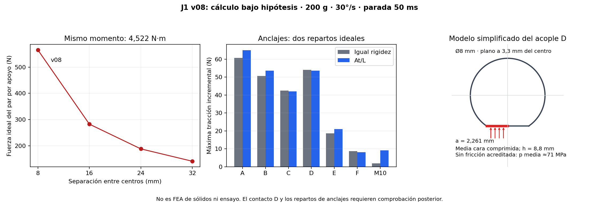

# J1 y sus uniones: comprobación resistente de la v08

28/10/2026 · AFR2-20261028-01. Continuación autorizada del estudio del brazo con carga de 200 g. **Resultado: J1 y sus uniones todavía requieren rediseño.** Se completan cálculos de sección, un modelo de barras y repartos de fijaciones; la geometría v08 se conserva sin cambios.

El usuario confirmó que **todavía no están definidos el filamento y el perfil de impresión**. Se expresan requisitos mínimos de resistencia bajo hipótesis; no se asigna al PETG una resistencia certificada.

## Resultado que guía la siguiente iteración

| Elemento | Resultado de cálculo | Decisión |
| --- | ---: | --- |
| Servo J1 actual | Demanda 16,27 kgf·cm en el caso individual 30°/s–50 ms, frente a 13 anunciados | No satisface ese caso; objetivo preliminar ×2: 32,55 kgf·cm |
| Dos 608 | Máximo 565,20 N radiales; cociente de referencia C₀/P₀=2,42 | El rodamiento metálico no parece gobernar este conjunto de casos; revisar asiento y rigidez |
| Contacto del plano D con PETG | Presión media ≥35,49 MPa en el modelo sin fricción; 70,98 MPa con reparto uniforme en media cara | Sustituir la transmisión directa del par sobre esa pequeña cara por una unión repartida |
| Eje Ø8 con plano y taladro | Hasta 94,13 MPa de tensión normal nominal | Confirmar acero y concentraciones; requisito ilustrativo de fluencia ≈377 MPa con n=2 y Kt=2 |
| Bastidor de columnas/nervios | Hasta 8,78 MPa nominales en el modelo de barras; requisito ilustrativo de resistencia 35,11 MPa | Revisar unión al puente y nervio posterior izquierdo; sin aprobación FDM |
| Postes del servo | Hasta 5,68 MPa nominales; requisito ilustrativo 22,72 MPa | Reforzar y repartir la reacción de torque; no cambiar solo el motor |
| Seis M3 y central M10 al chasis | Tracción incremental máxima ≈65 N en anclaje A, en dos repartos ideales | La unión completa sigue condicionada por precarga, contacto, PETG y acrílico |

Las presiones de contacto **no se comparan directamente con una resistencia a tracción entre capas**. Son modos resistentes diferentes. Tampoco un cociente de catálogo de rodamiento acredita la resistencia de su alojamiento.

## Lectura del estudio

1. [Cargas, camino resistente, rodamientos y eje](01_cargas_eje_y_rodamientos.md).
2. [PETG, acople D, postes y anclajes](02_uniones_y_materiales.md).
3. [Propuesta dimensional de rediseño y estudio de espacio](03_redisenio_propuesto.md).
4. [Fuentes, hipótesis y evidencia](FUENTES.md).

## Alcance efectivamente ejecutado

Se extraen **35 secciones CAD**, con contornos aproximados a tolerancia de cuerda de 0,0025 mm. Se estudian **7.075 estados**: 379 estados fuente: estática, frenadas de v08 y sentido negativo adicional de J1, rotados a 19 orientaciones finales entre −90° y +90°. Se excluyen las trayectorias que exceden los límites de J1. Es un estudio de cargas, sin barrido de interferencias de estas trayectorias adicionales. No se usan los casos de 600°/s para declarar una capacidad de J1 ni se inventan velocidades nominales bajo carga.

Se separan los dos caminos de carga: los rodamientos/cartucho llevan fuerzas y momentos perpendiculares al eje; la reacción del accionamiento alrededor de Z llega por los postes del servo. Se comprueba equilibrio numérico y concordancia con la estática al terminar las frenadas.

El estudio temporal de espacio contra **680 cuerpos** del auto, electrónica, anclajes y pan muestra que el GX3270BLS con cara de cuerpo en Z=56 mm tiene una interferencia con la cabeza del anclaje C. Al sustituir temporalmente esa cabeza por una envolvente avellanada al ras, no se detectan penetraciones reportables contra esos cuerpos. **Esto es una comprobación parcial de espacio; todavía no es un ensamble J1 rediseñado.**

## Datos y fuentes ejecutables

- [Extracción nativa de secciones](extraer_secciones.py) y [datos geométricos](secciones_CAD_v08.json).
- [Cálculo completo](calcular_J1.py), [resultados resumidos](resultados_J1.json) y [propiedades de secciones](propiedades_secciones.csv) y [estados de carga completos](estados_carga.csv). Los CSV por elemento retienen máximos por caso/orientación y métrica, identificados en `retained_peak_metrics`.
- [Rodamientos](rodamientos.csv), [eje](eje.csv), [columnas](columnas.csv), [postes de servo](postes_servo.csv), [anclajes](anclajes.csv), [acople D](acople_D.csv) y [sensibilidad de contraplaca](sensibilidad_contraplaca.csv).
- [Estudio de espacio](estudio_espacio_motor.py) y [resultado de las alternativas temporales](espacio_bajar_motor.json).
- [Fuente de la figura](graficar_J1.py).

**Sin modificación persistente del CAD, FEA de sólidos/contactos, fabricación o ensayo físico.** El bastidor de barras es una idealización numérica de rigidez y tensiones nominales, no un mallado del sólido de Fusion. Los despieces continúan diferidos. Los cálculos no cubren movimientos simultáneos, parada del AGV, impactos, tolerancias reales, fatiga o creep.
