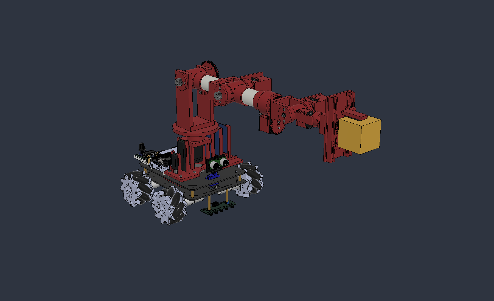

# 2. Caso de carga, estática y reacciones

## Postura horizontal

Se guarda una copia nativa [AFR2_Brazo_PVC32_Estatica_200g_v06.f3d](AFR2_Brazo_PVC32_Estatica_200g_v06.f3d), manteniendo intacto el maestro v06. Ángulos: J1=90°, J2=90°, J3=0°, J4=0°, J5=0°, J6=0°, servo de pinza=109,8°. J1 apunta hacia el frente del auto; todos los eslabones de elevación están alineados horizontalmente. Es el caso pesimista de alcance para gravedad pedido; no demuestra ser el peor estado de aceleración, frenada o choque.

Hombro a Z=209 mm sobre el chasis. Posiciones longitudinales desde el hombro: J3 130 mm, J4 250 mm, J5 305 mm y J6 370 mm. La pinza sostiene el centro del cubo en **s=458 mm**, a Z=209 mm. El TCP nominal está en s=448,5 mm: no se debe usarlo en lugar del CG del cubo, que queda 9,5 mm más lejos. El frente del cubo alcanza s=483 mm, pero la resultante de su peso actúa en su centro.



## Ecuaciones usadas

Para cada cuerpo i: `m_i = densidad_i × V_i`. Para un conjunto, `r_G = suma(m_i × r_i) / suma(m_i)`. Volúmenes en cm³ y densidades en g/cm³ dan masas en gramos. En la estática se convierten a kg y m.

Se aplica `g = (0,0,−9,80665) m/s²`. En el centro de cada cuerpo se aplica `F_i = m_i g`. Sobre la sección/junta j, con todos los componentes aguas abajo:

```text
F_j = Σ F_i
M_j = Σ [(r_i − r_j) × F_i]
tau_j = eje_unitario_j · M_j
M_flex_j = M_j − tau_j × eje_unitario_j
```

Las reacciones que la junta ejerce sobre el conjunto distal son `−F_j` y `−M_j`. En la pieza proximal se aplica la acción opuesta. `tau_j` es el par de gravedad sobre el grado de libertad; la magnitud de `M_flex_j` es el momento perpendicular que deben transmitir eje, rodamientos, horquilla y alojamiento. En J1/J4/J6 pueden ser muy diferentes.

## Resultados estáticos, PETG macizo

| Junta | Masa distal con carga (kg) | Peso distal (N) | Par sobre eje (N·m) | Flexión perpendicular (N·m) | Par servo (kgf·cm) |
| --- | --- | --- | --- | --- | --- |
| J1 | 1.686 | 16.53 | 0.000 | 2.933 | 0.00 |
| J2 | 1.245 | 12.21 | 2.911 | 0.135 | 17.46 |
| J3 | 0.855 | 8.39 | 1.552 | 0.061 | 15.83 |
| J4 | 0.594 | 5.83 | 0.061 | 0.723 | 0.69 |
| J5 | 0.401 | 3.93 | 0.427 | 0.003 | 4.36 |
| J6 | 0.312 | 3.06 | 0.000 | 0.209 | 0.00 |


El par del servo J2 incluye reducción 2:1 y eficiencia **supuesta 0,85**: `tau_motor = tau_J2/(2×0,85)`. J4 incluye relación 1:1 y eficiencia supuesta 0,90. Los demás accionamientos de eje son directos en el modelo; rozamiento y aceleración no están incluidos. `1 kgf·cm = 0,0980665 N·m`. Los momentos con signo y las coordenadas están en [resultados_estatica.json](resultados_estatica.json).

En el hombro: el cubo solo aporta `0,200×9,80665×0,458 = 0.898 N·m`. El peso propio aporta **2.013 N·m**, por lo que el total es **2.911 N·m**, aproximadamente 29.7 kgf·cm en el eje de salida del hombro. **69.1 %** procede del propio brazo. El hombro sostiene 1.245 kg, no solamente 0,2 kg.

| Origen del peso | Aporte J2 (N·m) | Aporte J3 (N·m) | Aporte J5 (N·m) |
| --- | --- | --- | --- |
| PETG impreso | 1.129 | 0.532 | 0.092 |
| PVC | 0.046 | 0.010 | 0.000 |
| Servo | 0.368 | 0.170 | 0.015 |
| Rodamiento | 0.157 | 0.067 | 0.006 |
| Acero | 0.284 | 0.113 | 0.009 |
| Carga util | 0.898 | 0.643 | 0.300 |


Las categorías menores también están sumadas en el resultado; tabla completa: [contribuciones_momento.csv](contribuciones_momento.csv). No se carga la masa de un servo sobre su propio eje de salida si su carcasa está fijada al eslabón proximal. Por ejemplo, el DS3218 aumenta el momento del hombro, pero su carcasa no forma parte de la carga distal que él mismo sostiene en el codo.

## Sensibilidad del peso propio

| Caso | Masa total añadida con carga (kg) | J2 (N·m) | J3 (N·m) | J5 (N·m) |
| --- | --- | --- | --- | --- |
| CAD_macizo_200g | 2.229 | 2.911 | 1.552 | 0.427 |
| fraccion_efectiva_70pct | 1.915 | 2.572 | 1.392 | 0.399 |
| fraccion_efectiva_50pct | 1.706 | 2.347 | 1.286 | 0.381 |
| cero_carga | 2.029 | 2.013 | 0.909 | 0.127 |
| 200g_en_TCP_nominal | 2.229 | 2.892 | 1.533 | 0.408 |
| 200g_CAD_y_30g_cables | 2.259 | 3.043 | 1.646 | 0.469 |


La fracción efectiva 70/50 % afecta exclusivamente al PETG impreso y conserva el CG por hipótesis. El caso con cables agrega 30 g en el TCP, no incluidos en el CAD. No se modifica el alcance entre casos. El escenario TCP es una comparación geométrica; el centro del cubo real es más distal y gobierna el caso principal.

## Motores: capacidad publicada frente a demanda

Para una primera selección se propone un margen **2 respecto de la estática**. Es un criterio de selección, no un factor dinámico medido ni una certificación del par continuo. Par de bloqueo no equivale a par que pueda mantenerse indefinidamente sin calentamiento.

| Eje | Demanda estática en servo | Objetivo preliminar ×2 | Dato publicado / interpretación |
| --- | ---: | ---: | --- |
| Hombro J2 | 17.46 kgf·cm | 34.92 kgf·cm | GX anunciado 40 kgf·cm: margen geométrico aparente, ficha neta/curva continua por confirmar |
| Codo J3 | 15.83 kgf·cm | 31.65 kgf·cm | DS3218: bloqueo 18 a 5 V, 21,5 a 6,8 V; no alcanza este objetivo |
| Inclinación J5 | 4.36 kgf·cm | 8.71 kgf·cm | MG946R: bloqueo 10,5 a 4,8 V / 13 a 6 V; desempeño térmico pendiente |

Fuentes: [DSSERVO](https://www.dsservo.com/d_file/DS3218%20datasheet.pdf), [TowerPro MG946R](https://towerpro.com.tw/product/mg946r/), selección comercial GX documentada en [fuentes](FUENTES.md). No se interpola una curva de par para tensiones distintas de las publicadas.

El codo requiere **15.83 kgf·cm** con 200 g: incluso usando su máximo anunciado de 21,5 kgf·cm el margen de bloqueo sería solo 1.36. Con el criterio preliminar ×2 y PETG macizo, la carga compatible con ese criterio sería alrededor de **45 g**, no una carga útil física certificada. Esto identifica un cuello de botella de selección del actuador, no prueba una rotura del eslabón.

Para J1 el par de gravedad alrededor de su eje vertical es cero, pero hay **2.933 N·m de vuelco** y carga axial: no se puede concluir que J1 carece de carga. J4 tiene aproximadamente 0,061 N·m de par de roll y 0,723 N·m de flexión; J6 tiene casi nulo par de roll en la pose simétrica y 0,209 N·m de flexión. La exploración de 169 combinaciones de roll a 15° conserva el alcance horizontal y da máximos gravitatorios aproximados de 0.0630 N·m en J4 y 0.0011 N·m en J6. Una carga excéntrica cambia estos valores: 200 g a 25 mm del eje agregan 0,049 N·m.

## Dientes, ejes y alojamientos: cargas de interfaz

Engranajes rectos de 20°: `F_t = tau_rueda/r_primitivo`, `F_r = F_t tan(20°)`. En el hombro resultan **97.0 N tangenciales y 35.3 N radiales**; en J4, 3.38/1.23 N para esta pose. Son cargas sobre el diente/contacto, no los 1,96 N del cubo. La fuerza tangencial ideal entre engranajes es la misma en rueda y piñón; las pérdidas se añadieron a la demanda del servo.

Los apoyos se modelan como dos reacciones a distancia L, con eje u. Tras agregar las fuerzas de engrane y trasladar el momento al centro del par:

```text
R_1 = −F_perp/2 − (u × M_perp)/L
R_2 = −F_perp/2 + (u × M_perp)/L
```

| Par de apoyos | Separación centros (mm) | Carga radial apoyo 1 (N) | Carga radial apoyo 2 (N) | Axial total a repartir (N) |
| --- | --- | --- | --- | --- |
| J1 | 8.0 | 366.6 | 366.6 | 16.53 |
| J2 | 56.0 | 23.6 | 122.7 | 0.00 |
| J3 | 56.0 | 3.1 | 5.3 | 0.00 |
| J4 | 8.0 | 91.8 | 96.7 | 0.00 |
| J5 | 42.0 | 1.9 | 2.0 | 0.00 |
| J6 | 6.0 | 37.2 | 40.3 | 0.00 |


Se incluyó el engrane desplazado lateralmente en J2 y J4. En J3/J5/J6 se idealiza el accionamiento coaxial como un par puro: el modelo no resuelve concentraciones en horn, estriado o tornillos. La distribución axial depende de los hombros, arandelas, contactos y precarga. Los valores son reacciones del apoyo sobre el eje; el alojamiento recibe la fuerza opuesta. El momento calculado respecto del centro de un par de apoyos no es automáticamente el máximo momento interno de cada tramo del eje.

En J1 la separación actual es solo 8 mm: `2,933/0,008 ≈ 367 N` por efecto del par. A esto se añade la carga axial total 16,53 N. La capacidad nominal del rodamiento metálico no demuestra la resistencia del asiento PETG, de la tapa o de sus insertos. [Vectores y coordenadas para la fase FEA](reacciones_para_FEA.csv), [contactos completos](apoyos_y_contactos.json).

## Carga que recibe el chasis

Brazo, soporte y electrónica añadida suman **2.229 kg con la carga**; CG global **(-13.22, 120.33, 153.03) mm**. En el centro del apriete M10 `(0,333; −8,501; 0) mm`, la gravedad equivale a fuerza **(0.00, 0.00, -21.86) N** y momento **(-2.82, -0.30, 0.00) N·m**. Es la resultante externa, no un reparto igual entre seis M3 y un M10. Ese reparto requiere rigidez de placas, contacto con el acrílico y precarga.

El CG añadido queda hacia delante. La masa y el CG del auto base no se han medido; por tanto no se acredita estabilidad. Para una línea de vuelco frontal en `y_f`, el criterio estático es `m_auto (y_f − y_auto) ≥ suma[m_i (y_i − y_f)]`, con las coordenadas de apoyo reales. Este análisis no sustituye esa comprobación ni la de aceleración del AGV.
