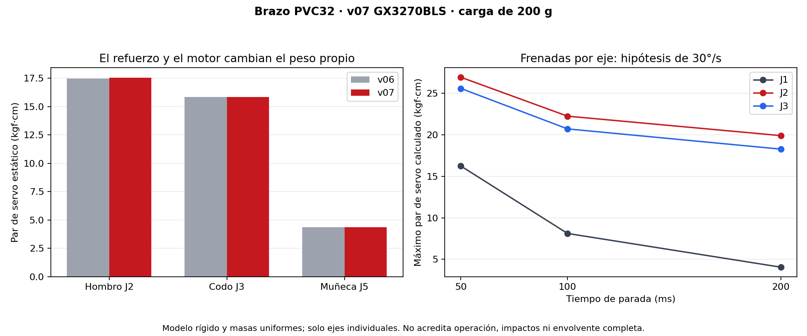

# 7. Actuador implementado, refuerzos y cargas v07

> **Continuación v08 — AFR2-20261027-21:** [housing completado, interferencias corregidas, movimiento comprobado y masas/cargas actualizadas](../revision_v08/README.md). Los datos v07 de este capítulo se preservan; la v08 no acredita resistencia o frenada física.

[Índice integrado](INFORME_ITERACION_DISENO.md) · [Plan inicial](06_plan_rediseño_v07.md) · [Archivos editables v07](../revision_v07/README.md)

27/10/2026 · AFR2-20261027-20. Esta entrega pasa del plan a la geometría nativa y al recálculo. **No completa la selección operativa de todos los ejes ni demuestra que el robot soporte una parada de emergencia.**

## Selección del codo y ruta de carga

Se reemplaza el DS3218 por **Yipin GX3270BLS posicional de 270°**, [Starware SKU 2982](https://tienda.starware.com.ar/producto/servo-motor-digital-brushless-yipin-gx3270bls-70kg-5-84v-270gr-ip68-metal/), ofrecido con stock en Argentina al consultar. Publica 90 g sin accesorios y máximos ≥55/63/70 kgf·cm a 6/7,4/8,4 V. Se propone trabajar a **7,4 V regulados**. Los máximos anunciados no son curvas de servicio continuo ni de frenado.

Primero se modeló el servo con parámetros propios y después se adaptó A06. Carcasa 40,5×21×41,7 mm, pestañas 55,1, patrón 48×10 y pasos Ø4,5. El dibujo Yipin fue recuperado de la galería del proveedor; no se obtuvo un datasheet independiente del fabricante. Hay una discrepancia entre foto y dibujo para la altura: se reserva 50,15 mm total; offset del eje 10,5 y resalte Ø20 son inferencias editables. [Cotas, fuentes, reservas y alimentación](../revision_v07/ACTUADOR_Y_MONTAJE.md).

El cuerpo del motor se prolonga hacia el costado exterior conservando eje y apoyos del codo. Sus pestañas apoyan en dos bancos enlazados por largueros y bandeja a la horquilla. Cuatro M3 con arandelas e insertos cierran esa fijación. Horquilla, cuna y manguito son **un solo cuerpo PETG**; el cubo del horn se prolonga para conectar geométricamente el estriado con la brida y el eje Ø8. El horn se representa metálico y requiere adaptar su patrón a la pieza comercial real.

La nueva capacidad de torque también carga más la fijación: usando el máximo anunciado a 7,4 V,63 kgf·cm=6,178 N·m, cuatro fijaciones en 48×10 tienen radio 24,515 mm. En un reparto ideal de igual rigidez, la componente tangencial sería T/(4r) ≈ 63 N por fijación. Para el pico calculado 25,56 kgf·cm resulta≈25,6 N. Son **cargas para estudiar bancos/insertos y pretensión**, no resistencias demostradas; se omiten aquí contacto, desigualdad de rigidez y excentricidades.

## Por qué se agregaron estos refuerzos

Se extienden los solapes del primer tubo de 17 a 27 mm y se agregan nervios locales de 4 mm. Se conserva el corte 80 mm y la distancia 130 mm; el manguito distal recupera un tope axial más allá del final del PVC. El mayor solape busca repartir apoyo, aplastamiento y tendencia al giro; no reemplaza el cálculo de contacto ni la fijación.

La torre del hombro incorpora cuatro nervios. La montura baja incorpora collar Ø50/40 alrededor del cartucho y cuatro nervios hacia las columnas. Se mantiene la contraplaca inferior única y Z = 6…12 mm: la modificación no vuelve a elevar todo el robot. El hombro sigue a 209 mm.

El diseño conserva **8 mm entre centros de apoyos J1**. El refuerzo local no aumenta esa palanca. Para una flexión estática de 2,947 N·m, el par de reacciones ideal M/d es ≈ 368 N por apoyo. En el caso ilustrativo de frenada que produce 4,505 N·m de flexión, pasa a≈563 N. Debe superponerse la distribución de fuerza transversal y estudiarse el contacto real; son estimaciones del par de apoyos, no cargas exactas de cada rodamiento. **Separar más los apoyos sigue pendiente** y exige reubicar el accionamiento dentro de la altura baja disponible.

## Masas y centros de masa actualizados

Se extrajeron 271 cuerpos del documento v07, excluyendo las referencias del auto. Se conservaron las densidades y masas comerciales explícitas del [estudio v06](FUENTES.md): PETG 1,27 y PVC 1,45 g/cm³; metales según hipótesis. El motor nuevo recibe 90 g una sola vez; el horn móvil se presupuesta como aluminio 2,70 g/cm³. Geometría Steel original no se usa como densidad universal.

| Conjunto | Masa v07 | CG global (X,Y,Z), mm |
| --- | ---: | --- |
| Torre y giro J1 | 438,42 g | (−20,76; −10,99; 147,34) |
| Primer eslabón + motor del codo | 403,39 g | (−20,85; 56,94; 205,91) |
| Antebrazo + motor J4 | 255,67 g | (−0,07; 164,46; 204,99) |
| Giro J4 + horquilla/motor J5 | 193,50 g | (−30,58; 277,83; 203,52) |
| Núcleo J5 + motor J6 | 88,30 g | (−3,33; 312,36; 207,60) |
| Palma + servo de pinza | 88,62 g | (0,03; 381,58; 207,72) |
| Cubo de referencia | 200,00 g | (0,00; 444,00; 209,00) |
| **Todo lo añadido al auto, incluida carga y control fijo** | **2.267,03 g** | **(−13,40; 118,68; 152,66)** |

Las filas parciales no son una BOM exhaustiva; [CSV por cuerpo](../revision_v07/masas_por_cuerpo_v07.csv) y [agrupaciones completas](../revision_v07/estatica_v07.json). El volumen PETG es825,573 cm³, equivalente a 1.048,48 g macizos, frente a 823,13 cm³/1.045,38 g antes. Masa real FDM, cableado y motor adquirido deben sustituir estas hipótesis. Los120 g de rodamientos y177 g estimados de electrónica permanecen. El total aumenta38,23 g; no se incluye la masa propia del vehículo, por lo que este CG no demuestra estabilidad contra vuelco.

## Estática en extensión horizontal

Se conserva q=(90°,90°,0°,0°,0°,0°), cubo200 g y distancia horizontal hombro–CG de carga458 mm. La fuerza de la carga es1,961 N y su contribución al hombro 0,898 N·m.

| Resultado | v06 | v07 |
| --- | ---: | ---: |
| J2, momento de salida gravitatorio | 2,911 N·m | 2,925 N·m |
| J2, demanda al servo con reducción2:1/η0,85 | 17,46 kgf·cm | 17,54 kgf·cm |
| J3, demanda directa de gravedad | 15,83 kgf·cm | 15,83 kgf·cm |
| J5, demanda directa de gravedad | 4,36 kgf·cm | 4,36 kgf·cm |
| J1, momento perpendicular al eje vertical | 2,933 N·m | 2,947 N·m |

El motor del codo está sobre el primer eslabón. Su cambio aumenta la carga de J2 y J1, pero no la masa aguas abajo de J3. Por eso no se reduce el par que debe producir el codo al elegir un servo mayor: se aumenta la capacidad anunciada disponible frente a esa misma demanda.

## Primer cálculo de frenada finita

No existe una desaceleración nominal publicada bajo nuestra carga. Se calculan escenarios **hipotéticos** desde 30°/s, con un solo eje en movimiento cada vez y parada en la postura horizontal. También se calcula una sensibilidad de J3 a 600°/s, obtenida del valor de catálogo0,10 s/60° **sin carga**; no es una velocidad alcanzable ni un máximo operativo demostrado.

Para s=t/tb, el perfil usado es:

\[
\dot q=\omega_0(1-3s^2+2s^3),\quad
\ddot q=\frac{\omega_0}{t_b}(-6s+6s^2),\quad
q=q_f-\frac{\omega_0t_b}{2}+\omega_0t_b(s-s^3+\tfrac12s^4).
\]

La aceleración máxima tiene módulo1,5ω0/tb y ocurre a mitad de frenada; inicio y final tienen aceleración cero. A30°/s y50 ms, el recorrido de parada es0,75° y la desaceleración máxima900°/s². **Este perfil no representa el salto desde una aceleración previa máxima**: faltan prestaciones reales, jerk, dinámica interna y transición del controlador para calcular ese evento.

Se utilizan centroide y tensor principal de cada cuerpo CAD; kg·cm² se convierte a kg·m² multiplicando por 10⁻⁴ y se escala por la masa asignada/masa nativa. Interiores y rotor de los motores no están modelados; su distribución uniforme es una aproximación. Se transforman las inercias al mundo y se evalúa, para cada conjunto distal:

\[
\mathbf F=\sum m(\mathbf a_G-\mathbf g),\qquad
\mathbf M_O=\sum[(\mathbf r_G-\mathbf r_O)\times m(\mathbf a_G-\mathbf g)
+\mathbf I_G\boldsymbol\alpha+\boldsymbol\omega\times(\mathbf I_G\boldsymbol\omega)].
\]

Las derivadas cinemáticas se aproximan por diferencia temporal central con h=10⁻⁴ s. Se calculan 21 instantes por caso; los picos son máximos de esos instantes, no una optimización continua. Se incluyen ambos sentidos cuando los límites articulares permiten aproximarse a la postura final: J1 está en su extremo90°. En total se conservan 21 casos. No se ejecutó una batería de comprobaciones del modelo numérico.

| Tiempo de parada | Máximo de demanda J1 | Máximo de demanda al servo J2 | Máximo de demanda J3 |
| --- | ---: | ---: | ---: |
| 200 ms | 4,06 kgf·cm | 19,89 kgf·cm | 18,26 kgf·cm |
| 100 ms | 8,12 kgf·cm | 22,23 kgf·cm | 20,70 kgf·cm |
| 50 ms | 16,23 kgf·cm | 26,91 kgf·cm | 25,56 kgf·cm |

Cada columna toma su máximo entre los movimientos individuales calculados a 30°/s; no describe tres máximos simultáneos. El pico de J3 lo produce aquí la frenada de J2. Los CSV conservan caso, instante y vector completo, evitando sumar componentes máximas de estados diferentes.

La sensibilidad a 600°/s alcanza **144,68 kgf·cm en J3**, superior a los63 anunciados a 7,4 V. Por tanto, no se sostiene que el nuevo motor permita frenar este brazo a la velocidad sin carga de catálogo. También el MG946R de J1 anuncia 13 kgf·cm a 6 V, inferior a 16,23 del caso 30°/s–50 ms: requiere revisar actuador/transmisión o limitar la operación. El GX3240 del hombro conserva su oferta de «40 kgf·cm», sin curva térmica/continua. Ninguno se acepta por comparar un pico anunciado con un cálculo ilustrativo.

## Cortante, axial, torsión y flexión en base y primer eslabón

Se conservan **las seis componentes** por sección, con Z local longitudinal. En J1, Z es el eje vertical del cartucho; en J2/J3 coincide con la dirección longitudinal del eslabón. Signos según ese sistema. Los valores siguientes son demandas transmitidas al mecanismo, no tensiones ni resistencias:

| Caso e interfaz, t=25 ms | N, N | Vx, N | Vy, N | T, N·m | Mx, N·m | My, N·m |
| --- | ---: | ---: | ---: | ---: | ---: | ---: |
| Frenada J1,50 ms, interfaz J1 | 16,739 | 0,358 | −4,707 | −1,592 | 0,754 | −2,906 |
| Mismo estado, interfaz J2 | 0,209 | −12,357 | −4,686 | 0,130 | 1,576 | −2,927 |
| Frenada J2,50 ms, interfaz J1 | 21,424 | 0,028 | ≈0 | −0,002 | 0,281 | −4,496 |
| Mismo estado, interfaz J2 | 0,070 | −17,042 | ≈0 | 0,189 | 0,002 | −4,486 |

La frenada azimutal J1 genera torsión apreciable en la base y flexión lateral del primer eslabón, además de gravedad. La frenada del hombro J2 produce en este conjunto de casos la mayor flexión de base,4,505 N·m. Estos dos estados justifican estudiar nervios, raíces, asientos, dientes, anclajes y acrílico con cargas diferentes; una sola fuerza vertical en la punta no representa todo.

## Qué queda abierto para aceptar el diseño

Se implementaron el motor, alojamiento, acople y refuerzos descritos; se guardó el maestro y se calcularon sus nuevas masas y escenarios. No hay FEA, análisis de contacto, validación de resistencia FDM, nuevo barrido de interferencias/movimiento ni ensayo físico. Los3.141 casos CAD de v06 no acreditan la geometría v07.

Falta completar la dinámica de movimientos simultáneos, otros ángulos, aceleración previa, frenada/rotación del AGV, inercias de rotor reflejadas, elasticidad, holgura/impactos y agarre. El brazo horizontal no se declara peor caso universal. La frenada instantánea sigue sin ser un caso finito calculable sin tiempo/recorrido o rigidez de impacto.

El montaje nuevo necesita medición del servo y horn reales, envolvente de cable/conector, tolerancias FDM y estudio de insertos/pestañas. La fuente debe sostener7,4 V y contemplar hasta 7 A de bloqueo anunciados del servo, más las otras cargas; los XL4016 y la batería existentes no quedan aprobados. PWM sigue siendo consigna, no posición medida ni garantía de parada.

Los despieces y las láminas siguen pendientes de la indicación humana. La documentación conserva esta iteración como **diseñada y calculada bajo hipótesis**, con 200 g como requisito de estudio.
