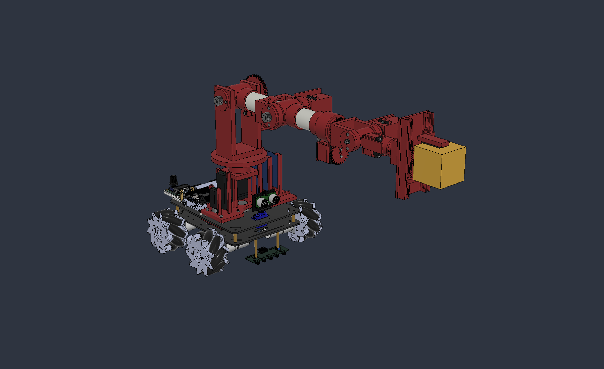

# Informe integrado: esfuerzos e iteración del brazo PVC32

**Fecha:** 27/10/2026, Argentina. **Revisión documental:** AFR2-20261027-18.

Este informe explica por qué se corrigió el prototipo, qué cargas se calcularon y qué decisiones deben guiar su siguiente iteración. Integra la evolución geométrica, el presupuesto de masas, la estática con 200 g y el planteo de frenada de emergencia. **Ampliación AFR2-20261027-20:** se implementó el servo del codo y los refuerzos v07 y se recalcularon masas/estática y frenadas hipotéticas; [capítulo7](07_implementacion_y_cargas_v07.md). La aceptación operativa, FEA y dinámica completa permanecen abiertas.

La finalidad es conservar la cadena **problema observado → causa mecánica → evidencia o hipótesis → modificación → efecto secundario → resultado pendiente**. Una modificación puede resolver una discontinuidad geométrica sin acreditar resistencia; una pieza más resistente puede agregar masa y aumentar el esfuerzo del motor anterior.

## Cómo leer el informe

| Capítulo | Contenido | Estado de la evidencia |
| --- | --- | --- |
| [1. Materiales, masas y centros de masa](01_materiales_y_masas.md) | Densidades, masa por pieza, motores y distribución del peso | Estimación calculada sobre geometría v06, con supuestos identificados |
| [2. Estática y reacciones](02_estatica_y_reacciones.md) | Brazo horizontal, fuerzas, pares, apoyos y engranajes | Resultados analíticos existentes; no incluyen frenada |
| [3. Tensiones preliminares y refuerzos](03_tensiones_preliminares_y_refuerzos.md) | Flexión nominal del PVC, agarre y criterios locales | Aproximaciones de sección; articulaciones sin FEA |
| [4. Por qué se hicieron las correcciones](04_evolucion_y_correcciones.md) | Historial v01–v06 y relación entre problema, corrección y límite | Modificaciones CAD documentadas y decisiones del usuario |
| [5. Frenada y esfuerzos combinados](05_frenada_y_esfuerzos_combinados.md) | Dinámica, seis componentes por sección y zonas críticas | Método propuesto originalmente; primeros resultados en capítulo7 |
| [6. Plan de selección y rediseño v07](06_plan_rediseño_v07.md) | Actuadores argentinos, cotas, montaje y secuencia de iteración | Plan original; ejecución y decisiones actuales en capítulo7 |
| [7. Implementación y cargas v07](07_implementacion_y_cargas_v07.md) | GX3270BLS modelado, montaje/refuerzos, masas y primeras frenadas | CAD nativo guardado y cálculo bajo hipótesis; sin barridos, FEA ni aceptación física |
| [Fuentes y supuestos](FUENTES.md) | Referencias de materiales, actuadores y mecánica | Procedencia y límites de cada dato |

## Requisitos que gobiernan esta iteración

- Manipular un cubo de **50 × 50 × 50 mm**, con **200 g máximos como requisito de estudio**. Los nombres históricos de algunas piezas siguen diciendo 100 g.
- Mantener los tubos de PVC de **Ø32 exterior y Ø28,3 interior**, con articulaciones impresas en PETG rojo y rodamientos comerciales.
- Conservar como punto de partida las distancias entre ejes de **130 y 120 mm**, los cortes de tubo de **80 y 70 mm** y el montaje bajo y bilateral sobre el auto.
- Elegir actuadores por eje según su demanda; pueden ser modelos diferentes. Priorizar disponibilidad argentina, costo, documentación y facilidad de fabricación.
- Incorporar sostenimiento, aceleración y frenada del brazo y del AGV. El brazo horizontal extendido es un caso importante de gravedad y frenada; aún no se ha demostrado que gobierne todas las piezas.
- Conservar componentes parametrizables y registrar de dónde proviene cada cota.

La imagen del tubo aportada indicaba también C=3,2 mm; ese espesor es incompatible con ambos diámetros. En este modelo se respetaron Ø32/28,3 y, por tanto, pared **(32−28,3)/2 = 1,85 mm**. Debe identificarse y medirse el tubo que finalmente se compre.

## Lo que ya sabemos del caso estático

El centro de masa del cubo queda a **458 mm del hombro**, no en el TCP nominal de 448,5 mm. Los 200 g aportan 1,961 N y un momento de 0,898 N·m sobre el hombro. Con el peso propio, el momento del hombro asciende a 2,911 N·m; aproximadamente el 69 % procede del brazo mismo.

| Resultado, caso PETG macizo | Valor | Decisión que fundamenta |
| --- | ---: | --- |
| PETG geométrico | 823,13 cm³; 1.045,38 g macizos | Reemplazar por masa de laminador/pesaje; evitar refuerzos distales indiscriminados |
| Masa añadida al auto, con carga | 2,229 kg | Revisar chasis, anclajes y estabilidad con la masa/CG real del auto |
| Hombro J2, par de salida | 2,911 N·m | Revisar servo, reducción 2:1, dientes y apoyos |
| Codo J3, accionamiento directo | 1,552 N·m = 15,83 kgf·cm | Objetivo estático preliminar ×2: 31,65 kgf·cm; revisar DS3218 |
| Inclinación de muñeca J5 | 0,427 N·m = 4,36 kgf·cm | Revisar torque sostenido y efecto de nuevos componentes distales |
| Flexión perpendicular en J1 | 2,933 N·m | Revisar cartucho y continuidad con la montura |
| Reacción radial por apoyo J1 | ≈367 N, centros separados 8 mm | Estudiar mayor separación sin elevar el conjunto |
| Fuerza tangencial en engrane del hombro | ≈97 N | Dimensionar dientes, cubo, eje y fijaciones |
| Flexión nominal del PVC en las salidas libres | 1,97 / 1,00 MPa | Priorizar el estudio de articulaciones y contactos antes de engrosar todo el tubo |

Los valores pertenecen al mismo modelo estático existente; **no son los picos de frenada**. PETG macizo es una hipótesis conservadora de masa del CAD actual, no una garantía de resistencia de la impresión. Se conservan los escenarios de masa efectiva 70/50 % del capítulo 2.

## Qué cambia a partir de estos resultados

El DS3218 del codo no satisface el objetivo estático preliminar ×2 frente a sus 21,5 kgf·cm máximos publicados de bloqueo a 6,8 V. Eso justifica reabrir la selección del actuador. No significa que 31,65 kgf·cm sea ya el requisito final de frenada, ni que un servo cuyo rótulo supera esa cifra esté aprobado para servicio continuo.

La prioridad estructural será la base, el hombro, los encastres del primer eslabón y la transferencia de carga al acrílico. El nuevo servo debe acompañarse de una revisión de eje, acople, apoyos, fijaciones y piezas impresas. También debe mantenerse el seguimiento de muñeca y agarre, cuyas fuerzas no desaparecen por reforzar la base.

La hipótesis de «frenada instantánea» se reemplaza por una parada de emergencia con tiempo/recorrido finitos y perfil definido. Se propone explorar inicialmente **200, 100 y 50 ms**; son casos de sensibilidad, no capacidades medidas ni parámetros ya configurados. Los picos deben obtenerse durante toda la trayectoria y en las distintas posturas y sentidos de movimiento.

## Resultado documental de esta entrega

Este apartado describe la entrega18 original. La entrega20 añade el [resultado implementado y recalculado v07](07_implementacion_y_cargas_v07.md); los capítulos1–6 y sus resultados v06 se conservan como antecedentes.

Se consolidan fundamentos y plan. El maestro [v06](../AFR2_Brazo_PVC32_AGV_v06.f3d), la [copia horizontal](AFR2_Brazo_PVC32_Estatica_200g_v06.f3d), los CSV y los resultados originales permanecen como antecedentes. No se recalcularon cargas, no se ejecutó dinámica ni FEA y no se modelaron los nuevos refuerzos o actuadores.

Los despieces y las láminas de fabricación siguen diferidos por indicación del usuario. La capacidad estructural de 200 g, el frenado real, la temperatura de los servos, la fuerza de agarre y la estabilidad del auto todavía requieren evidencia posterior.

[Archivos y datos del estudio](README.md) · [Plan v07](06_plan_rediseño_v07.md)
