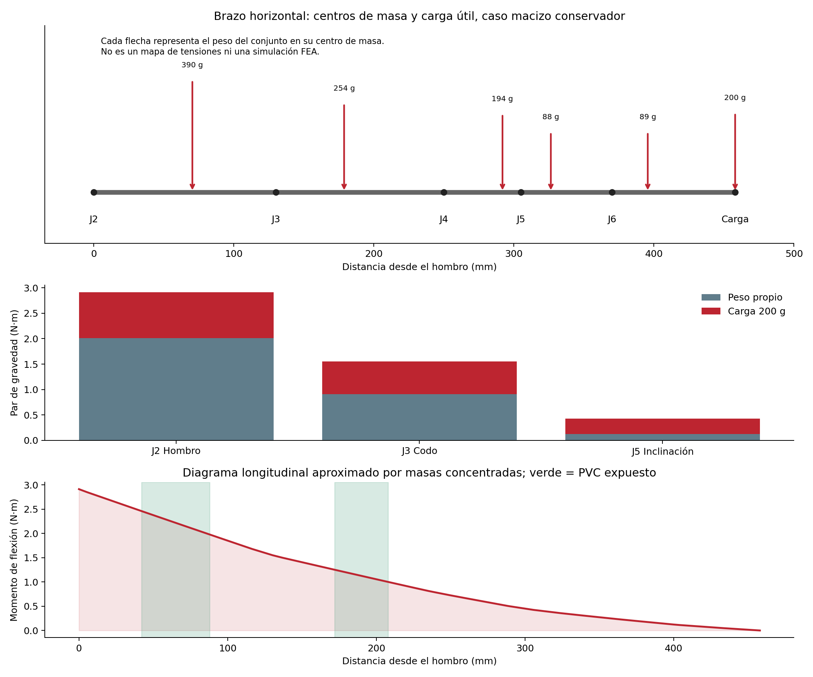

# Brazo v06: masas y cargas con 200 g

Análisis solicitado el 27/10/2026, primera etapa antes de diseñar los refuerzos y realizar tensiones detalladas. Se parte del maestro `AFR2_Brazo_PVC32_AGV_v06`; la copia nativa de estudio queda extendida horizontalmente y con `part_mass=200 g`. Las fuerzas se aplican en el modelo analítico como gravedad por cuerpo y carga puntual en el CG del cubo. **No hay un estudio FEA ejecutado en Fusion.**

## Resultados principales

- Carga útil: **200 g = 1,961 N**, a **458 mm del hombro** en el agarre CAD. Su contribución al hombro es **0.898 N·m**.
- PETG geométrico: **823.1 cm³**, equivalente a **1045 g macizos**. Debe reemplazarse por masa de laminador/pesaje para estimar la impresión real.
- Eslabón 1 con su motor de codo y herrajes: **390 g**; antebrazo con motor J4 y herrajes: **254 g**, en el caso macizo. La herramienta y muñecas añaden masa distal significativa.
- Par de gravedad: **hombro 2.911 N·m**, **codo 1.552 N·m**, **inclinación de muñeca 0.427 N·m**. El peso propio aporta aproximadamente 69 % del par del hombro.
- Con reducción 2:1 y eficiencia supuesta 0,85, el servo de hombro necesita **17.5 kgf·cm estáticos**. El codo directo necesita **15.8 kgf·cm**; objetivo preliminar con margen 2: **31.7 kgf·cm**, superior al máximo de bloqueo publicado del DS3218.
- Tensiones nominales en las salidas libres de PVC: **1,97 y 1,00 MPa**. La prioridad de refuerzo parece estar en articulaciones, asientos, dientes y agarre, no en añadir material a todo el caño.
- J1 transmite alrededor de **367 N radiales por apoyo** por su par de vuelco con solo 8 mm de separación. Es una carga para revisar en el alojamiento PETG, aunque el servo no tenga par gravitatorio alrededor del eje vertical.

## Lectura por capítulos

1. [Materiales, masas y CG de cada conjunto y motor](01_materiales_y_masas.md).
2. [Postura, ecuaciones, esfuerzos, transmisión y reacciones](02_estatica_y_reacciones.md).
3. [Tensiones nominales de PVC y criterios de refuerzo/FEA](03_tensiones_preliminares_y_refuerzos.md).
4. [Fuentes y supuestos](FUENTES.md).

## Archivos de cálculo

- [Masas y CG por cuerpo](masas_por_cuerpo.csv), [PETG por pieza](petg_por_pieza.csv), [aportes de par](contribuciones_momento.csv), [reacciones para submodelos](reacciones_para_FEA.csv).
- [Geometría extraída](geometria_v06.json), [resultados y sensibilidad](resultados_estatica.json), [apoyos y contactos](apoyos_y_contactos.json).
- [Cálculo reproducible](calcular_estatica.py) y [postproceso](completar_informe.py). Requieren Python con NumPy/Matplotlib; se ejecutaron como cálculo de ingeniería autorizado, no como ensayo físico.
- [Copia F3D horizontal de estudio](AFR2_Brazo_PVC32_Estatica_200g_v06.f3d), [pose nativa](pose_horizontal_nativa.json), [diagrama vectorial](cargas_y_momentos.svg).

El caso principal adopta PETG macizo para una cota conservadora de peso propio. Se comparan masas efectivas 70/50 %, sin confundirlas con porcentaje de relleno. No se usa una masa automática del CAD con material Steel asignado a todas las piezas. Componentes comerciales emplean masas de ficha cuando están disponibles; GX y electrónica conservan supuestos explícitos. No se incluyen cables reales, aceleraciones, golpes, fuerzas del AGV ni precarga medida.

**Conclusión de esta etapa:** el cálculo de pesos/cargas está preparado para elegir refuerzos y revisar actuadores. La resistencia de las articulaciones y la estabilidad del auto no quedan certificadas por este análisis estático. No se modificó el maestro v06, no se hicieron despieces y no se modelaron aún nervios nuevos.
