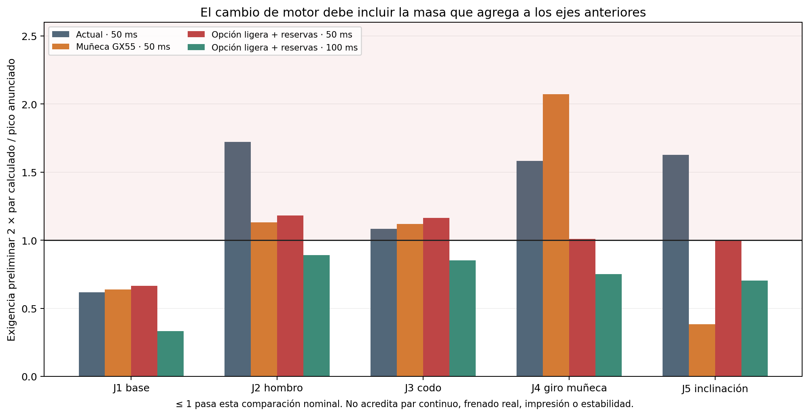

# Comprobación de motores y masas antes de modelar

28/10/2026 · AFR2-20261028-06. CAD v09 intacto. Se estudian masas, posiciones y tensores alternativos sobre las piezas actuales; no se modelan motores ni housings nuevos.

**Resultado: no se justifica un reemplazo masivo por motores más pesados para prometer la parada de50 ms.** Hay una opción ligera que pasa la comparación preliminar de pares×2 en100 ms, con reservas de montaje, pero todavía faltan recorrido documentado de los dos Dualsky, curvas de servicio/frenado, agarre, alimentación y estabilidad. Es preselección por cálculo, no selección de compra o capacidad física aprobada.

## Qué pesa hoy y quién lo soporta

El conjunto actual se estima en2.400,43 g con carga200 g y sin el auto. Incluye1.014,88 g de PLA PrintaLot macizo. Se conserva su geometría, masa de PVC, herrajes y electrónica. Los100 g del servo J2 son un presupuesto conservador anterior, no una pesada neta confirmada; sus diferencias de masa se expresan respecto de ese presupuesto.

| Motor | Masa actual usada | Dónde está fijado | A qué articulaciones agrega carga por su propio peso |
| --- | ---: | --- | --- |
| J2, GX3240 | 100 g supuestos | Torre giratoria, antes de J2 | Principalmente J1/base; su peso no actúa como carga distal sobre su propio J2 |
| J3, GX3270 | 90 g de catálogo | Primer eslabón, antes de J3 | J1 y J2; no se suma como carga distal de su propio J3 |
| J4, MG90S | 13,4 g | Antebrazo, antes de J4 | J1/J2/J3 |
| J5, MG946R | 55 g | Rotor de J4, antes de J5 | J1/J2/J3/J4; por eso un motor pesado de muñeca perjudica al MG90S de J4 |
| Pinza, MG90S | 13,4 g | Herramienta, después de J6 | Todos los ejes anteriores |

Se incluye la inercia de traslación y de giro de los cuerpos. Las masas nuevas se representan por prismas uniformes de dimensiones publicadas, conservando el plano delantero y orientación de montaje como hipótesis; la distribución interna real, salientes/estriado y CG exacto siguen pendientes. El desplazamiento del eje dentro de la carcasa se infiere y no se presenta como cota comercial confirmada.

## Candidatos encontrados

| Candidato | Masa neta adoptada | Pico usado y tensión | Situación antes de fabricar |
| --- | ---: | --- | --- |
| GX3270BLS 270 | 90 g | 63 kgf·cm @ 7.4 V; 70 kgf·cm @ 8.4 V | En stock en la pagina local consultada; cotas de salida y offset inferidos, no plano completo |
| GX3255BLS 180 | 90 g | 55 kgf·cm @ 7.4 V | En stock local; ficha tecnica5-7.4V aunque titulo dice8.4. Se usa7.4V |
| Dualsky DS8930 | 68 g | 22 kgf·cm @ 7.4 V; 24 kgf·cm @ 8.4 V | Catalogo local indica1 disponible al consultar. Titulo64g, tabla y PDF del fabricante68g: se adopta68g. Recorrido180 y corriente pendientes |
| Dualsky DS9401 | 26 g | 3.5 kgf·cm @ 6.0 V | Catalogo local8 disponibles. Se usan26g/3.5kgfcm@6V del PDF, no25g/4kg@7.4V del titulo local. Recorrido180 e interfaz pendientes |
| DSSERVO DS3225 | 60 g | 24.5 kgf·cm @ 6.8 V | Solo oferta de importacion localizada; no se presenta como stock nacional. Especificacion fabricante24.5, no25 del titulo |
| TowerPro MG92B posicional160 | 13.8 g | 3.5 kgf·cm @ 6.0 V | Oferta CANDY-HO14g localizada. Confirmar variante posicional160 del PDF y no360 continua.160 sirve para pinza60mm(133.7deg), no reemplazo1:1 de J4 con180 |

El título local del DS8930 dice64 g, pero la tabla y PDF oficial recuperado indican68 g: se toma68 g. Para DS9401 se usa3,5 kgf·cm a6 V y26 g del PDF, con7,4 V marcadoN/C. No se adopta el título local de4 kg/7,4 V. El GX55 se limita a7,4 V, según su ficha, aunque el título del anuncio incluye8,4 V.

El MG92B posicional160° no sustituye1:1 un J4 que requiere180°. Sí alcanza el recorrido funcional de la pinza para el cubo50 mm: agarre en109,8° y apertura60 mm en≈133,7°, por debajo de160°. El máximo geométrico con160° sería≈71,03 mm. Exige confirmar la variante, horn, pulsos y límites, sin extrapolar automáticamente los180° del MG90S.

Se descarta SPT5325LV-360 porque la fuente del fabricante identifica rotación continua sin realimentación angular accesible: PWM controla giro, no una posición. El DYM70 no se selecciona porque la página mezcla masa neta/bruta y dimensiones de empaque; tampoco su variante180° cubre el recorrido270° requerido por J2 con reducción2:1.

## Cálculo reproducible y alcance

Se usan **16,507 estados fuente**, 787 trayectorias/casos y25 combinaciones de masas/selección, entre ellas ocho sensibilidades del CG de J5 y una masa hipotética200 g en J3. Las cargas de J1 se transportan a **297,379 estados por alternativa** al orientar la base entre−90° y+90° cada10°. No son nuevos ensayos CAD.

Se conserva200 g,30°/s por eje y paradas suaves de200/100/50 ms con21 instantes por trayectoria. Además de los casos originales, se ensayan orientaciones finales J4/J6 en−90°,0°,+90°, manteniendo J2=90°,J3=0°,J5=0° y el brazo extendido. Se excluyen trayectorias que salen de los límites angulares actuales. Las muestras no prueban todo el espacio ni los máximos reales de velocidad/aceleración de un servo cargado.

La suma por bases de masa/inercia se contrasta contra la suma directa por cuerpos y contra los4.411 estados originales de J1: las discrepancias máximas están en el orden de10⁻⁸ N y10⁻⁹ N·m. Se mantienen reducción2:1/eficiencia0,85 en J2 y eficiencia0,9 en J4. Los resultados ya están referidos al motor: no hay que volver a dividirlos por la reducción.

No se dispone de curvas de frenado/regeneración ni de torque continuo. La sensibilidad linealτ≈τbloqueo(1−|velocidad|/velocidad_sin_carga) solo ilustra pérdida de capacidad con velocidad, no caracteriza estos servos. Tampoco se conocen rotor/inercia reflejada, flexibilidad, backlash, aceleración inicial arbitraria, temperaturas, tolerancias o parada del AGV. Una frenada instantánea no tiene un esfuerzo finito que pueda cerrarse con este modelo.

## Cuánto empeora agregar masa

El centro de masa del conjunto actual, en la postura horizontal de inventario J1=90°/J2=90°, es **[-13.29, 110.93, 147.23] mm**. Con la opción ligera completa y reservas pasa a **[-13.99, 116.16, 148.82] mm**, respecto del origen global del auto utilizado en v09.

Ampliar las orientaciones de muñeca/herramienta lleva el pico de J1 actual a **19,50 kgf·cm**, frente a16,30 del muestreo anterior más restringido. Ese incremento es por los casos añadidos, no por cambiar el CAD o la masa de partida.

| Variante de cálculo | Masa total | Cambio | J2 en50 ms | J3 en50 ms | J4 en50 ms |
| --- | ---: | ---: | ---: | ---: | ---: |
| v09_actual | 2400,43 g | 0,00 g | 34,47 | 34,13 | 1,42 |
| solo_J5_GX55 | 2435,43 g | 35,00 g | 35,64 | 35,28 | 1,87 |
| GX70_J2_DS8930_J5_8V4 | 2403,43 g | 3,00 g | 34,90 | 34,55 | 1,57 |
| ligero4_8V4 | 2416,03 g | 15,60 g | 35,18 | 34,76 | 1,57 |
| ligero5_montajes_7V4 | 2496,43 g | 96,00 g | 37,19 | 36,70 | 1,77 |
| sensibilidad_J3_200g | 2513,43 g | 113,00 g | 35,93 | 34,55 | 1,57 |

Pares en kgf·cm. La variante J3 de200 g es una sensibilidad de masa, **no un producto comercial elegido**. Muestra por qué importa la posición de la masa:35 g en la muñeca pueden perjudicar más a J2 que110 g adicionales en el motor del codo, más próximo.

La opción ligera completa usa GX70 en J2, mantiene GX70 en J1/J3, estudia DS9401 en J4, DS8930 en J5 y MG92B posicional en la pinza. Cambiar solo esos motores suma16 g frente al inventario. Se reservan15 g para cada uno de los montajes de J2/J3/J4/J5/pinza y5 g de cable en herramienta: **80 g de reserva y96 g netos de incremento**, hasta2.496,43 g. La reserva es una hipótesis localizada, no el peso de housings diseñados; no incluye una batería o regulación nuevas.

Incluso ignorando el problema de J4, la combinación mínima J2GX70/J5DS8930 a8,4 V deja aproximadamente **5,42 g** de reserva uniforme del modelo antes de perder×2 enJ2 a50 ms. Al agregar el motor de J4 y sus soportes, esa aparente holgura desaparece. Por eso no se dimensiona contra70 kgf·cm usando únicamente las piezas antiguas.

## Resultado de la opción ligera completa

| Eje | Pico anunciado usado | Demanda50 ms | Pico/demanda50 ms | Demanda100 ms | Pico/demanda100 ms |
| --- | ---: | ---: | ---: | ---: | ---: |
| J1 | 63,00 | 20,93 | 3,01 | 10,47 | 6,02 |
| J2 | 63,00 | 37,19 | 1,69 | 28,07 | 2,24 |
| J3 | 63,00 | 36,70 | 1,72 | 26,86 | 2,35 |
| J4 | 3,50 | 1,77 | 1,98 | 1,32 | 2,66 |
| J5 | 22,00 | 10,99 | 2,00 | 7,75 | 2,84 |
| J6 | 1,80 | 0,07 | 25,18 | 0,04 | 50,26 |

La comparación×2 falla a50 ms. A100 ms, los seis ejes pasan esta comparación nominal en la opción ligera, con J2 como limitante. La sensibilidad lineal torque–velocidad también queda por encima de2 en esos seis ejes a100 ms. **Eso no convierte100 ms en una frenada garantizada ni implementada**: la curva real de los actuadores y la electrónica debe demostrarlo.

Elevar los GX a8,4 V tampoco cierra el caso50 ms con la reserva completa: J2/J3/J4 continúan debajo del objetivo. Se mantienen circuitos separados para los servos de6 V. Los MG90S se comparan conservadoramente contra1,8 kgf·cm a4,8 V; incluso tomando favorablemente2,2 kgf·cm, el J4 actual no llega a×2 en50 ms. La variante y tensión efectiva deben confirmarse.

## Uniones y tubos con las masas alternativas

Se aplican las cargas a las **secciones y cuna actuales de v09**. Los housings futuros no existen y no se declara su resistencia. Se conservan el modelo de dos paredes de sección variable, puente rígido, apoyos6000 separados13 mm y las hipótesis de placa rígida de las fijaciones. E=1.500 MPa/ν0,38 del PLA son supuestos de rigidez, no propiedades FDM certificadas.

| Magnitud nominal | Actual, mismas orientaciones | Opción ligera completa y reserva |
| --- | ---: | ---: |
| Carga equivalente de referencia6000 | 447,22 N | 482,04 N |
| Cota nominal equivalente de referencia del eje | 70,49 MPa | 76,11 MPa |
| Resistencia normal efectiva FDM requerida, n2/Kt2 | 12,58 MPa | 13,56 MPa |
| Tracción incremental máxima en anclaje al auto | 84,26 N | 90,74 N |
| Tracción incremental máxima de tirante de cartucho | 162,33 N | 175,06 N |
| Presión nominal bajo arandela de tirante | 5,33 MPa | 5,75 MPa |

La referencia metálica con n2/Kt2 exige **304,44 MPa** frente al certificado propuesto≥600 MPa. La relación C₀/P₀ del6000 es≈4,07; no es un factor de seguridad de la impresión ni vida a fatiga. El eje usa una envolvente superior nominal por caja de sección; por eso no debe compararse su cifra directamente con los62,45 MPa de la evaluación puntual v09 anterior. La fila actual de esta tabla usa exactamente el mismo método y las mismas orientaciones que la alternativa.

| Tubo, sección libre a25 mm | Normal actual | Normal alternativa completa | Cortante/torsión alternativa |
| --- | ---: | ---: | ---: |
| PVC1 | 4,38 MPa | 4,72 MPa | 0,35 MPa |
| PVC2 | 2,49 MPa | 2,67 MPa | 0,25 MPa |

Los tubos conservanØ32/Ø28,3 mm, pared1,85 mm. Se corta el grafo de cargas por unión y centroides; no se modela el contacto de manguitos. Se reportan axial+flexión y envolvente de torsión+cortante; no se asigna un admisible a un grado de PVC no identificado. Las uniones J2–J6 quedan acompañadas de sus fuerzas y momentos por eje enresultados/NPZ, sin aprobación local de asientos, insertos, engranajes o impresión.

La comprobación de continuidad/interferencias v09 sigue siendo antecedente. **No se repite ni se hereda como prueba de montaje de los nuevos motores**: sus planos, housings y recorrido real todavía deben confirmar que el paquete es realizable.

## Pinza y orientación de la carga

La prueba con una sola orientación de pinza subestima la fricción necesaria: si una mordaza queda debajo de la pieza, gran parte del peso va por reacción normal. Se incluyen giros J4/J6 para estudiar la pieza sostenida también por fricción. La pieza sigue solidaria en el cálculo de movimiento; el análisis siguiente es una condición necesaria independiente.

| Parada | Fuerza tangencial máxima de la pieza | Par necesario con μ=0,3 | μ mínimo con MG90S1,8 | μ mínimo con MG92B3,5 |
| --- | ---: | ---: | ---: | ---: |
| 200 ms | 2,70 N | 1,38 kgf·cm | 0,23 | 0,12 |
| 100 ms | 3,44 N | 1,76 kgf·cm | 0,29 | 0,15 |
| 50 ms | 4,92 N | 2,51 kgf·cm | 0,42 | 0,21 |

Se usa2μN≥Ft, piñón de radio12 mm y eficiencia0,8 supuesta: ambos racks consumen par. Los mínimos deμ anteriores **no incluyen margen×2**; para ese criterio se duplican. Tampoco resuelven momentos de contacto, presión de almohadillas, flexión del dedo ni las curvas reales del servo. Debe medirse el agarre de las almohadillas elegidas. El MG92B es una alternativa por masa/par/recorrido funcional, no una prueba de agarre físico.

## Alimentación y estabilidad

Los tres GX3270 anuncian hasta7 A de bloqueo cada uno a7,4 V: suma21 A, antes de J4/J5/pinza/lógica. A8,4 V anuncian9 A cada uno: suma27 A. No es un consumo continuo calculado ni una fuente aprobada; se desconocen corrientes de bloqueo confirmadas de los Dualsky. Los reguladores, batería, cableado, protección y disipación actuales no quedan dimensionados por esta comparación de masas. Una batería2S no sostiene8,4 V regulados con un buck durante toda su descarga; cambiar la alimentación agrega otra masa que habría que incorporar.

| Semihuella hipotética hacia el brazo | Masa mínima de auto sin brazo, CG centrado |
| --- | ---: |
| 60 mm | 2336,83 g |
| 80 mm | 1128,51 g |
| 100 mm | 403,53 g |

Es solo una sensibilidad estática sin factor de margen: m_auto ≥ m_brazo(y_CG−b)/b, con CG del auto en0. **Esas semihuellas no fueron medidas** y no identifican el polígono real de apoyo Mecanum. Falta masa/CG del auto y batería, posición de contactos y aceleración del AGV; por ello no se declara estabilidad.

## Decisión antes de modelar

1. **GX3270 en J2 merece la preselección por par/masa**. Está antes de J2 y su masa no se vuelve contra su propio hombro; sí carga J1. No hace falta reemplazar J3 por uno más pesado para la hipótesis100 ms: el GX3270 actual conserva margen nominal.
2. **No elegiría GX55 en J5 por defecto**: sus35 g extra elevan cargas de J2/J3 y especialmente J4. DS8930 es mejor candidato de masa, sujeto a recorrido y curva reales.
3. **J4 también necesita revisión para×2 en50 ms**. DS9401 es una alternativa de masa/par para estudiar, no compra cerrada: faltan recorrido180° y plano. El MG92B160° no conserva ese recorrido1:1, aunque sí sirve como candidato para la apertura funcional de pinza.
4. **Con el requisito50 ms mantenido, la combinación propuesta no se justifica como solución terminada**. Harían falta más capacidad real, compensación/reducción con el recorrido correcto, reducción de masas distales o una envolvente de movimiento distinta. No se oculta ese déficit aumentando solo el rótulo de torque.
5. **Para100 ms y30°/s existe una opción ligera que pasa el cribado nominal con reservas**, pero esa parada es una hipótesis distinta, no permiso para asegurar que cualquier emergencia frenará así. Confirmar los datos de los candidatos, agarre y alimentación antes de crear sus housings.

## Archivos y fuentes

[Inventario de partida](../revision_v09/masas_por_cuerpo_v09.csv) · [Candidatos/URLs](candidatos.json) · [Cálculo](comparar.py) · [Uniones](uniones.py) · [Resultados](resultados.json) · [Resumen CSV](comparacion_resumen.csv) · [Pinza](pinza_carga.json) · [Presupuesto de reserva](presupuesto_masa_reserva.json) · [Manifest de evidencia](evidencia_calculo.json)

Los estados completos son una exportación regenerable de≈182 MB en`AutoFinalRobo2-CAD/exports/analisis-actuadores-v10/cargas_comparadas.npz`, excluida de Git según la política del repositorio. Se publican resultados, fuentes y SHA256. Para reconstruir en otra PC, ejecutar con Python/NumPy/Matplotlib, en este orden: `comparar.py`, `uniones.py`, `informar.py`. No requieren Fusion, hardware o compilación de firmware.

El PDF Dualsky enlazado por el fabricante se recuperó en`.downloads/actuadores/DUALSKY_SERVO-spec-202605.pdf`, excluido de Git; SHA256`a3ec9401e7ec962dd19000d9c62cb49c58db122f12573529ffb234c782e92de8`. Los recortes de lectura tampoco son modelos CAD. Las fuentes siguientes respaldan sus datos comerciales, no los resultados numéricos propios:

- [GX70](https://tienda.starware.com.ar/producto/servo-motor-digital-brushless-yipin-gx3270bls-70kg-5-84v-270gr-ip68-metal/)
- [GX55](https://tienda.starware.com.ar/producto/servo-motor-digital-brushless-yipin-gx3255bls-55kg-5-84v-180gr-rojo-ip68/)
- [GX40](https://tienda.starware.com.ar/producto/servo-motor-digital-starware-gx3240mgv1-40k-5-74v-270g-metal-alto-torque/)
- [DS8930_local](https://www.hobbymotors.com.ar/store/productos/servos/dualsky-ds8930-brushless-standard-64g-22kg-com-7-4v)
- [DS8930_manufacturer](https://shop.dualsky.com/ds8930-brushless-standard-64g-22kgcom74v_p0324.html)
- [DS8930_pdf](https://shop.dualsky.com/u_file/2605/file/87295eb38f.pdf)
- [DS3225_pdf](https://dsservo.com/d_file/DS3225%20datasheet.pdf)
- [DS3225_import](https://tiendamia.com.ar/p/ebay/v1%7C123872582846%7C0/ds3225-25kg-metal-gear-digital-servo-waterproof-high-torque-for)
- [DYM](https://tienda.starware.com.ar/producto/servo-motor-digital-brushless-dym-bls-hv70mg-70kg-5-84v-180gr-ip65/)
- [SPT_manufacturer](https://reacherbrushless.com/product/product-24-326.html)
- [MG90S_manufacturer](https://towerpro.com.tw/product/mg90s-3/)
- [DS9401_manufacturer](https://shop.dualsky.com/u_file/2605/file/87295eb38f.pdf)
- [DS9401_local](https://www.hobbymotors.com.ar/store/productos/servos)
- [MG92B_datasheet](https://akizukidenshi.com/goodsaffix/mg92b.pdf)
- [MG92B_local](https://www.mercadolibre.com.ar/mini-servo-tower-pro-14gr-metal-gear-mg92b/up/MLAU3872823218)
