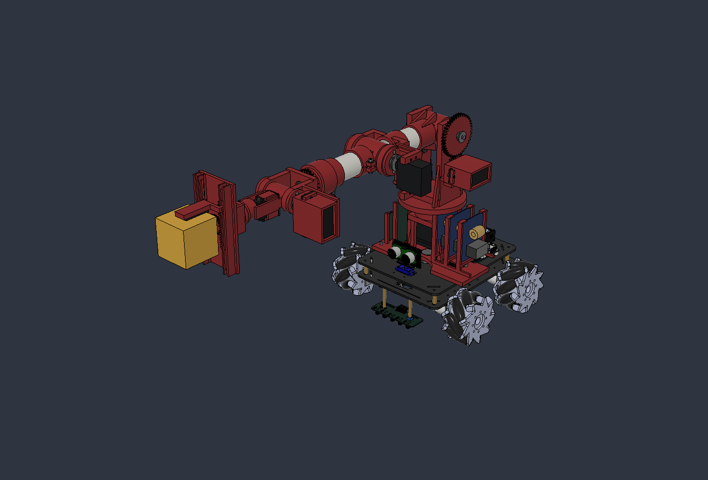
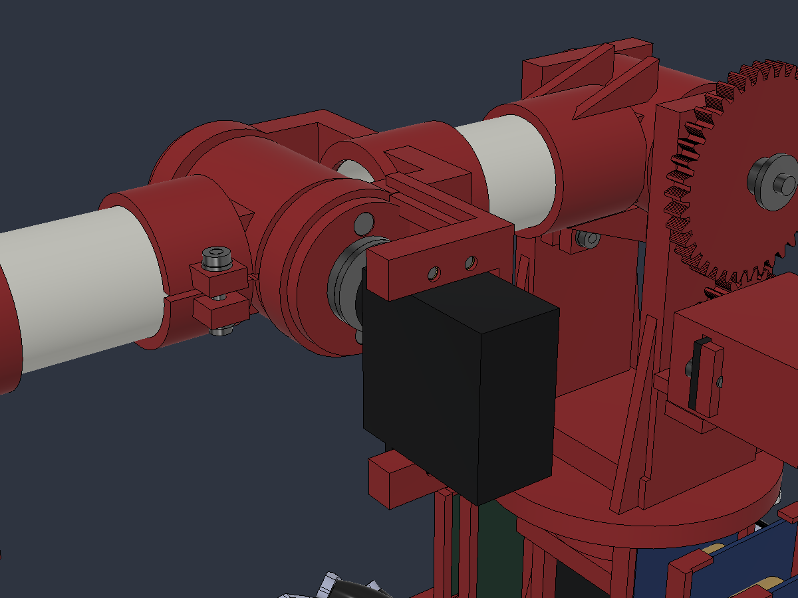

# Brazo v07: GX3270BLS en el codo y refuerzos locales

> **Continuación AFR2-20261027-21:** [v08 con housing terminado y comprobaciones geométricas](../revision_v08/README.md). La revisión encontró y corrigió interferencias de v07. Este archivo y sus datos se conservan como antecedente; la aceptación de carga/frenada sigue abierta.

27/10/2026 · AFR2-20261027-20. Se implementa una iteración CAD para estudiar 200 g de carga: nuevo servo del codo, alojamiento integrado, mayor solape del primer eslabón y nervios en torre/base. **Prototipo editable, sin liberación de fabricación ni capacidad física acreditada.**

## Abrir y editar

- [Ensamble completo F3D](../AFR2_Brazo_PVC32_AGV_v07_GX3270BLS.f3d), documento Fusion `AFR2_Brazo_PVC32_AGV_v07_GX3270BLS`.
- [Motor paramétrico independiente F3D](GX3270BLS_Referencia_Parametrica.f3d).
- [158 parámetros con expresión y procedencia](../parametros_prototipo_v07.csv); las nuevas dimensiones se agrupan en `v07_*`.
- [Script de construcción por fases](../revise_actuator_v07.py), ejecutable dentro de Fusion. No repetir fases sobre un documento ya construido: el F3D contiene sus operaciones y se edita directamente.
- [Identidad del documento y contenido](modelo_v07.json). El ensamble conserva 14 uniones nativas y cuatro vínculos de movimiento. Los 339 componentes incluyen referencias y auxiliares; no son 339 piezas a imprimir.

Se preservan el [maestro v06](../AFR2_Brazo_PVC32_AGV_v06.f3d) y su [copia de estudio](../analisis_cargas_200g/AFR2_Brazo_PVC32_Estatica_200g_v06.f3d). El nuevo archivo parte de la postura horizontal, con carga de referencia de 200 g. Algunos nombres históricos conservan «100g» para mantener identidades.

## Qué se modificó y por qué

| Zona | Cambio implementado | Motivo |
| --- | --- | --- |
| Servo J3 | DS3218 sustituido por Yipin GX3270BLS 270°, 90 g | Aumentar el margen frente a 15,83 kgf·cm estáticos; oferta argentina y plano dimensional disponible |
| Codo A06 | Una pieza roja con manguito, horquilla, cuna y bancos de montaje; cuatro M3×10, arandelas e insertos | Adaptar carcasa y patrón 48×10 mm conservando el eje articular y los dos 608 |
| Acople | Horn metálico de referencia, cubo extendido hasta el estriado | Mantener continuidad geométrica entre salida, horn y brida; patrón comercial por confirmar |
| Primer eslabón | Solape de manguitos 17→27 mm; nervios cortos en encastre proximal | Aumentar longitud de apoyo sin cambiar tubos ni engrosarlos completos |
| Torre | Cuatro nervios integrados | Reforzar localmente la transferencia del momento del hombro |
| Montura baja | Collar alrededor del cartucho J1 y nervios en columnas | Dar continuidad local a la base manteniendo su altura y la contraplaca inferior única |

Se mantienen distancias de 130/120 mm, caños de 80/70 mm, PVC Ø32/28,3 mm, montura Z = 6…12 mm y hombro Z = 209 mm. La separación de los dos 608 de J1 **sigue siendo 8 mm**; no se atribuye al refuerzo una reducción de sus reacciones.

La [selección y lectura del plano](ACTUADOR_Y_MONTAJE.md) documenta cotas inferidas, discrepancia de altura, horn y alimentación. El modelo comercial es una envolvente propia; el estriado no es un perfil para fabricar.

## Resultado del recálculo

| Magnitud | v06 | v07 |
| --- | ---: | ---: |
| Masa añadida al auto, con carga de 200 g | 2.228,81 g | 2.267,03 g |
| PETG equivalente macizo | 1.045,38 g | 1.048,48 g |
| Momento gravitatorio J2 | 2,911 N·m | 2,925 N·m |
| Par requerido al servo J2, reducción 2:1 y η=0,85 | 17,46 kgf·cm | 17,54 kgf·cm |
| Par estático del codo J3 | 15,83 kgf·cm | 15,83 kgf·cm |
| Flexión perpendicular al eje J1 | 2,933 N·m | 2,947 N·m |

La demanda estática del codo no cambia porque su nuevo motor está en el primer eslabón, aguas arriba de J3. Sí modifica la masa que levanta el hombro. El cambio total añade 38,23 g y el CG del conjunto añadido pasa a (−13,396; 118,676; 152,663) mm respecto del origen del auto.

Los primeros cálculos de frenada son **hipótesis de 30°/s, un eje por vez, con paradas de 200/100/50 ms**. El máximo de J3 entre esos casos es 25,56 kgf·cm; el GX3270BLS anuncia 63 kgf·cm máximos a 7,4 V, sin curva continua. En el caso de 50 ms, J1 requiere 16,23 kgf·cm, superior a los 13 anunciados del MG946R a 6 V: esta frenada no queda aprobada. Una sensibilidad de J3 a 600°/s, tomada de la velocidad publicada **sin carga**, demanda hasta 144,68 kgf·cm y tampoco es admisible por comparación con el anuncio del servo.

[Informe de implementación, ecuaciones, resultantes y límites](../analisis_cargas_200g/07_implementacion_y_cargas_v07.md) · [Informe integrado](../analisis_cargas_200g/INFORME_ITERACION_DISENO.md).

## Datos conservados

[Geometría, centroides e inercias](geometria_v07.json), [masas por cuerpo](masas_por_cuerpo_v07.csv), [PETG por pieza](petg_por_pieza_v07.csv), [estática](estatica_v07.json), [estados de frenada](frenadas_hipotesis_v07.json), [picos por caso](picos_frenadas_v07.csv) y sus fuentes [extracción](extraer_v07.py), [cálculo](calcular_v07.py), [figura](graficar_resultados.py). Los registros de construcción identifican las fases realmente aplicadas.

Pendientes: recorrido/interferencias de v07, esfuerzos locales FDM/contactos/dientes/insertos, separación de apoyos J1, frenada simultánea y del AGV, curvas de los servos bajo carga, fuente/regulador, horn comercial y medición de las cotas inferidas. No se ejecutaron tests, compilaciones, validadores, barridos CAD, FEA ni ensayos físicos en esta revisión. Los despieces siguen diferidos.
