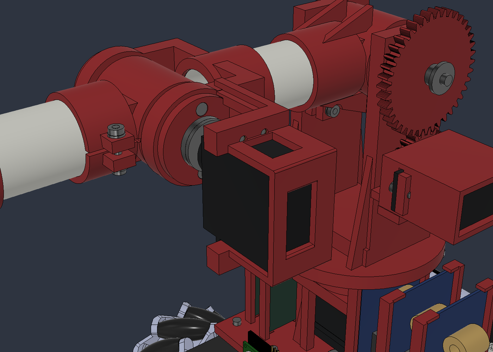
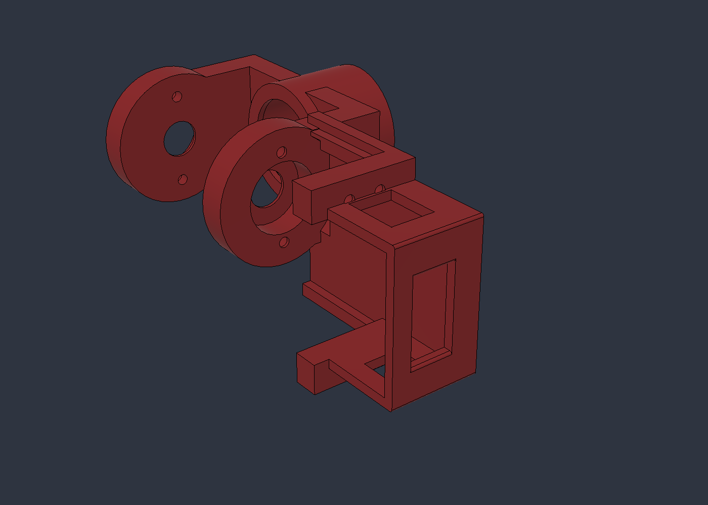

# Brazo v08: housing GX3270BLS y revisión geométrica

> **Continuación AFR2-20261028-01:** [comprobación resistente de J1 y sus uniones](../analisis_J1_uniones/README.md), con requisitos de material y propuesta dimensional de rediseño. Se conserva esta geometría; el estudio no da por aprobada la resistencia.

27/10/2026 · AFR2-20261027-21. Se completa el housing del codo, se corrigen interferencias introducidas por los refuerzos v07 y se repite la revisión CAD pedida por el usuario. Se conservan los maestros anteriores. **Los resultados son geométricos y analíticos; no acreditan resistencia física de 200 g ni frenada de emergencia.**

## Archivos editables

- [Ensamble completo F3D](../AFR2_Brazo_PVC32_AGV_v08_Housing.f3d), documento Fusion `AFR2_Brazo_PVC32_AGV_v08_Housing`.
- [Housing paramétrico independiente F3D](Housing_GX3270BLS_Parametrico.f3d), una pieza PETG roja con manguito, horquilla, cuna y protección.
- [Referencia del motor F3D](GX3270BLS_Referencia_v08.f3d).
- [163 parámetros](../parametros_prototipo_v08.csv), con expresión y procedencia; [inventario guardado](modelo_v08.json).
- [Construcción por fases](../revise_housing_v08.py) y [procedimiento de comprobación](../check_housing_v08.py), ejecutables en la API de Fusion. No repetir fases de construcción sobre el maestro terminado.

El documento contiene 339 componentes, 14 uniones y 4 vínculos de movimiento. El conteo de componentes incluye referencias/historial; no es una lista de piezas para imprimir.

## Housing y correcciones

Las paredes laterales y posterior de 3 mm, ventanas de ventilación y reserva de cable completan la cuna. El frente y la parte superior quedan abiertos para mantenimiento. Cuatro aristas de la cara posterior tienen radio 0,8 mm. Se conservan las cuatro fijaciones M3 del servo, el eje Ø8 y ambos 608 del codo. [Construcción y montaje propuesto](HOUSING_Y_MONTAJE.md).

La comprobación inicial encontró **12 penetraciones internas y una entre conjuntos** en v07: tapa 608 contra bandeja, insertos desalineados con sus cajas, pestañas del servo contra un larguero, perno/arandelas/tuerca contra los nuevos nervios, XL4016 contra refuerzo de base y tornillo central contra su paso. [Registro interno inicial](baseline_montajes_v07.json) y [postura inicial](baseline_v07.json).

Se hicieron reservas locales, se alinearon cajas y se cortaron los pasos M3/insertos después de agregar paredes. Se eliminó un recorte redundante del perno que había quedado sin objetivo; los accesos y el agujero original conservan el paso. La corrección no recorta tornillos, rodamientos o placas comerciales para ocultar choques.

La base continúa en Z=6…12 mm y el hombro a 209 mm. Caños de 80/70 mm, eslabones 130/120 mm, PVC Ø32/28,3 y separación de apoyos J1 de 8 mm se mantienen.

## Comprobaciones realizadas

| Comprobación | Resultado | Evidencia |
| --- | --- | --- |
| Housing | Un cuerpo sólido y una región continua; 67.738,29 mm³ | [Geometría e historial](geometria_housing.json) |
| Historial | Sin advertencias ni errores activos de cálculo | Mismo archivo |
| Piezas y apoyos | 25 sólidos impresos continuos, 6 ejes completos, 12 rodamientos completos con contacto de eje/apoyo | [Continuidad y rodamientos](continuidad_y_rodamientos.json) |
| Montajes internos | 0 penetraciones mayores a 0,001 mm³ entre componentes diferentes del brazo/montura | [Montajes](montajes_internos.json) |
| Postura nativa extendida | 0 penetraciones reportables entre conjuntos | [Interferencia nativa](pose_nativa_interferencias.json) |
| Contactos | 211 componentes: una cadena principal más los dos pares mordaza/almohadilla separados por el juego de guías | [Grafo](grafo_contactos.json) |
| Movilidad muestreada | **3.141 configuraciones, 0 con penetraciones mayores a 0,001 mm³** | [Informe acumulado](informe_movimiento_v08.json) |
| Pinza nativa | 50,000 mm a 109,8°; 60,011 mm a 133,7°; 79,405 mm a 180°; mínimo vacío 4,007 mm | [Apertura](apertura_nativa_fusion.json) |
| Límites nativos J1…J6 | Mínimo/centro/máximo accionados; error angular máximo 2,85×10⁻¹⁴° | [Extremos](extremos_nativos_fusion.json) |
| Pan HC-SR04 | Envolvente conservadora completa Ø68,8 mm, Z=5…51 mm libre de la montura | [Envolvente](envolvente_circular.json) |
| Engranajes/vínculos | Relaciones geométricas y cuatro vínculos conservados | [Transmisiones](transmisiones.json) |
| Recorrido de actuadores | Recorridos CAD dentro de los nominales de las variantes; J3 usa 180° de 270° | [Recorridos](recorridos_actuadores.json) |

El muestreo comprende 524 posiciones individuales de J1…J6,181 aperturas de pinza vacía, 2.197 combinaciones de muñeca con el cubo de 50 mm, 181 posiciones del pan, 57 combinacionesJ1/pan y una postura extendida. Ejes en pasos de 2° con extremos, pinza/pan de 1° y rejilla de muñeca de 15°. Los JSON conservan las posturas exactas de los demás ejes.

El barrido de hombro usa codo −90°; el de codo usa hombro 0°; la rejilla de muñeca usa hombro 35° y codo −15°. Por tanto, **no se declara libre toda combinación simultánea ni todo el espacio continuo**. La paridad entre matrices nativas y cinemática de comprobación está en [este registro](paridad_cinematica.json).

J1 y varios servos pequeños utilizan nominalmente su carrera completa; J2 requiere 270° de motor por su reducción 2:1. No hay margen nominal en esos extremos: las variantes reales, centrado, límites de pulsos y tolerancias deben ajustarse antes del uso físico. Las coordenadas CAD y PWM solicitado no son medidas físicas.

## Masas y cargas actualizadas

Se extraen 271 cuerpos e inercias, conservando el método y supuestos de v07. El housing representa 67,738 cm³, equivalentes a 86,03 g de PETG macizo. No es un peso de laminador o de pieza impresa.

| Magnitud | v07 | v08 |
| --- | ---: | ---: |
| Masa añadida al auto con 200 g de carga | 2.267,03 g | **2.277,49 g** |
| PETG equivalente macizo | 1.048,48 g | 1.058,94 g |
| PETG geométrico | 825,573 cm³ | 833,808 cm³ |
| Par estático del servo J2,2:1/η0,85 | 17,54 kgf·cm | 17,63 kgf·cm |
| Par estático J3 | 15,83 kgf·cm | 15,83 kgf·cm |
| Flexión gravitatoria perpendicular J1 | 2,947 N·m | 2,962 N·m |

El aumento neto es 10,46 g y el CG añadido pasa a (−13,774; 118,696; 152,955) mm. No incluye la masa del auto y no acredita estabilidad.

Se recalcularon las mismas hipótesis de frenada individuales a 30°/s y 200/100/50 ms. En50 ms se obtienen picos de 16,27/27,01/25,56 kgf·cm para los servos J1/J2/J3. J1 sigue superando los13 anunciados de su MG946R. La flexión máxima de base entre esos casos es 4,522 N·m, equivalente a ≈ 565 N por apoyo para el par idealM/d con 8 mm. La sensibilidad J3 a 600°/s sin carga de catálogo sigue llegando144,68 kgf·cm, superior al máximo anunciado del nuevo servo.

Estos resultados **no aceptan la frenada de emergencia**: mantienen abiertos actuador/transmisión de J1, separación de apoyos, alimentación, curvas bajo carga, FEA/contactos, impresión y dinámica simultánea/AGV. [Método y límites de cálculo](../analisis_cargas_200g/07_implementacion_y_cargas_v07.md).

[Geometría e inercias](geometria_v08.json) · [Masas por cuerpo](masas_por_cuerpo_v08.csv) · [PETG por pieza](petg_por_pieza_v08.csv) · [Estática](estatica_v08.json) · [Frenadas](frenadas_hipotesis_v08.json) · [Picos](picos_frenadas_v08.csv).

Se realizaron comprobaciones CAD autorizadas y cálculo de ingeniería. Sin compilación, flasheo, FEA, fabricación o ensayo físico. No se generaron despieces ni láminas; siguen diferidos por indicación del usuario. Firmware, Web y electrónica conservan sus fuentes y no incorporan automáticamente esta geometría.
