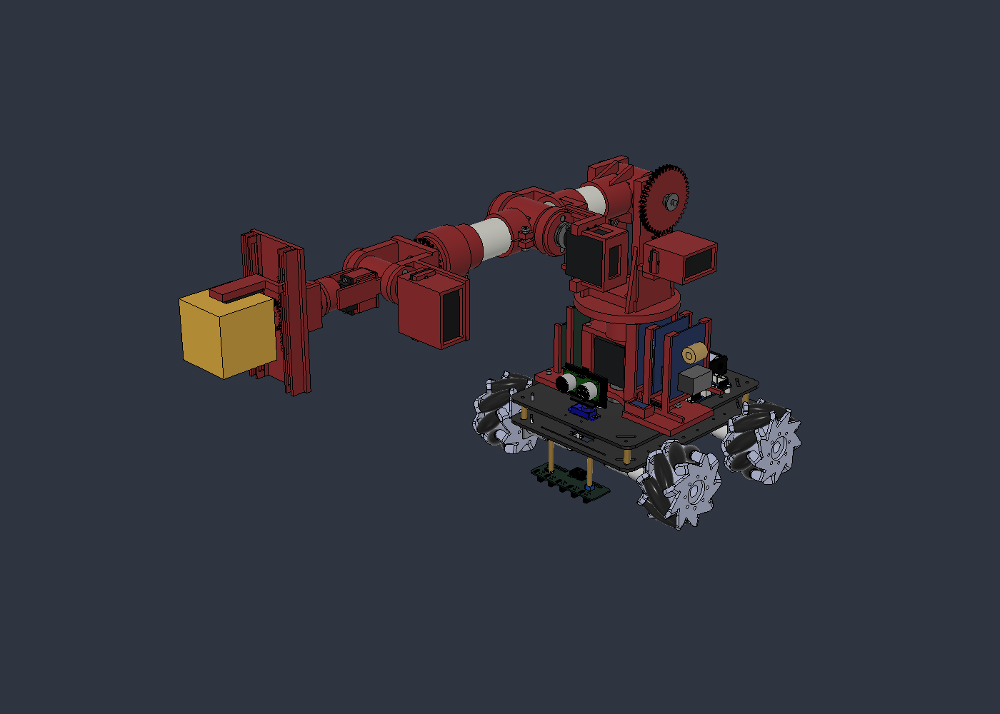
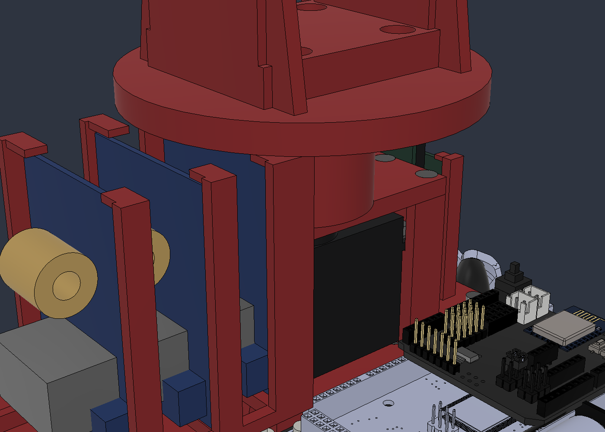

# Brazo v09: iteración de J1, actuador y montaje bajo

28/10/2026 · AFR2-20261028-04. Iteración solicitada tras el [estudio de J1 v08](../analisis_J1_uniones/README.md). Maestro anterior conservado. Diseño CAD y predimensionado bajo hipótesis; sin FEA de sólidos ni ensayo físico.

[Informe de cargas y resistencia](RESISTENCIA_Y_CARGAS.md) · [Ensamble editable](../AFR2_Brazo_PVC32_AGV_v09_J1_GX3270BLS.f3d) · [Parámetros](../parametros_prototipo_v09.csv) · [Autoría/reproducción](AUTORIA_Y_REPRODUCCION.md)

## Motivos de la corrección

La v08 demandaba 16,27 kgf·cm en J1 para la hipótesis individual de 30°/s y parada suave de 50 ms, por encima de los 13 anunciados del MG946R. El contacto D contra PETG concentraba la transmisión del par y los apoyos separados 8 mm daban aproximadamente 565 N radiales. La marca queda definida por el usuario durante esta iteración: **PLA PrintaLot**. El perfil FDM sigue pendiente.

Se modela un GX3270BLS de 270°, el mismo candidato comercial utilizado para J3: 90 g anunciados y ≥63 kgf·cm a 7,4 V. Se conserva la plataforma en Z=96 mm y el hombro en Z=209 mm. La velocidad publicada de 600°/s es **sin carga** y no se adopta como prestación nominal del brazo. [Oferta y especificación de Starware](https://tienda.starware.com.ar/producto/servo-motor-digital-brushless-yipin-gx3270bls-70kg-5-84v-270gr-ip68-metal/).

## Geometría de la iteración

| Elemento | Diseño |
| --- | --- |
| Actuador J1 | GX3270BLS, salida vertical, cara del cuerpo Z=55 mm y fondo Z=13,3 mm |
| Cuna y housing inferior | PLA PrintaLot rojo, abierto, apoyos de cuatro pestañas y refuerzos exteriores; mismo montaje bilateral al auto |
| Cartucho de apoyos | Pieza impresa desmontable sobre cuatro tirantes M3x60, tuercas y arandelas alojadas en la placa inferior |
| Rodamientos J1 | Dos 6000-2Z/ZZ, 10×26×8 mm; centros Z=72,5 y 85,5 mm, separación 13 mm |
| Eje | SAE4140 bonificado propuesto, certificado de lote con Rp0,2≥600 MPa; Ø10, cuello Ø20 y brida superior integral Ø60×3 mm; cuatro M4 en PCD50 |
| Adaptador inferior | Pieza metálica desmontable Ø22, doble plano complementario a 8 mm entre caras, engagement 3,35 mm |
| Horn | Metálico 25T, engagement nominal 4 mm, dos M3x5 ISO7380-1 y tornillo central accesible por el taladro axial del eje |
| Retención axial | Anillo DIN471 para eje10, ranura Ø9,6/ancho1,1 y arandela de ajuste; el servo no se usa como apoyo axial del brazo |
| Anclaje C | Cabeza avellanada al ras, reserva ISO10642 M3 Ø6,72/h1,86 |

Los rodamientos y el horn reciben nombres nuevos de6000/25T para evitar confundirlos con las piezas sustituidas. Los nombres históricos de impresos que contienen `PETG` se conservan como identificadores; el material asignado y el inventario v09 son PLA PrintaLot. La forma de aros, horn, roscas y anillo es una referencia simplificada. Las cotas comerciales inferidas de v07 —especialmente desplazamiento del eje 10,5 mm— siguen pendientes de contrastar con la unidad comprada.

Se mantienen servos posicionales y no se agregan sensores de posición externos. El PWM fija la consigna; no informa por sí mismo la posición real alcanzada bajo carga. Los recorridos se contrastan con el nominal de cada variante, y los pulsos/extremos reales requieren calibración. En J2, la reducción2:1 utiliza todo el recorrido nominal270° para135° de articulación, sin margen adicional de extremos.

## Iteración constructiva y secuencia de montaje

La propuesta inicial de 16 mm no se conserva: el horn, la fijación y el acceso de herramientas necesitan espacio. La separación final propuesta es 13 mm, sin elevar el plato.

La revisión de montaje también descartó fabricar un eje con dos bridas integrales: no pasaría por los rodamientos. Se mantiene integral únicamente la brida superior. El adaptador inferior transmite el torque metal contra metal mediante doble plano y se puede desmontar; el anillo y la arandela retienen el eje axialmente.

1. Preparar la cuna inferior y sus tuercas/arandelas accesibles desde abajo; instalar el servo con sus cuatro fijaciones.
2. Montar horn y adaptador sobre el servo, con tornillo central y dos tornillos cortos. Confirmar horn comercial y profundidad real de rosca.
3. Montar los dos 6000 y su tapa en el cartucho desmontable; introducir el eje desde arriba.
4. Colocar anillo y arandela desde abajo, antes de llevar el cartucho al motor. El taladro axial permite acceder al tornillo central del horn.
5. Bajar el cartucho sobre la cuna, encajando el doble plano, y cerrar sus cuatro tirantes. Montar el plato móvil sobre la brida mediante cuatro M4 y arandelas.

Esta secuencia es una revisión constructiva del CAD; todavía requiere tolerancias, herramientas reales y ensayo de montaje. No se modelan hélices de roscas o dientes del estriado como geometría de fabricación.

## Material metálico y proceso FDM

Para eje/brida y adaptador se propone SAE4140 bonificado, solicitando certificado de lote con Rp0,2≥600 MPa y contrastando el estado después del mecanizado. [TTI, oferta argentina de 4140 bonificado](https://ttisrl.com.ar/venta-de-acero/). Es una especificación de compra y cálculo, no una propiedad confirmada de una pieza existente. La brida integral exige torno/fresa y presupuesto de taller; no se presenta como pieza impresa barata.

El estudio de PLA PrintaLot representa geometría maciza. Como punto de partida de fabricación se propone evaluar boquilla0,4 mm, capa0,2 mm, seis perímetros y relleno100% en piezas estructurales, ajustando el perfil a la ficha del filamento comprado. Ese perfil propuesto no acredita resistencia entre capas; orientación, temperatura, humedad, creep y ensayos siguen abiertos.

El fabricante publica densidad **1,24 g/cm³**, que se usa para todas las piezas impresas. La [página oficial](https://printalot.com.ar/productos/filamentos/pla/filamento-pla-1-75mm/) enlaza una [TDS v1 de12FEB17](https://drive.google.com/file/d/1_zDQZ9XNZljfZKPe1RaTyX1GYB1henaX/view). El PDF recuperado tiene SHA256 `80aa99ebd931b2533735f68aade3b886916bf8f4a4b5975b61df2f484a618e08`. Descarga recuperable en `.downloads/filamentos/PrintALot_PLA_TDS.pdf`, excluida de Git.

La TDS informa 53 MPa mediante D882, sin una caracterización FDM por orientación que permita asignar ese valor a las uniones entre capas. También imprime un módulo de «3,6 MPa»: se registra esa ambigüedad y no se convierte silenciosamente a GPa. Para sensibilidad de rigidez se conserva **E=1.500 MPa y ν=0,38 supuestos**, sin atribuirlos a PrintaLot. Las deformaciones y tensiones se interpretan con ese límite. La proximidad a motor/reguladores requiere comprobar temperatura; TG≈60°C y HDT55°C de referencia no son una temperatura admisible de diseño.

## Comprobaciones y resistencia

La revisión se hizo por iteraciones sobre los sólidos nativos. Se detectaron y corrigieron:

- Bornera contra la cuna y un tirante: traslado a X=-51/Y=23 mm con cajetín continuo a la montura.
- Membrana residual de0,4 mm en el puente del cartucho: pasoØ24 completamente abierto para eje, adaptador y tornillos del horn.
- Tuercas/tornillos inferiores de la brida contra el XL4016 más próximo durante J1: desplazamiento lateral de5,5 mm del módulo1 y3 mm del módulo2, con apoyos adaptados. El primer intento de6 mm invadía el módulo vecino y se descartó.

La plataforma sigue en Z96 mm y la montura a6 mm del chasis. No se usa elevación general para resolver estas interferencias. Los hallazgos iniciales se conservan como antecedentes; únicamente los barridos finales representan la geometría corregida.

El [muestreo final](informe_movimiento_v09.json) comprende **3.087 configuraciones sin penetraciones reportables**, umbral0,001 mm³: barridos individuales, muñeca, pinza, pan y1.299 posiciones asociadas a frenadas. Son muestras discretas; no una prueba continua de todo el espacio articular. La [postura nativa](pose_nativa_interferencias.json) y los [montajes internos](montajes_internos.json) tampoco presentan penetraciones reportables. La [envolvente circular conservadora](envolvente_circular.json) deja libre la montura para el pan. Los18 extremos nativos comprobados tienen error numérico máximo≈2,85e-14°; no son medidas de servos físicos.

La [auditoría](continuidad_y_rodamientos.json) registra26 cuerpos impresos, seis ejes y12 rodamientos sin pendientes de continuidad/apoyo de su alcance. La montura es un sólido conectado, con línea de tiempo sin advertencias/errores. El grafo geométrico separa las mordazas por las holguras intencionales de sus guías; eso no se considera automáticamente una pieza suelta. La revisión no acredita tolerancias, aprietes, montaje físico ni retención efectiva de todas las interfaces.

El presupuesto macizo da **2.400,43 g** para brazo/montura/control/carga, sin el auto; **1.014,88 g** corresponden al PLA. Los [79.651 estados de cálculo](resistencia_v09.json) incluyen211 casos y64 combinaciones de sentido de seis ejes, a30°/s y paradas200/100/50 ms, con carga200 g y final horizontal. Los cálculos usan frenadas finitas explícitas; no existe una carga finita de «frenada instantánea» que pueda certificarse sin duración, flexibilidad o distancia de parada.

J1 demanda hasta16,30 kgf·cm en esos casos. El eje tiene62,45 MPa equivalentes de referencia y la cuna3,15 MPa normales nominales. Con n=2/Kt=2 provisionales se requieren249,81 MPa de fluencia metálica y12,58 MPa efectivos en la orientación resistente del impreso. El certificado propuesto de600 MPa supera el requisito metálico de este modelo; no resuelve contactos ni demuestra resistencia FDM.

**El brazo completo sigue condicionado:** en la frenada conjunta50 ms, J2/J3/J5 demandan34,47/34,13/10,58 kgf·cm respectivamente, sin cumplir el objetivo preliminar×2 frente a sus anuncios40/63/13. También falta estabilidad del auto, frenada del AGV, alimentación y caracterización de impresión. Se documentan estas limitaciones y sensibilidades en el informe, sin declarar200 g como capacidad física aprobada.

La resistencia FDM no se aprueba por ausencia de interferencias. Se documentan tensiones nominales y requisitos bajo factores supuestos, con límites de los modelos de barras/secciones y sin presentarlos como FEA de sólidos/contactos o ensayo físico. El nombre histórico de la pieza de referencia contiene100g, pero el parámetro y la masa de carga del cálculo son200g. Mantener la pieza solidaria a la herramienta en la dinámica no demuestra la fuerza de agarre ni el coeficiente de fricción real.

## Archivos de revisión

- [Housing J1 independiente](Housing_J1_GX3270BLS_v09.f3d), [cartucho6000](Cartucho6000_J1_v09.f3d), [eje/brida](Eje_brida_J1_v09.f3d), [adaptador metálico](Adaptador_dobleD_J1_v09.f3d) y [motor de referencia](GX3270BLS_Base_REF_v09.f3d).
- [Inventario de masas](masas_por_cuerpo_v09.csv), [PLA por pieza](pla_por_pieza_v09.csv), [estática](estatica_v09.json), [sensibilidades de movimiento](envolvente_operativa.json) y [picos de frenada](picos_frenadas_v09.csv).
- [Secciones nativas](secciones_CAD_v09.json), [estados completos comprimidos](estados_J1_v09.npz), [material asignado](material_PLA_v09.json) y [equivalencia de inercias](equivalencia_inercias.json).

## Fuentes adicionales

- [SKF, catálogo de ranura profunda](https://cdn.skfmediahub.skf.com/api/public/09468794f5d8f85a/pdf_preview_medium/09468794f5d8f85a_pdf_preview_medium.pdf): serie6000, dimensiones y C₀ de referencia1,96 kN; masa20 g adoptada conservadoramente para la variante2Z. No identifica una unidad comprada.
- [Mädler, DIN471](https://smarthost.maedler.de/datenblaetter/K43_726_EN.pdf): eje10, espesor1, ranuraØ9,6/ancho1,1; condiciones del material y radio de ranura. Envolvente del anillo instalado simplificada, sin cálculo elástico de montaje.
- [Böllhoff, ISO7380-1](https://eshop.boellhoff.de/out/media/pdf/ISO_7380-1_Stahl_10.9_Innensechskant___de.pdf): cabeza M3 Ø5,7/h1,65, usada para el espacio bajo el horn.
- [Böllhoff, ISO10642](https://eshop.boellhoff.de/out/media/pdf/ISO_10642_Stahl_10.9___en.pdf): cabezas avellanadas de referencia. Confirmar variante y largo de compra; no se prescribe apriete.

La alimentación de dos GX3270BLS requiere revisar batería y regulación: cada unidad anuncia hasta7 A de bloqueo a7,4 V. La fuente actual no queda aprobada por el cambio de CAD. Atmega, ESP, Web y Loader no se modifican en esta iteración.
