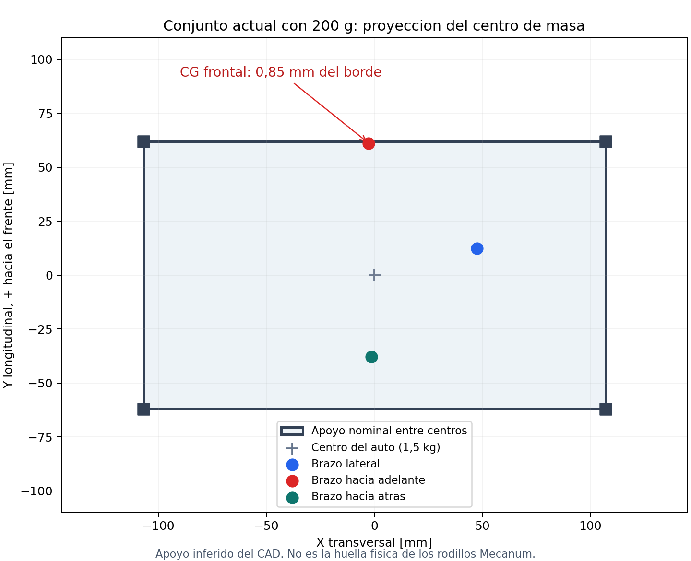

# Estabilidad y capacidad de movimiento del conjunto actual

**AFR2-20261101-10 · 1 de noviembre de 2026.** Brazo v17 abierto en Fusion: `AFR2_Brazo_v17_Base_V7_J3_Remoto`. Carga: 200 g. Auto: 1,5 kg, distribuido simétricamente sobre el chasis por hipótesis del usuario. Solo apoyo sobre ruedas.

## Resultado

**Los motores del auto tienen margen de par nominal para desplazar la masa calculada sobre piso firme, pero el conjunto actual no tiene margen suficiente de estabilidad con el brazo extendido hacia adelante. No queda acreditado que pueda trabajar cargado en cualquier dirección sin volcar.**

La masa calculada del brazo, montura y control propio es **2,345 kg**; con auto y carga se llega a **4,045 kg**. En la orientación frontal extendida el centro de masa combinado queda a **0,85 mm** del borde de apoyo supuesto. El factor de estabilidad por momentos es **1,023**, inferior al margen1,2 considerado previamente. Una variación pequeña de masa, del punto de contacto de los rodillos, una pendiente o una frenada puede eliminar ese equilibrio.

Esto no significa que el brazo pese2,345 kg ya impreso ni que se haya observado un vuelco físico. Es un cálculo con geometría nativa actual, densidades y masas comerciales/estimadas. No se modificó el modelo ni se hizo FEA, ensayo de resistencia, prueba de conducción o montaje físico.

## 1. Fuente y alcance

- Extracción nueva del documento conectado: **426 cuerpos sólidos por instancia**, contando el cubo como una única carga de200 g. Incluye piezas ocultas del brazo; excluye raíces80/81/82 de auto, pan y envolvente para no sumar el auto por segunda vez.
- `geometria_actual.json`: volúmenes BRep, centroides, inercias uniformes de envolvente, transformaciones, atributos comerciales, parámetros y límites.
- `masas_actuales.json`: asignación de masa de cada cuerpo; un componente comercial con varios sólidos reparte su masa entre ellos. Se cuenta cada ocurrencia comercial por separado.
- `calcular.py` y `resultados.json`: cálculo reproducible sobre esa captura. Reutiliza la cinemática y las reglas de masa de `../calcular_cad_v17.py` y su dependencia histórica `../../analisis_cargas_200g/calcular_estatica.py`; los parámetros y cuerpos se sustituyen por la captura actual.
- La reconstrucción de las transformaciones de los diez grupos principales/auxiliares se comparó con la pose nativa capturada: discrepancia de posición inferior a1e-8 mm. Esto comprueba la correspondencia de coordenadas utilizada; no prueba contacto, resistencia o fabricación.
- La apariencia blanca no define por sí sola una densidad. Se conservan atributos físicos/comerciales y se identifica expresamente el PLA blanco sin atributo heredado.
- Las masas del interior de los servos se distribuyen uniformemente en su envolvente; las masas de electrónica y algunos herrajes son estimaciones. No se dispone de pesaje real ni G-code del laminador.

## 2. Presupuesto de masas

| Elemento | Masa calculada |
| --- | ---: |
| PLA PrintALot, volumen sólido de las piezas modeladas | 788,97 g |
| Acero: ejes, tornillos, casquillos y herrajes modelados | 566,78 g |
| Cinco STS3250, masa comercial conservadora75,5 g/unidad | 377,50 g |
| Dos STS3032, masa comercial21,6 g/unidad | 43,20 g |
| Aluminio y aluminio2024 | 217,76 g |
| Rodamientos, masas comerciales por instancia | 155,00 g |
| Electrónica propia del brazo | 177,00 g |
| PVC de ambos eslabones | 7,93 g |
| Correa, latón y almohadillas | 10,86 g |
| **Brazo completo con montura/control, sin carga** | **2.344,99 g** |
| Carga manipulada | 200,00 g |
| Auto listo, sin brazo: dato aproximado del usuario | 1.500,00 g |
| **Total del conjunto** | **4.044,99 g** |

La montura/control fijo aporta583,91 g; el conjunto que gira conJ1, incluida la carga, aporta1.961,08 g. El motor remoto deJ3 sigue la estructura del primer eslabón: se usa su posición real en ese grupo, no la posición del codo.

El peso total es39,67 N. La carga útil pesa1,961 N. **No corresponde multiplicar toda la masa por el alcance de la punta**: cada parte se incluye con su propio centro de masa y brazo de palanca.

Los 1,5 kg del auto se interpretan sin la electrónica propia del brazo listada arriba. Si ese pesaje ya incluyera alguno de esos módulos, habría que descontarlo. El auto físico actual puede diferir del CAD en batería, cables y soportes.

### Impresión e infill

Los788,97 g usan densidad de cálculo1,24 g/cm³ sobre el volumen CAD ocupado por plástico, con los agujeros y ventanas ya modelados. **No se asignó un porcentaje de infill.** Es una referencia maciza; no incluye soportes de impresión, purga ni brim. Un infill30% no significa masa30%: paredes y tapas también pesan.

| Sensibilidad del PLA final, no perfil de impresión | Masa del conjunto | Factor estático frontal | Distancia al borde frontal |
| --- | ---: | ---: | ---: |
| 100% de la masa sólida CAD | 4,045 kg | 1,023 | 0,85 mm |
| 70% de la masa sólida CAD | 3,808 kg | 1,073 | 2,61 mm |
| 50% de la masa sólida CAD | 3,651 kg | 1,112 | 3,91 mm |
| CAD sólido +50 g fijos +10 g en punta | 4,105 kg | 1,018 | 0,66 mm |

Incluso la hipótesis de50% de masa efectiva de plástico queda por debajo del factor1,2 en esta orientación. El aligerado debe estudiarse por ubicación; quitar masa de una base estabilizante puede perjudicar.

## 3. Geometría y apoyo

Se utilizan los eslabones actuales:70 y60 mm entre ejes principales, distancias de muñeca55 y65 mm y PVC25/20 mm. Los nombres de componentes y algunos parámetros antiguos todavía dicenPVC32; **no se calcularon los tubos nuevos como tubos32 mm**: sus masas provienen de los volúmenes actuales.

Coordenadas del CAD del brazo: X transversal; +Y hacia el HC-SR04/frente del auto; Z vertical. Centro longitudinal del autoY=-32 mm. EjeJ1 aproximadamenteY=-14 mm: no está centrado longitudinalmente sobre las ruedas.

Modelo de apoyo nominal tomado del CAD/referencia anterior y contrastado con las envolventes de ruedas actuales:

| Cota de cálculo | Valor |
| --- | ---: |
| Separación transversal entre centros de apoyo nominales | 214 mm |
| Separación longitudinal entre ejes de ruedas | 124 mm |
| Semianchos del rectángulo de apoyo | 107 y62 mm |
| Piso del auto en coordenadas del brazo | Z=-79,05 mm |
| CG horizontal del auto1,5 kg | Centro del rectángulo |
| Altura supuesta del CG del auto sobre el piso | 40 mm; sensibilidad30–60 mm |

**El rectángulo de centros es una idealización del apoyo, no una medición del polígono instantáneo de contacto de los rodillos Mecanum.** El ancho exterior de la foto tampoco equivale a distancia entre contactos. No hay una medición física que garantice estos107/62 mm; con margen menor de1 mm esa incertidumbre determina la conclusión. Repartir1,5 kg sobre una superficie simétrica fija el CG horizontal, pero no la altura.

## 4. Método de vuelco estático

Para cada parte: peso `Wi=mi·g`, con `g=9,80665 m/s²` y centro `ri` transformado según la pose. Centro combinado:

`rCG = Σ(mi·ri) / Σmi`.

En cada borde de apoyo, para la distancia firmada `di` desde la proyección del centro de cada pieza al borde:

`Mestabilizante = Σ Wi·max(di,0)`; `Mvolcante = Σ Wi·max(-di,0)`.

`FS = Mestabilizante / Mvolcante`. `FS>1` indica equilibrio de este modelo; un valor cercano a1 no da una reserva práctica. La distancia `d` del CG combinado al borde y el momento neto cumplen `Mneto=Mtotal·g·d`.

Se muestrearon43.798 configuraciones: J1 en pasos5°, J2 en pasos15° más horizontal/límites explícitos, J3 en pasos15°, J5 en pasos30°, J4/J6 a0 en esa malla general, más27 combinaciones extendidas conJ4/J6=-90/0/90°. **Es un muestreo parcial; no un máximo global demostrado de las seis articulaciones.** J1 nativo está limitado a±90°; la orientación180° incluida en JSON es solo comparación geométrica y no se usa como recorrido permitido. No se cambian límites.

### Brazo horizontal con200 g

Postura de referencia: J2=90°, J3=0°, J5=0°; resto0° salvoJ1. Coordenadas del CG relativas al centro del auto y al piso.

| Orientación | CG X/Y/Z | Borde crítico | Distancia mínima | FS de ese borde |
| --- | --- | --- | ---: | ---: |
| Hacia un lateral, J1=0° | 47,58 /12,28 /161,94 mm | Lateral | 59,42 mm | 3,629 |
| Hacia adelante, J1=90° | -2,63 /61,15 /161,94 mm | Frontal | **0,85 mm** | **1,023** |
| Hacia atrás, J1=-90° | -1,28 /-37,93 /161,94 mm | Trasero | 24,07 mm | 1,859 |

En el frente: `Mestabilizante=1,4855 N·m`, `Mvolcante=1,4518 N·m`, diferencia **0,0337 N·m**. La reacción total del par de ruedas que se descarga queda en **0,272 N**, equivalente al peso de unos28 g. Es la suma del par, no la carga de cada rueda; el reparto entre cuatro ruedas depende de rigidez, piso y posición de los rodillos.

Como referencia de sensibilidad, manteniendo todo lo demás, el equilibrio neutro aparece con auto de1,445 kg; el dato aproximado1,5 kg solo supera ese valor en55 g. ParaFS1,2 estático haría falta un auto centrado de1,922 kg. **No se propone agregar ese lastre**: es sensibilidad estática, aumenta masa de transporte y no cierra por sí sola la dinámica.

## 5. Movimiento y frenada

### Auto acelerando o frenando con brazo solidario

En piso horizontal, con brazo inmóvil respecto del auto, una solicitación inercial horizontal hacia el borde desplaza la resultante al piso:

`yZMP = yCG + a_inercial·hCG/g`.

`acrit = g·(b-yCG)/hCG`.

Aquí `a_inercial` apunta hacia el borde frontal; corresponde, por ejemplo, a frenar un avance hacia adelante. Al acelerar hacia adelante la inercia apunta hacia atrás. No confundir el signo de la aceleración del vehículo con el de esta carga equivalente.

En la postura frontal: **acrit≈0,0515 m/s²**. Con CG del auto a30/60 mm resulta0,0527/0,0492 m/s²: el resultado no mejora sustancialmente por esa incertidumbre de altura.

| Solicitación inercial hacia adelante | Resultante al pisoY | Distancia restante al borde62 mm | Resultado idealizado |
| --- | ---: | ---: | --- |
| 0,05 m/s² | 61,98 mm | 0,02 mm | Prácticamente neutro |
| 0,10 m/s² | 62,80 mm | -0,80 mm | Pierde equilibrio |
| 0,30 m/s² | 66,10 mm | -4,10 mm | Pierde equilibrio |
| 0,50 m/s² | 69,41 mm | -7,41 mm | Pierde equilibrio |

Una pendiente hacia el frente de aproximadamente `atan(0,85/161,94)=0,30°` consumiría el mismo margen estático de esta pose. Es una sensibilidad del modelo, no una especificación utilizable del vehículo.

### Frenada del propio brazo, auto detenido

Se calcularon ejemplos adicionales conJ2 oJ3 moviéndose inicialmente a±30°/s y deteniéndose al llegar a la horizontal frontal. Perfil suave de velocidad `ω(u)=ω0·(1-3u²+2u³)`, duraciónT y aceleración pico `1,5·ω0/T`. Se incluyen gravedad, aceleración de centroides, inercias externas y término giroscópico; se muestrea u=0/0,25/0,5/0,75/1. El CG del auto está quieto.

| Duración de frenada | Caso más desfavorable entre estos ejemplos | Distancia frontal de resultante al borde |
| --- | --- | ---: |
| 50 ms | J2, velocidad inicial+30°/s, u=0,5 | **-12,80 mm** |
| 300 ms | J2, velocidad inicial+30°/s, u=0,5 | **-1,71 mm** |
| 500 ms | J2, velocidad inicial+30°/s, u=0,5 | **-0,76 mm** |

Estos ejemplos ya muestran pérdida de apoyo en el modelo. No son la envolvente de movimientos simultáneos, ni garantizan que los servos reproduzcan ese frenado. No se ha calculado una parada instantánea de duración cero: exigiría aceleración/momentos no acotados en un modelo rígido. Elasticidad, holgura, control, tiempo de frenada, deslizamiento y contactos reales determinan la respuesta física.

## 6. Esfuerzos estáticos sobre el brazo

Para la horizontal se sumaron fuerzas y momentos con todos los centroides. El par de un motor es la proyección del momento sobre su eje; **un par gravitatorio axial nulo enJ1 no significa ausencia de esfuerzo en su soporte**.

| Sección o eje | Solicitación estática calculada |
| --- | ---: |
| Carga de200 g | 1,961 N |
| Reacción vertical del conjunto móvil enJ1 | 19,232 N |
| Flexión resultante alrededor deJ1 | ≈1,965 N·m |
| Fuerza vertical transmitida porJ2 | 13,993 N |
| Par gravitatorio enJ2 | 1,949 N·m |
| Momento transversal adicional enJ2, fuera de su eje de giro | ≈0,135 N·m |
| Par gravitatorio enJ3 | 1,192 N·m |
| Par gravitatorio enJ5 | 0,425 N·m |

La montura fija transmite además su propio peso: brazo+carga sobre el auto suman24,96 N, además del peso del propio auto. La placa acrílica y el anclaje deben resistir esa fuerza y el momento; no basta con dimensionar el servo.

Comparación de par estático con la selección actual, usando relaciones y eficiencias asumidas previamente:

| Articulación | Motor | Reducción | Par exigido al servo | Capacidad nominal equivalente en articulación | Margen estático |
| --- | --- | ---: | ---: | ---: | ---: |
| J2 | STS3250 | 4:1, η0,80 | 0,609 N·m | 5,021 N·m | 2,58 |
| J3 | STS3250 | 2,5:1, η0,80 | 0,596 N·m | 3,138 N·m | 2,63 |
| J4, en esta pose | STS3250 | 1:1, η0,80 | 0,079 N·m | 1,255 N·m | 19,91 |
| J5 | STS3250 | 1:1, η0,95 | 0,447 N·m | 1,491 N·m | 3,51 |

La referencia deSTS3250 es16 kgf·cm nominales a12 V, no50 kgf·cm de bloqueo; [ficha FEETECH](https://www.feetechrc.com/Data/feetechrc/upload/file/20240120/6384135881578380868917773.pdf). La tensión y eficiencias deben cumplirse en el montaje. Los márgenes de esta tabla son estáticos para esa pose, no márgenes de frenada ni resistencia del PLA. No se revalida aquí la fuerza de agarre de la pinza oJ6 con carga excéntrica. No hay propiedades FDM, laminado, contacto ni condiciones de unión para afirmar resistencia estructural por tensiones.

## 7. ¿Los motores del auto pueden mover el conjunto?

Referencia instalada/documentada: **GM25-370-24140-75-14.5D10**, reducción75:1, rueda nominalØ80 mm. [Ficha alojada porOSOYOO](https://osoyoo.com/picture/mecanum_wheel_robotic/GM25-370-motor%20specification.pdf), página1, también conservada enContracts/hardware/supplied.

| Dato de ficha, por motor | Valor |
| --- | ---: |
| Tensión nominal en el motor | 9 V |
| Par nominal a salida de reductora | 3 kgf·cm =0,2942 N·m |
| Velocidad nominal bajo carga | 100 rpm±10% |
| Corriente nominal declarada máxima | 1,2 A |
| Par de bloqueo, no continuo | 9,5 kgf·cm =0,9316 N·m |
| Corriente de bloqueo máxima | 4,5 A |

En llano el peso es vertical y los motores entregan fuerza horizontal. No deben levantar4 kg: deben vencer rodadura, aceleración, pendiente y pérdidas. Modelo:

`Fnecesaria = M·[a + g·sin(θ) + Crr·g·cos(θ)]`.

Para avance ideal con cuatro motores: `τpor_motor=F·r/4`. Se usa además una **reserva global hipotética de50% de fuerza utilizable**: `τpor_motor=F·r/(4·0,50)`. No es una eficiencia medida de Mecanum ni reemplaza la matriz de cada maniobra. La reductora ya está incluida en el par de salida de ficha y no se vuelve a descontar.

Fuerza ideal nominal de los cuatro:29,42 N. Con esa reserva de50%:14,71 N. Potencia mecánica nominal sumada a100 rpm:12,32 W. Velocidad periférica a100 rpm yØ80:0,419 m/s, **no velocidad garantizada del auto ni recomendación de operación**.

| Escenario hipotético | Fuerza necesaria | Par/motor con50% utilizable | Margen respecto de0,2942 N·m |
| --- | ---: | ---: | ---: |
| Llano, Crr0,03, aceleración0,3 m/s² | 2,40 N | 0,0481 N·m | 6,12 |
| Llano, Crr0,06, aceleración0,3 m/s² | 3,59 N | 0,0719 N·m | 4,09 |
| Llano, Crr0,10, aceleración0,3 m/s² | 5,18 N | 0,1036 N·m | 2,84 |
| Llano, Crr0,10, aceleración0,5 m/s² | 5,99 N | 0,1198 N·m | 2,46 |
| Pendiente5°, Crr0,06, aceleración0,3 m/s² | 7,04 N | 0,1408 N·m | 2,09 |
| Pendiente10°, Crr0,10, aceleración0,3 m/s² | 12,01 N | 0,2402 N·m | 1,22 |

**Las filas de pendiente prueban demanda de par, no estabilidad ni autorización para subir rampas.** En la pose frontal el vehículo perdería apoyo mucho antes. En diagonales pueden actuar solo dos ruedas; desplazamiento lateral y giro tienen cinemática, pérdidas y demanda por rueda distintas. La reserva50% no demuestra cobertura de todas esas maniobras.

Los coeficientesCrr son escenarios de cálculo, no mediciones de este piso/rodillo. Además debe cumplirse adherencia: `F≤μefectivo·N` y la restricción de cada rueda cargada. En el escenario exigente de llano5,18 N la razón globalF/(Mg) es0,131, pero eso no garantiza que cada rueda pueda aportar un cuarto de esa fuerza. Con el brazo frontal casi toda la carga cae sobre el par delantero; el reparto uniforme de par deja de ser una hipótesis físicamente garantizada.

La ficha vale a9 V en bornes. El PWM, caída del puente, batería descargada, calentamiento y cableado reducen prestaciones. No se sustituye9 V por tensión nominal de batería ni se extrapola el par nominal linealmente sin curva aplicable. Los cuatro motores suman hasta4,8 A nominales declarados y18 A de bloqueo; son referencias para la fuente/driver, no consumos medidos ni aprobación del ModelY. La alimentación del brazo debe evaluarse adicionalmente. No se inspeccionó hardware ni se energizaron motores.

**Conclusión de tracción:** no aparece justificación de cambiar los motores del auto solamente por la masa de4,045 kg para avance en llano, con las hipótesis de la tabla. Sí falta confirmar tensión/corriente disponible, variante instalada, rodadura y adherencia. Ese margen de motor no corrige el riesgo de vuelco.

## 8. Decisión y siguientes datos

1. **No aprobar trabajo extendido con200 g en cualquier dirección con el conjunto actual.** La dirección frontal es marginal incluso quieta y falla en los ejemplos de frenada calculados.
2. Conservar por ahora los motores del auto como candidatos: el filtro de par da margen en llano. No se solicita comprar motores más grandes a partir de estos resultados.
3. Pesar auto listo y piezas impresas; obtener masas por pieza del laminador con el perfil real. Medir apoyos/huella de los rodillos y ubicación real de batería/control. El margen frontal es menor que la incertidumbre de esos datos.
4. Para recuperar margen sin apoyos externos, evaluar reducción de masa distal/alcance, desplazamiento del montaje hacia atrás o redistribución de masa existente. Cualquier cambio debe recalcularse con su nueva masa y CG; este informe no implementa modificaciones.
5. Fijar velocidades, aceleraciones, frenada y piso de servicio antes de cerrar una envolvente dinámica. No afirmar que posición extendida y velocidades máximas independientes ocurren simultáneamente como un único máximo global.

Estado de entrega: cálculo estático, ejemplos dinámicos y predimensionado de tracción sobre captura nativa actual. FuenteAtmega/ESP/Web/Loader sin cambios por esta revisión. CAD abierto leído sin modificar ni guardar encima. Resistencia del PLA/acrílico, engranajes y uniones, interferencias, curvas reales de actuador y validación física siguen sin acreditarse por este informe.
