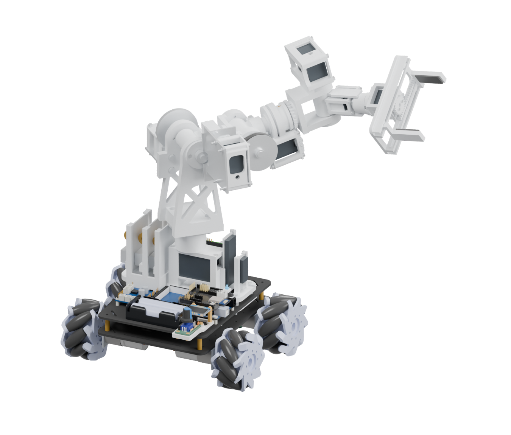
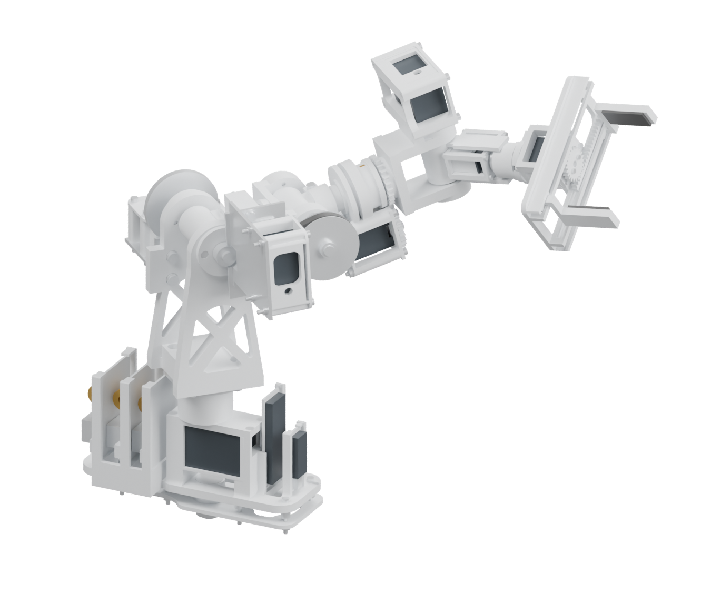

# AutoFinalRobo2 · Primer borrador del informe técnico

Manipulador antropomorfo de seis ejes sobre plataforma móvil Mecanum. Integración mecánica, modelos matemáticos, electrónica y software.

Revisión documental D1 · 9 de noviembre de 2026. Autor de esta documentación: Koba Chajchir. Institución, asignatura, docentes e integrantes: por completar con los datos del equipo.



Este borrador se entrega separado del informe maestro. Reúne datos de los contratos, fuentes y CAD disponibles; propone el desarrollo matemático que corresponde a esa configuración. Los resultados históricos se identifican por fecha y método. No se ejecutaron ensayos, compilaciones, flasheos ni nuevos análisis de resistencia, colisión o estabilidad durante esta entrega.

# 1. Resumen, problema y alcance

El proyecto integra una base de cuatro ruedas Mecanum con un brazo de seis articulaciones rotacionales y una pinza de dos mandíbulas. La base aporta movilidad en el plano y el brazo permite orientar y posicionar la herramienta. El objetivo académico es explicar esa integración mediante geometría trazable, cinemática, medición, control y una arquitectura de comunicación común.

El problema técnico central consiste en transformar una consigna de desplazamiento o manipulación en movimientos coordinados, manteniendo explícitas las unidades, referencias espaciales y limitaciones del montaje. La movilidad amplía el alcance del brazo, pero también modifica la estabilidad del conjunto y exige distinguir el movimiento de la plataforma del movimiento relativo del manipulador.

El sistema incluye seis módulos bajo un único repositorio: firmware ATmega, firmware ESP8266, interfaz Web, contratos, CAD y cargador Windows. El informe cubre el robot como sistema; no presenta como terminadas las piezas que carecen de tolerancias de fabricación ni la integración física del bus de servos.

| Elemento | Estado que puede sostenerse con las fuentes |
| --- | --- |
| Geometría del brazo | Modelo nativo v17; documentación extraída de la copia F3D del 02/11/2026. |
| Nuevo libro mecánico | 66 definiciones fabricadas o adaptadas, con vistas, cotas nominales, interfaces y cortes documentales. |
| Matemática | Modelo analítico vinculado a dimensiones y referencias del descriptor Web; derivaciones del borrador, sin nueva comprobación numérica o física. |
| Software | Fuentes y contratos disponibles. La lectura del código no demuestra su comportamiento en la placa o en el navegador. |
| Resultados físicos | Se distinguen datos informados por el usuario, estimaciones CAD y ensayos todavía pendientes. |

## 1.1 Objetivo general y objetivos específicos

Desarrollar y documentar una plataforma móvil con capacidad de manipulación, relacionando el diseño mecánico con modelos matemáticos y una interfaz de operación reproducible.

Los objetivos específicos son describir las transformaciones de ambos robots; relacionar velocidades de ruedas con movimiento planar; convertir pulsos Hall en desplazamiento; derivar la cinemática directa e inversa del brazo; documentar transmisiones y piezas; explicar el sistema de control y comunicación; y formular criterios medibles para la futura puesta en marcha.

## 1.2 Criterio de evidencia

En todo el texto se usan cuatro niveles: dato nominal de fuente, geometría CAD, implementación en código y comportamiento físico medido. Un valor del modelo no reemplaza una medición. Una captura de la Web representa una visualización; una animación de ensamble no demuestra que el mecanismo pueda montarse o trabajar bajo carga.

# 2. Requisitos y arquitectura del sistema

| Requisito | Traducción técnica | Estado documental |
| --- | --- | --- |
| Moverse en el plano | Tres velocidades de cuerpo: avance, lateral y giro; cuatro ruedas accionadas. | Mezcla Mecanum y signos definidos en contratos. |
| Manipular un objeto | Seis ejes del brazo y accionamiento auxiliar de pinza. | Geometría v17 y límites CAD; operación física completa pendiente. |
| Observar el entorno | Sensores de línea, ultrasonido con barrido y telemetría. | Pinout y fuentes disponibles; caracterización metrológica pendiente. |
| Operar localmente | OLED y encoder con navegación consistente. | Contrato de interacción común a firmware y Web. |
| Operar y diagnosticar a distancia | ESP8266, Web y protocolo con estados y errores. | Arquitectura implementada en fuentes; no se infiere disponibilidad de un despliegue. |
| Documentar y reproducir | CAD editable, BOM, láminas, contratos y herramientas propias. | Este borrador y el nuevo libro amplían esa cobertura. |

El ATmega concentra la interacción con motores y sensores de la plataforma. El ESP8266 proporciona conectividad y transporte hacia la interfaz Web. Contracts mantiene las definiciones compartidas, las unidades y el catálogo de comandos. El Loader es una aplicación C# independiente para las tareas de mantenimiento autorizadas. El CAD contiene la representación mecánica y sus insumos.

La cadena de operación se describe como operador → Web/OLED → comando con parámetros y estado → comunicación ESP↔ATmega → actuadores, con retorno por telemetría. Las funciones del brazo deben respetar el bus TTL serie de los servos seleccionados. Las placas Nano/PCA9685 presentes en representaciones CAD anteriores son referencias de ocupación y no prueban una electrónica válida para servos STS.

## 2.1 Restricciones de diseño

Se conserva la pinza V7 y la revisión v17 de PVC25/20. Se evita atribuir al robot la geometría histórica de PVC32 o longitudes de brazo de versiones anteriores. Los valores de masa obtenidos por volumen y densidad son estimaciones. Las superficies de dientes representadas por discos de paso no se consideran perfiles de engranajes fabricables.

# 3. Configuración mecánica v17



| Magnitud | Valor nominal | Interpretación |
| --- | --- | --- |
| Hombro–codo | 70 mm | Eslabón geométrico L1. |
| Codo–eje J4 | 60 mm | Primer tramo distal al codo. |
| J4–J5 | 55 mm | Separación longitudinal hasta el centro de muñeca. |
| J5–J6 | 65 mm | Tramo sobre el eje distal; interviene en el offset del TCP. |
| J6–TCP | 78,5 mm | Distancia de la herramienta definida en el descriptor. |
| PVC del brazo | Ø25 × 1,2 mm | Interior nominal 22,6 mm. |
| PVC del antebrazo | Ø20 × 1 mm | Interior nominal 18 mm. |
| Cortes de tubos | 42 mm y 28,5 mm | Longitudes de pieza; no confundir con distancia entre ejes. |
| Accionamientos | 5 STS3250 + 2 STS3032 A0 | J1–J5; J6 y pinza respectivamente. |

Los parámetros antiguos pvc_od32 y otros nombres heredados permanecen en el documento nativo. La interpretación de la configuración vigente se realiza a partir de los sólidos, las interfaces y el descriptor v17, no solamente por el nombre de un parámetro o del archivo.

| Conjunto | Función principal |
| --- | --- |
| A100 · Montura y control fijo | Une el brazo a la plataforma y reserva los componentes de control. |
| A200 · Base y hombro | J1 y transmisión de J2 mediante engranajes 18/72. |
| A300 · Brazo | Primer eslabón y accionamiento remoto de J3 por correa. |
| A400 · Antebrazo y J4 | Segundo eslabón y giro de muñeca. |
| A500 · J5 y soporte J6 | Inclinación de muñeca y alojamiento del eje distal. |
| A600 · Herramienta | Giro J6, piñón y dos mandíbulas de la pinza V7. |

El accionamiento de J3 está montado sobre el eslabón anterior y acompaña a J2. La correa no atraviesa la articulación J4. Esta ubicación afecta la masa transportada por el hombro y debe respetarse al construir un modelo dinámico.

# 4. Documentación técnica producida y alcance de fabricación

El libro inicial del 02/11 contenía 14 láminas A3, concentradas en vistas generales, J5/J6, cuatro despieces y seis piezas individuales. El nuevo libro complementario documenta las 66 definiciones fabricadas o adaptadas identificadas en la misma geometría, incluidas las 30 definiciones de piezas impresas. Las cantidades de montaje se conservan separadas del número de definiciones.

Cada definición recibe proyecciones ortogonales, cotas exteriores extraídas del BRep, representación sólida y corte de referencia. Las hojas de interfaces agrupan superficies cilíndricas coaxiales para informar ejes, diámetros y longitudes de los tramos. El origen local de acotación se identifica en cada plano. No se cuentan caras cilíndricas como si cada una fuese un agujero independiente.

Los seis conjuntos incluyen listas por ocurrencia y despieces parciales numerados. Las separaciones son documentales: conservan la orientación relativa, pero no se presentan como una secuencia de desmontaje comprobada. Las referencias comerciales siguen identificadas como tales.

| Información | Procedencia y límite |
| --- | --- |
| Cotas exteriores e interfaces cilíndricas | BRep de la copia nativa importada. Valores nominales en mm. |
| Aristas curvas | Discretización de aristas de 0,03 mm. |
| Siluetas y cortes | Malla derivada del CAD, tolerancia de superficie 0,12 mm; no es una tolerancia de fabricación. |
| Renders | Mismos sólidos CAD, sin reconstrucción por imagen. |
| Asociatividad | Proyecciones vectoriales reproducibles; no son hojas Drawing nativas asociativas de Fusion. |
| Tolerancias, roscas y ajustes | No se inventan a partir de diámetros aproximados. Requieren decisión de fabricación y componentes reales. |

## 4.1 Qué falta para liberar fabricación

Se deben definir el proceso y material efectivo de cada pieza, orientación y compensación de impresión, ajustes de rodamientos y ejes, tolerancias geométricas, referencias funcionales, roscas y longitudes de enganche, espesor mínimo, rebabas y acabado. Los taladros y ranuras libres requieren confirmar su función. En adaptaciones comerciales se debe trabajar sobre el modelo o pieza efectivamente comprada.

Los engranajes y poleas comerciales requieren referencia de compra o un perfil de diente fabricable, no la copia de un disco de paso. Las estrías de horns y uniones al servo necesitan el patrón real del fabricante. Esta entrega completa la cobertura documental nominal de las definiciones identificadas; no sustituye la liberación de planos de taller.

# 5. Convenciones, unidades y transformaciones homogéneas

Se usan metros, segundos y radianes en las ecuaciones de movimiento; los planos usan milímetros. En la base móvil, X apunta hacia adelante, Y a la izquierda y Z hacia arriba. El giro positivo alrededor de Z es antihorario visto desde arriba. En la captura CAD, X es transversal, Y hacia adelante y Z hacia arriba; por eso la conversión entre ambas referencias se declara explícitamente.

Transformación de A a B, que lleva coordenadas expresadas en B al marco A:

```text
[ r11 | r12 | r13 | px ]
[ r21 | r22 | r23 | py ]
[ r31 | r32 | r33 | pz ]
[ 0 | 0 | 0 | 1 ]
```

```text
p_A = R_AB p_B + t_AB ;   T_AC = T_AB T_BC
```

```text
T_AB⁻¹ = [R_ABᵀ, −R_ABᵀ t_AB; 0, 1]
```

Una columna de R indica la dirección de un eje local expresado en el marco anterior. El orden de las transformaciones importa: girar y luego trasladar en ejes locales puede producir un resultado distinto de trasladar en ejes fijos. El cuaternión del descriptor se interpreta como (x, y, z, w).

Rotación elemental alrededor de Z:

```text
[ cos θ | −sin θ | 0 ]
[ sin θ | cos θ | 0 ]
[ 0 | 0 | 1 ]
```

Rotación elemental alrededor de Y:

```text
[ cos θ | 0 | sin θ ]
[ 0 | 1 | 0 ]
[ −sin θ | 0 | cos θ ]
```

## 5.1 Transformaciones de montaje usadas en la visualización

| Transformación | Traslación [m] | Cuaternión (x,y,z,w) |
| --- | --- | --- |
| Montura del brazo en robot | (0,027819; 0; 0,079041) | (0; 0; −0,70710678; 0,70710678) |
| Conversión CAD al robot | (0,041819; 0; 0,079041) | (0; 0; −0,70710678; 0,70710678) |
| Montura en escena individual | (0; 0; 0,018) | (0; 0; 0; 1) |

La rotación de presentación renderBasis (−0,5; 0,5; 0,5; 0,5) pertenece al visor. No debe aplicarse de nuevo a magnitudes físicas si la conversión CAD→robot ya fue realizada. Las traslaciones de montura y de conversión cumplen funciones distintas; no se suman como dos desplazamientos físicos del mismo origen.

# 6. Modelo cinemático del brazo: cadena y parámetros

Se definen q1…q6 como los ángulos geométricos del descriptor v17, con signo positivo y offset cero en ese archivo. Se fija h = 0,096 + 0,113 = 0,209 m; L1 = 0,070 m; L2 = 0,060 + 0,055 = 0,115 m; d = 0,065 + 0,0785 = 0,1435 m. La agrupación es válida porque los tramos agrupados son colineales y las rotaciones intermedias correspondientes no alteran ese eje de traslación.

```text
T_montura,TCP = Tz(h) Rz(q1) Ry(q2) Tz(L1) Ry(q3) Tz(L2) Rz(q4) Ry(q5) Rz(q6) Tz(d)
```

Esta expresión desarrolla la cadena del descriptor. La distancia física codo–J4 sigue siendo 60 mm: el valor L2 = 115 mm corresponde al modelo equivalente hasta el centro de muñeca, no a un tubo de 115 mm. De forma análoga, d agrupa el tramo distal y el TCP porque la rotación J6 no cambia una traslación sobre su propio eje.

El uso de marcos y productos ordenados de movimientos rígidos sigue la formulación general de cinemática de robots. La cadena particular y la tabla equivalente de esta sección se derivan de los datos propios de AutoFinalRobo2; no se toman como dimensiones de un ejemplo bibliográfico. [R2]

## 6.1 Tabla Denavit–Hartenberg equivalente

Para una exposición académica con DH estándar se propone la tabla siguiente, usando A_i = Rz(θ_i) Tz(d_i) Tx(a_i) Rx(α_i). Son marcos elegidos para esta derivación; θ_i no equivale a la lectura bruta de servo ni a un límite de articulación sin aplicar los offsets de la tabla. No es una tabla exportada por Fusion.

| i | θ_i | d_i [m] | a_i [m] | α_i |
| --- | --- | --- | --- | --- |
| 1 | q1 | 0,209 | 0 | π/2 |
| 2 | π/2 − q2 | 0 | 0,070 | 0 |
| 3 | π/2 − q3 | 0 | 0 | π/2 |
| 4 | q4 − π | 0,115 | 0 | −π/2 |
| 5 | q5 | 0 | 0 | π/2 |
| 6 | q6 | 0,1435 | 0 | 0 |

Matriz DH estándar de una articulación:

```text
[ cθ | −sθ cα | sθ sα | a cθ ]
[ sθ | cθ cα | −cθ sα | a sθ ]
[ 0 | sα | cα | d ]
[ 0 | 0 | 0 | 1 ]
```

c y s abrevian coseno y seno. La cadena completa resulta del producto ordenado A1…A6. La formulación por transformaciones explícitas se mantiene como referencia de lectura porque muestra directamente los ejes Z–Y–Y–Z–Y–Z empleados en el descriptor.

# 7. Cinemática directa: posición y orientación del TCP

El centro de muñeca W es el punto hasta el cual llegan L1 y L2. Sea β = q2 + q3 y e_z = (0,0,1). La orientación previa a la muñeca es R_pre = Rz(q1) Ry(β). La orientación final incorpora los tres ejes distales.

```text
ρ = L1 sin(q2) + L2 sin(q2 + q3)
```

```text
z_W = h + L1 cos(q2) + L2 cos(q2 + q3)
```

Centro de muñeca expresado en la montura:

```text
[ ρ cos(q1) ]
[ ρ sin(q1) ]
[ z_W ]
```

```text
R = Rz(q1) Ry(q2 + q3) Rz(q4) Ry(q5) Rz(q6)
```

```text
p_TCP = p_W + d R e_z
```

Las dos expresiones determinan la pose completa. Para obtener la pose respecto de la plataforma se antepone la transformación fija de montaje. Para expresarla en un mapa o referencia mundial se antepone además la pose planar estimada del autito.

```text
T_mundo,TCP = T_mundo,base T_base,montura T_montura,TCP(q)
```

## 7.1 Pose de transporte y límites

| Eje | Rango geométrico documentado |
| --- | --- |
| J1 | −90° a +90° |
| J2 | −10° a +125° |
| J3, J4, J5, J6 | −90° a +90° |
| Pinza auxiliar | Accionamiento separado; referencia geométrica heredada de 0° a 180°. |

La pose de transporte del descriptor es [0°, 15°, −40°, 0°, 25°, 0°]. Los límites son datos del modelo y no garantizan ausencia de colisiones, límites de cableado o funcionamiento bajo carga. El documento nativo conserva relaciones de movimiento, pero eso no demuestra un barrido continuo libre de interferencias.

Una comprobación posterior deberá comparar poses conocidas entre la ecuación, el descriptor Web y mediciones del mecanismo. No se presentan errores RMS ni precisiones del TCP porque no se realizaron esas mediciones.

# 8. Cinemática inversa y selección de soluciones

Para una pose deseada (p_d, R_d), primero se resta el offset de herramienta y se obtiene el centro de muñeca. Esto desacopla idealmente posición y orientación en el modelo de ejes de muñeca concurrentes. El desacople no elimina los límites físicos ni las colisiones.

```text
p_W,d = p_d − d R_d e_z
```

```text
q1 = atan2(y_W, x_W) ;   ρ = √(x_W² + y_W²) ;   s = z_W − h
```

```text
c3 = (ρ² + s² − L1² − L2²) / (2 L1 L2)
```

```text
q3 = ± acos(c3)
```

```text
q2 = atan2(ρ, s) − atan2(L2 sin(q3), L1 + L2 cos(q3))
```

Debe cumplirse |c3| ≤ 1 dentro de la tolerancia numérica elegida. Las dos ramas representan configuraciones de codo diferentes. Si se admite un alcance radial firmado, también debe contemplarse la rama asociada al giro alternativo de base; la solución debe evaluarse con los límites reales y continuidad respecto de la pose actual.

```text
R_W = [Rz(q1) Ry(q2 + q3)]ᵀ R_d = Rz(q4) Ry(q5) Rz(q6)
```

Para una rama Z–Y–Z no singular con 0 < q5 < π y elementos r_ij de R_W:

```text
q5 = atan2(√(r13² + r23²), r33)
```

```text
q4 = atan2(r23, r13) ;   q6 = atan2(r32, −r31)
```

La rama equivalente (q4 + π, −q5, q6 + π) permite buscar soluciones compatibles con el rango documentado de q5. Si sin(q5) = 0, q4 y q6 no se determinan por separado: debe elegirse una continuidad o criterio adicional. El conjunto de candidatos se filtra por límites, autocolisión, entorno, estabilidad y variación mínima entre consignas.

## 8.1 Alcance de la implementación disponible

La implementación Web consultada resuelve un problema restringido de herramienta orientada hacia abajo con J4 y J6 fijados. No se declara implementado un solucionador numérico general de seis grados de libertad. Las ecuaciones de esta sección son el desarrollo propuesto para el informe y una base para una implementación posterior expresamente autorizada.

Conviene reemplazar comentarios históricos con dimensiones 130/120 por una referencia al descriptor: el descriptor vigente tiene tramos de 70/60 mm y los agrupamientos equivalentes explicados antes. En esta entrega se registra la discrepancia sin modificar código.

# 9. Jacobiano, singularidades y propagación de errores

Para una articulación revoluta i, se expresa en un marco común el eje unitario z_i y un punto o_i de dicho eje. La columna lineal del Jacobiano es el producto vectorial del eje por el vector hasta el TCP; la columna angular es el propio eje. Esta forma admite los ejes Y del modelo al usar su dirección real transformada, sin asumir que todos coinciden con el Z global.

Columna del Jacobiano geométrico:

```text
[ z_i × (p_TCP − o_i) ]
[ z_i ]
```

```text
[v_TCP ; ω_TCP] = J(q) dq/dt
```

```text
τ = J(q)ᵀ [F_TCP ; M_TCP]
```

La segunda ecuación vincula una fuerza y momento externos con pares articulares cuasiestáticos mediante trabajo virtual. Las unidades son N, N·m y radianes. No incluye por sí sola gravedad de eslabones, rozamiento ni inercia.

## 9.1 Singularidades relevantes

En el subproblema de posición, sin(q3) = 0 corresponde a eslabones alineados y pérdida de capacidad en una dirección. Cuando ρ = 0, la posición no fija el ángulo de base de forma única. En la muñeca Z–Y–Z, sin(q5) = 0 hace coincidir las direcciones de los giros primero y tercero. Cerca de estas situaciones pueden crecer las velocidades articulares requeridas para una pequeña velocidad cartesiana.

```text
dq/dt = Jᵀ (J Jᵀ + λ² I)⁻¹ v_d
```

La pseudoinversa amortiguada es una opción de control futuro; λ debe justificarse por precisión, límites de velocidad y cercanía a singularidades. No se afirma que esa ley esté implementada en el robot.

## 9.2 Incertidumbre de posición

```text
δp ≈ J_v δq + J_l δl ;   Σ_p ≈ J_v Σ_q J_vᵀ + J_l Σ_l J_lᵀ
```

δl reúne errores de longitudes, montaje y TCP. La resolución angular del servo no equivale al error del efector: holguras de engranajes, flexión, juego de rodamientos e impresión 3D también contribuyen. Antes de publicar una precisión se deben medir puntos de referencia y separar repetibilidad de exactitud.

# 10. Transmisiones, actuadores y pinza

| Eje | Transmisión nominal | Relación motor/salida |
| --- | --- | --- |
| J1 | Directa | 1 |
| J2 | Piñón 18 / rueda 72, módulo 0,8 | 4 |
| J3 | Correa HP3M 210 × 6; poleas 20/50 | 2,5 |
| J4 | Engranajes 24/24 | 1 |
| J5 y J6 | Directa | 1 |

```text
i = ω_motor / ω_salida ;   |ω_salida| = |ω_motor| / i ;   |τ_salida| = η i |τ_motor|
```

η es la eficiencia efectiva. Un engrane exterior cambia el sentido relativo; una correa abierta normalmente lo conserva. El signo definitivo de cada articulación requiere el cero mecánico, el montaje del motor y el sentido del controlador. No se sustituyen esos signos por el cociente de dientes.

La hoja del STS3250 informa, a 12 V, un par nominal de 16 kgf·cm y un par de bloqueo de 50 kgf·cm. La conversión es 1 kgf·cm = 0,0980665 N·m. El par de bloqueo no es un punto de operación continua. La selección debe comparar el par exigido con el nominal y el ciclo de trabajo, temperatura, velocidad y tensión efectiva. [R3]

## 10.1 Apertura de pinza

La pinza V7 conserva dos cremalleras con un piñón de 24 dientes, módulo 1 y radio primitivo de 12 mm. El intervalo geométrico documentado de apertura es aproximadamente 4,007 a 79,405 mm. La referencia de servo 109,8° para contacto sobre 50 mm procede de la parametrización geométrica heredada; no demuestra la conversión de consignas del bus STS.

```text
g(θ) = g0 + 2 r_p θ ;   dg/dt = 2 r_p dθ/dt
```

```text
F_mandíbula ≈ η τ_piñón / (2 r_p)
```

θ representa el giro respecto de una referencia elegida y se expresa en radianes. La relación de fuerza supone dos cremalleras simétricas con la misma carga. El coeficiente de fricción en las almohadillas, rigidez y par continuo disponible determinan la retención del objeto; no se atribuye una carga máxima a partir de la apertura o del par de bloqueo.

# 11. Cinemática del autito con ruedas Mecanum

La base se modela como un sólido rígido planar con velocidad de cuerpo V = (v_x, v_y, ω). Se adopta la disposición de rodillos que corresponde al mezclador del proyecto y el orden lógico de ruedas FL, FR, RL, RR. El radio nominal es r = 0,040 m y la suma de semidistancias geométricas es L = 0,170 m. [R1, S3]

Mezclador geométrico canónico A:

```text
[ 1 | −1 | −L ]
[ 1 | 1 | L ]
[ 1 | 1 | −L ]
[ 1 | −1 | L ]
```

```text
u = A S V ;   ω_ruedas = u / r
```

Corrección de sentidos vigente en motion_reference.json:

```text
[ −1 | 0 | 0 ]
[ 0 | −1 | 0 ]
[ 0 | 0 | −1 ]
```

S = diag(s_f, s_l, s_ω) y en el contrato consultado los tres signos valen −1. Es una convención del proyecto basada en sentidos informados por el usuario; el archivo mantiene physicalVerification:false. Es indispensable aplicarla tanto en mezcla como en reconstrucción. u es velocidad periférica en la base de signos del contrato, no ángulo ni PWM.

Inversa geométrica A⁺:

```text
[ 1/4 | 1/4 | 1/4 | 1/4 ]
[ −1/4 | 1/4 | 1/4 | −1/4 ]
[ −1/(4L) | 1/(4L) | −1/(4L) | 1/(4L) ]
```

```text
V = S⁻¹ A⁺ u = S A⁺ u
```

Los signos de calibración de cada encoder y de cada puente H deben llevar la medición a la misma base antes de aplicar la inversa. No se introduce una segunda inversión por conveniencia visual. La matriz es válida para la disposición de ruedas definida; invertir la orientación física de los rodillos cambia el modelo.

## 11.1 Límites de velocidad

```text
γ = max(1, max_i |u_i| / u_max) ;   u_aplicada = u / γ
```

El escalado uniforme conserva la proporción entre avance, lateral y giro. La limitación independiente de cada rueda puede alterar la dirección solicitada. El valor de configuración de 150 mm/s es una consigna nominal de software, no una velocidad máxima física caracterizada.

# 12. Encoders, odometría y estimación de pose

La configuración actual parte de 370 cuentas por vuelta por rueda, informadas por el usuario, con decodificación x1: flanco ascendente de A y lectura de B para el sentido. No se multiplican nuevamente esas cuentas por cuatro ni se reemplazan por hipótesis antiguas de 1320 o 3300. El diámetro nominal de rueda es 80 mm. [S4]

```text
Δφ_i = 2π Δn_i / N_i ;   Δs_i = r_i Δφ_i ;   u_i ≈ Δs_i / Δt
```

```text
Resolución lineal nominal = π D / N ≈ 0,679 mm/cuenta, para D = 80 mm y N = 370
```

Ese valor es una cuantización nominal. Deslizamiento Mecanum, tolerancia del diámetro efectivo, carga y piso pueden dominar el error. El orden físico de conectores y máscaras de encoder debe convertirse al orden lógico FL,FR,RL,RR; no se aplica directamente el índice de un conector a una fila del Jacobiano.

Paso de velocidad del cuerpo al marco mundial:

```text
[ dx/dt ]
[ dy/dt ]
[ dψ/dt ]
```

```text
dx/dt = cos(ψ) v_x − sin(ψ) v_y
```

```text
dy/dt = sin(ψ) v_x + cos(ψ) v_y ;   dψ/dt = ω
```

## 12.1 Integración temporal propuesta

```text
ψ_m = ψ_k + ω Δt/2
```

```text
x_(k+1) = x_k + [cos(ψ_m) v_x − sin(ψ_m) v_y] Δt
```

```text
y_(k+1) = y_k + [sin(ψ_m) v_x + cos(ψ_m) v_y] Δt ;   ψ_(k+1) = ψ_k + ω Δt
```

Se propone la orientación de punto medio para reducir el error de integración respecto de usar únicamente el ángulo inicial. Deben preservarse el tiempo real de muestreo y la detección de muestras inválidas. Una odometría sin referencia externa acumula deriva; no equivale a localización absoluta ni demuestra precisión de navegación.

## 12.2 Calibración posterior

Conviene medir una trayectoria recta, una lateral y un giro conocido para estimar diámetro efectivo por rueda y L efectivo. El conjunto de datos debe guardar cuentas crudas, tiempos, consignas y referencia externa. Las covarianzas y errores se calcularán con esas mediciones, no con la apariencia del recorrido en el visor.

# 13. Control, trayectorias y estados

La relación cinemática genera consignas de rueda; el PWM es una acción eléctrica y no una medida de velocidad. Una eventual regulación por rueda debe comparar la velocidad estimada por Hall con la consigna. La existencia de encoders cableados o de una fórmula de PI en el informe no prueba que el lazo esté ajustado en hardware.

```text
e_i(k) = u_ref,i(k) − u_med,i(k)
```

```text
a_i(k) = sat[Kp e_i(k) + I_i(k) + a_ff,i(k)]
```

```text
I_i(k+1) = I_i(k) + Ki Δt e_i(k), con antiwindup cuando la salida satura
```

La compensación de zona muerta, inversión de sentido y frenado requiere caracterización por rueda. Si faltan pulsos o envejece la telemetría se debe informar la condición; no reemplazarla por una velocidad cero confiable. El informe final deberá identificar los estados efectivos de control en firmware y separar las propuestas de mejora.

## 13.1 Interpolación de articulaciones

```text
q(t) = q0 + (qf − q0) [10σ³ − 15σ⁴ + 6σ⁵] ;   σ = t/T
```

El polinomio quíntico permite velocidad y aceleración nulas en los extremos. La duración T debe elegirse respetando velocidad y aceleración máximas de todos los ejes, carga y estabilidad. La interpolación independiente de ángulos no produce necesariamente una línea recta del TCP; una trayectoria cartesiana requiere resolver la cinemática inversa a lo largo del recorrido.

## 13.2 Estados y autorización de movimiento

La operación debe distinguir reposo, movimiento, parada, error y mantenimiento. Las consignas deben tener unidades, vigencia y confirmación de estado. Los cambios pendientes de interfaz requieren confirmación Sí/No. En la OLED, el corto desde dashboard abre el menú completo; el largo, al soltar con duración ≥800 ms, abre controles rápidos desde dashboard y retorna al contexto anterior desde el resto, sin omitir esa confirmación.

# 14. Modelo integrado: plataforma y manipulador móvil

La configuración general incluye la pose planar (x,y,ψ), los seis ángulos del brazo y el accionamiento auxiliar de pinza. Una rueda pasiva o la articulación de pinza no se suma como un nuevo grado de libertad de pose del TCP. El desplazamiento del autito modifica a la vez la posición y la orientación mundial de la herramienta.

```text
Q = (x, y, ψ, q1, q2, q3, q4, q5, q6)
```

```text
T_W,TCP(Q) = T_W,B(x,y,ψ) T_B,M T_M,TCP(q)
```

Transformación planar de la base:

```text
[ cos ψ | −sin ψ | 0 | x ]
[ sin ψ | cos ψ | 0 | y ]
[ 0 | 0 | 1 | 0 ]
[ 0 | 0 | 0 | 1 ]
```

Para una herramienta situada en p = (p_x,p_y,p_z) respecto de la base y velocidades de cuerpo, la contribución de la base a la velocidad lineal es (v_x − ω p_y, v_y + ω p_x, 0). La contribución angular es (0,0,ω). Ambas se rotan al marco de expresión elegido.

```text
V_TCP = J_base(Q) V_base + J_brazo(Q) dq/dt
```

Esta redundancia permite repartir una tarea entre base y brazo, pero una solución que minimiza velocidad articular puede acercar el centro de masa al borde de apoyo. Un planificador futuro debería combinar alcance, estabilidad, obstáculos, singularidades y postura de transporte. No se declara implementado ese planificador ni una coordinación física simultánea de los nueve grados de libertad.

## 14.1 Uso en una secuencia de recogida

Una secuencia justificable es aproximación de la base, detención y confirmación de estado, posicionamiento del brazo, cierre de pinza con criterio de contacto, retorno a transporte y continuación. La proximidad por ultrasonido no garantiza por sí sola que el objeto esté en la apertura de la pinza. Deben definirse el tamaño de objeto, superficie de contacto y criterio de agarre antes de evaluar éxito de recogida.

# 15. Gravedad, dinámica y estabilidad: resultados disponibles

Para masa m_i y centro r_i en el mismo marco, el centro de masa global es el promedio ponderado. El peso debe proyectarse con la gravedad y las orientaciones reales de cada pieza. Las densidades CAD no describen automáticamente el relleno, paredes, tornillería faltante o cables de una impresión real.

```text
r_G = (Σ_i m_i r_i) / (Σ_i m_i)
```

```text
τ_g = Σ_i J_v,i(q)ᵀ m_i g ;   g = (0,0,−9,80665) m/s²
```

La expresión es el par de fuerzas gravitatorias según la convención del Jacobiano; el actuador debe ejercer el par opuesto para sostener el equilibrio. En dinámica completa se agregan inercia, Coriolis y rozamiento:

```text
M(q) d²q/dt² + C(q,dq/dt) dq/dt + g_q(q) + τ_f = τ_act + Jᵀ F_ext
```

M es simétrica definida positiva para un mecanismo no degenerado. No se dispone aquí de una identificación dinámica ni de una caracterización del rozamiento, por lo que la ecuación expresa la estructura del modelo y no resultados medidos.

## 15.1 Análisis histórico del 01/11/2026

| Resultado histórico | Valor / significado |
| --- | --- |
| Masa estimada de brazo, montura y control | 2,34499 kg a partir de volúmenes y densidades CAD. |
| Hipótesis de masa del autito y carga | 1,5 kg y 0,2 kg respectivamente; total de referencia 4,04499 kg. |
| Apoyo de referencia | Rectángulo nominal 214 × 124 mm; no sustituye el contacto real de ruedas. |
| Pose extendida hacia adelante | Margen proyectado al borde ≈0,85 mm; factor estático 1,023. |
| Criterio usado en ese análisis | Factor requerido 1,2: la pose anterior no lo satisface. |
| Barrido de ese informe | 43.798 configuraciones muestreadas; no una prueba continua de todo el espacio. |
| Márgenes de actuadores en una pose | J2 2,58; J3 2,63; J4 19,91; J5 3,51 según hipótesis del análisis. |

Estos números proceden del informe histórico conservado en analisis_conjunto_20261101/INFORME.md. No se recalcularon en esta entrega. El resultado frontal impide describir el conjunto como estable en todo el alcance. Un margen de par favorable tampoco corrige un riesgo de vuelco.

## 15.2 Modelo de vuelco y marcha

```text
M_estabilizante − M_volcante > 0 ;   FS = M_estabilizante / M_volcante
```

La proyección del centro de masa debe permanecer dentro del polígono de apoyo con margen. En aceleración, el centro de presión y las fuerzas inerciales cambian respecto del caso estático. La fuerza aproximada de marcha F = M[a + g sin(α) + Crr g cos(α)] y el par de rueda τ ≈ Fr/4 solo sirven como estimación bajo reparto uniforme; el desplazamiento lateral Mecanum y el deslizamiento requieren ensayos específicos.

# 16. Electrónica, alimentación y responsabilidades

| Subsistema | Referencia disponible | Consideración del informe |
| --- | --- | --- |
| Control de plataforma | ATmega2560; fuentes AVR C / avr-libc | Sensores y motores según pinout y contratos. |
| Conectividad | ESP-12S/ESP8266 en el shield | Firmware propio; no se describe como un módulo AT. |
| Interfaz propia | OLED I2C D20/D21; encoder D2/D3 y pulsador D42 | Alimentación y niveles deben corresponder al módulo real; 5 V fue informado para el montaje. |
| Sensado de batería | A5; divisor 10 kΩ / 10 kΩ y capacitor 100 nF | Se debe caracterizar referencia ADC y tensión máxima admisible. |
| Ultrasonido y radar | D30/D31; servo de barrido D13 | Distancia y consigna angular son magnitudes distintas. |
| ESP↔ATmega | TX1 D18 / RX1 D19 | Respetar niveles eléctricos y catálogo de comandos. |
| Mantenimiento automático | KEY D32 y RESET D33 mediante NPN y resistencia 1 kΩ | Integración física de servicio pendiente según documentación. |
| Brazo | STS3250 a 12 V; STS3032 a 6 V; bus TTL serie | Diseño de potencia y bus debe corresponder a servos STS, no a PCA9685. |

```text
V_bat = ADC/(2^n − 1) · V_ref · (R_superior + R_inferior)/R_inferior
```

Con resistencias iguales, el factor de escala nominal es 2. Debe asegurarse que la entrada nunca supere el límite del microcontrolador. El capacitor atenúa ruido, pero no protege de sobretensión. La tensión medida no equivale directamente a porcentaje de carga sin una curva de batería y condiciones de corriente definidas.

El presupuesto eléctrico debe sumar consumo de control, motores y servos según simultaneidad, picos y caída de tensión. Se necesita decidir distribución de 12 V/6 V, masa común, protecciones, conectores, conductores y parada de potencia. Una BOM mecánica y la preselección de servos no resuelven ese diseño eléctrico.

# 17. Sensores: modelos y calidad del dato

## 17.1 Ultrasonido

```text
ρ = c Δt / 2 ;   c ≈ 331,3 + 0,606 T [m/s]
```

T se expresa en °C en la aproximación del aire. A 20 °C, c ≈343,4 m/s. La mitad corresponde al viaje de ida y vuelta. Si el temporizado se cuantiza a 25 μs, el incremento nominal de distancia es aproximadamente 4,29 mm. Ese incremento no es exactitud: inclinación, textura, ancho de haz, ecos múltiples y temperatura afectan la medida.

Una muestra inválida o vencida no se interpreta como camino libre. El paquete de radar debe distinguir validez, instante de adquisición, edad y consigna del servo. La posición comandada por PWM no constituye una lectura de ángulo real; holgura y tiempo de establecimiento afectan la ubicación del eco.

```text
x_obj = ρ cos(α) ;   y_obj = ρ sin(α)
```

La transformación debe incluir la posición real del sensor y su cero angular sobre el chasis. La nube polar mostrada en pantalla es una representación de medidas temporales; no se considera un mapa simultáneo perfecto del entorno.

## 17.2 Sensores de línea

```text
e_línea = (Σ_i w_i x_i) / (Σ_i w_i)
```

x_i es la posición transversal del sensor y w_i su evidencia de línea. Para señal analógica se requiere calibrar blanco/negro, polaridad y rango. En la configuración actual consultada line_kind = 1 corresponde a lectura digital y line_invert = 31; no debe describirse esa configuración como una matriz de mediciones ADC continuas solo porque el hardware dispone de pines analógicos.

Cuando Σw_i = 0 debe existir un estado de línea no detectada. El valor anterior, una búsqueda o una detención son decisiones de control que deben documentarse; no se asigna e = 0 como si la línea estuviera centrada. Para seguimiento PID debe informarse período de muestreo, saturación y criterio de pérdida.

# 18. Software, comunicaciones y trazabilidad

Contracts es la fuente compartida para unidades, signos, campos y catálogo del enlace. Una modificación de comandos ESP↔ATmega debe mantener wire_catalog.json, header, commands.json y catálogo de Protocol Studio. Un comando retirado conserva su ID y los datos con SSID o claves se identifican como sensibles. El informe no necesita reproducir claves ni configuraciones personales.

La Web utiliza React/Vite y ofrece visualización, control y exploración del sistema. El ESP8266 ejecuta firmware propio con almacenamiento LittleFS. El ATmega se desarrolla en C con avr-libc. El Loader mantiene sus fuentes C#, perfiles y manual por separado, con configuración y registros de usuario fuera del repositorio.

## 18.1 Contratos matemáticos

| Dato | Contrato necesario |
| --- | --- |
| Velocidad lineal | Unidad explícita; conversión mm/s↔m/s en una frontera identificada. |
| Ángulos y velocidad angular | Distinguir grados de visualización de radianes de ecuación y de unidad nativa de servo. |
| Ruedas | Orden FL,FR,RL,RR y signos de motion_reference.json. |
| Tiempo | Período real, edad de muestra y rechazo de datos inválidos. |
| Pose del brazo | Modelo/revisión, ceros, límites y referencia de montaje. |
| Error | No confundir desconectado, dato vencido, fuera de rango y valor cero. |

La versión del producto puede avanzar en otros trabajos mientras este borrador permanece fijo. Por eso los resultados se vinculan a rutas y revisiones de los insumos, no a una afirmación de que el firmware actual haya sido ejecutado. Esta entrega solo modifica documentación y no eleva la versión de ATmega, ESP o Web.

## 18.2 Registro mínimo para futuros ensayos

Cada sesión debería guardar identificación del modelo, versiones, calibraciones, tensión de batería, carga, superficie, consignas, medidas crudas, tiempos y causa de parada. Con esos datos podrán calcularse error de trayectoria, deriva de odometría, repetibilidad del TCP, tiempo de ciclo y tasa de agarre. La ausencia de una muestra no debe rellenarse con un resultado favorable.

# 19. Resultados y criterios pendientes de demostración

| Área | Resultado disponible | Evidencia que falta |
| --- | --- | --- |
| Mecánica | Geometría v17, conjuntos y documentación dimensional complementaria. | Ajustes liberados, piezas fabricadas y secuencia de montaje real. |
| Brazo | Cadena matemática y modelo de orientación derivados del descriptor. | Comparación numérica independiente y mediciones de poses en el prototipo. |
| Base | Matriz Mecanum, signos de contrato y 370 cuentas/vuelta informadas. | Calibración del radio efectivo, giro y deslizamiento por superficie. |
| Estabilidad | Análisis CAD histórico detecta margen frontal insuficiente. | Masas pesadas, contactos reales y envolvente operativa aprobada. |
| Control | Fuentes y arquitectura compartida. | Regulación y frenado caracterizados con carga y batería reales. |
| Sensores | Pinout y modelos de medición. | Error de distancia, ángulo, latencia y tasa de inválidos medidos. |
| Electrónica del brazo | Selección de servos y niveles nominales. | Integración del bus TTL y potencia bajo condiciones definidas. |

No se publican porcentajes de éxito, precisión, velocidad máxima, carga útil garantizada ni autonomía porque no existe en esta entrega una campaña de medidas que los respalde. El primer resultado del trabajo es una base documental y matemática consistente para preparar esas mediciones.

## 19.1 Plan de mediciones para una etapa posterior

Cuando el equipo lo autorice, se propone comenzar con identificación de ruedas y ejes a baja energía, medición de CPR y signos, calibración de diámetros y L, contraste de poses del brazo, registro de masas y centro de masa, verificación de interfaces mecánicas y pruebas de carga escalonadas. Cada ensayo debe tener hipótesis, instrumento, condiciones, repeticiones, criterio de aceptación y registro de incertidumbre. Este texto es un plan; no implica que se haya ejecutado.

# 20. Aportes propios y mejoras sobre el proyecto de referencia

BioLog se toma como referencia de organización y profundidad matemática, no como fuente de medidas de este robot. El informe propio debe presentar una línea coherente que conecte geometría real, transformación, actuación, medición y evidencia. Las figuras de otro proyecto no deben reutilizarse como si representaran piezas o resultados de AutoFinalRobo2.

| Mejora documental/metodológica | Implementación propuesta para este proyecto |
| --- | --- |
| Trazabilidad de cada número | Asociar dimensión, matriz y resultado a descriptor, plano, contrato o medida. |
| Dos robots en una sola cadena | Derivar la transformación mundial del TCP incluyendo base Mecanum y montura. |
| Convenciones consistentes | Aplicar explícitamente los signos del mezclador, encoder, CAD y visor. |
| Resultados con límites | Separar geometría, simulación, estimación y medición física en cada tabla. |
| Fabricación reproducible | Unir BOM, hojas por definición, ocurrencias y archivos editables. |
| Incertidumbre | Explicar cómo holgura, cuentas Hall y error de montaje afectan la tarea. |
| Estabilidad operativa | Usar margen al apoyo y postura de transporte como restricciones de planificación. |
| Diagnóstico transversal | Relacionar OLED, Web, telemetría, errores y herramientas de mantenimiento. |

## 20.1 Visuales que aportan al informe final

Se proponen láminas de marcos y ejes sobre la geometría real; cadena de transformaciones con colores por marco; comparación de ramas de cinemática inversa; vectores de rueda en avance, lateral y giro; recorrido real frente a odometría; error del TCP por pose; esquema de potencia y comunicación; y mapa de evidencias y pendientes.

Las burbujas o envolventes de trabajo lateral y superior quedan como pendiente ligado al aviso de diseño terminado que solicitó el usuario. Deben salir de geometría, límites, TCP y criterio de colisión declarados, con contorno alcanzable distinto del contorno operativo seguro. Esta entrega no ejecuta los prompts diferidos ni inventa radios de alcance para imitarlos.

Estas mejoras distinguen la propuesta del informe de referencia por la integración móvil, los contratos comunes y la correspondencia entre modelo matemático, piezas e implementación. Todavía deben materializarse y medirse los resultados físicos antes de considerarlas prestaciones demostradas.

# 21. Pendientes y decisiones para la siguiente revisión

| Prioridad | Decisión o dato requerido | Producto esperado |
| --- | --- | --- |
| P1 | Pesar autito, brazo, batería y carga objetivo. | Tabla de masas y estabilidad revisada con datos reales. |
| P1 | Elegir proceso, material y componentes comprados. | Planos de fabricación con ajustes y referencias aprobadas. |
| P1 | Definir alimentación, bus TTL y protección del brazo. | Esquema eléctrico, presupuesto de corriente y cableado. |
| P1 | Confirmar signos y CPR en condiciones controladas. | Calibración con registros, sin invertir arbitrariamente el visor. |
| P2 | Completar integración de cero y límites de servos. | Conversión trazable q geométrico↔consigna nativa. |
| P2 | Autorizar una campaña de mediciones. | Datos para error, repetibilidad, carga, deriva y autonomía. |
| P2 | Completar carátula y requisitos académicos. | Institución, equipo, docentes, cronograma y formato final. |
| P3 | Avisar que el diseño está listo para las envolventes. | Ejecutar en orden los prompts ya guardados y pendientes. |

El cierre del informe requerirá reemplazar los pendientes por decisiones y resultados, incorporar fotografías propias del montaje y redactar conclusiones apoyadas en los ensayos. Hasta entonces, esta revisión debe mantenerse identificada como borrador D1.

# 22. Conclusiones del primer borrador

AutoFinalRobo2 dispone de una base CAD y de software que permite formular una descripción conjunta de movilidad y manipulación. La geometría v17 permite desarrollar una cadena Z–Y–Y–Z–Y–Z, una solución analítica ideal de posición y orientación y un Jacobiano para relacionar velocidades, fuerzas e incertidumbre. La base Mecanum aporta tres velocidades de cuerpo cuya relación con las ruedas queda definida por una matriz y signos explícitos.

El nuevo libro extiende la documentación nominal a las piezas fabricadas o adaptadas identificadas y a los seis conjuntos del brazo. Ese avance no elimina las decisiones de ajustes, materiales y proceso. El análisis estático histórico muestra que la extensión frontal puede quedar por debajo del criterio de estabilidad utilizado, por lo que el alcance geométrico no debe presentarse como un alcance operativo seguro.

La etapa siguiente debe cerrar la fabricación y la integración eléctrica, después producir datos medidos. El valor de este primer informe es dejar identificadas las relaciones, fuentes y condiciones necesarias para que la futura conclusión del equipo sea verificable.

# 23. Fuentes y procedencia

| ID | Fuente | Uso |
| --- | --- | --- |
| S1 | BioLog_informe_v4.pdf, 87 páginas; aportado como referencia. | Estructura y repertorio matemático. No aporta dimensiones de AutoFinalRobo2. |
| S2 | AutoFinalRobo2-CAD/.../revision_v17/laminas_20261102/AFR2_Fuente_Laminas_20261102.f3d | Copia geométrica nativa usada en la documentación del 09/11. |
| S3 | Contracts/contracts/afr2_geometry.h y motion_reference.json | Radio/diámetro nominal, L y signos de movimiento. |
| S4 | Atmega/include/afr2_product.h; src/services/afr2_product.c | CPR y configuración nominal de rueda/sensores. |
| S5 | Web/src/features/collector/models/pvc25-v17-blanco.json | Cadena de articulaciones, marcos, TCP y límites. |
| S6 | Web/src/features/collector/armKinematics.ts; features/control/sequences/mecanumKinematics.ts; features/control/motionReference.ts | Alcance restringido de IK, mezclador, inversa y signos de contrato. |
| S7 | CAD/.../revision_v17/README.md; ALCANCE_VIGENTE.md; ENSAMBLES_Y_MOVIMIENTO.md; SELECCION_ACTUADORES.md; SELECCION_PVC.md | Configuración v17, transmisiones y materiales nominales. |
| S8 | CAD/.../revision_v17/analisis_conjunto_20261101/INFORME.md | Resultados históricos de masas, pares y estabilidad. |
| S9 | Contracts/hardware/INFORME_PINOUT_ROBOT_20261106.md y PINOUT.md | Electrónica de plataforma y añadidos propios. |
| S10 | Contracts/README.md; docs/VERSIONADO.md; contracts/wire_catalog.json | Arquitectura, trazabilidad y compatibilidad. |
| S11 | CAD/.../revision_v17/laminas_20261109/interfaces_nativas.json y vistas_completas.json | Extracción de 66 definiciones, 237 parámetros nativos y vistas reproducibles. |

R1. Lynch y Park, Modern Robotics, recurso oficial 13.2: robots móviles con ruedas omnidireccionales. https://modernrobotics.northwestern.edu/nu-gm-book-resource/13-2-omnidirectional-wheeled-mobile-robots-part-1-of-2/

R2. Lynch y Park, Modern Robotics, recurso oficial 4.1.1: producto de exponenciales y marcos cinemáticos. https://modernrobotics.northwestern.edu/nu-gm-book-resource/4-1-1-product-of-exponentials-formula-in-the-space-frame/

R3. FEETECH, ficha técnica oficial STS3250, tensiones y pares nominal/de bloqueo. https://www.feetechrc.com/Data/feetechrc/upload/file/20240120/6384135881578380868917773.pdf

Las fuentes locales se citan respecto de D:/ProyectoRobotica2. El identificador de linaje de la copia CAD es urn:adsk.wipprod:dm.lineage:EcPmilmLR5e65I7_wwDoSg; captura de geometría 02/11/2026 11:39:50 UTC. La extracción de interfaces del 09/11 reutiliza esa copia: no es una afirmación de que se haya capturado una geometría posterior.

# Apéndice A. Símbolos y conversiones

| Símbolo | Significado | Unidad |
| --- | --- | --- |
| q_i | Ángulo geométrico de articulación | rad |
| θ_i | Ángulo DH o referencia de pinza según contexto | rad |
| L1, L2, d, h | Longitudes del modelo equivalente | m |
| T_AB | Transformación de B a A | mixta: rotación y m |
| J | Jacobiano geométrico | según filas y coordenadas |
| v_x, v_y, ω | Velocidades de cuerpo de la base | m/s, m/s, rad/s |
| u_i | Velocidad periférica de rueda | m/s |
| N_i, Δn_i | Cuentas por vuelta y variación de cuentas | cuentas/vuelta, cuentas |
| m_i, r_G | Masa y centro de masa | kg, m |
| τ, F | Par y fuerza | N·m, N |
| Σ | Matriz de covarianza | producto de unidades de sus variables |

```text
1 mm = 10⁻³ m ;   1° = π/180 rad ;   1 rpm = 2π/60 rad/s ;   1 kgf·cm = 0,0980665 N·m
```

El símbolo ρ se utiliza para alcance radial del brazo y para distancia de ultrasonido en sus respectivos capítulos; no se mezclan ambas magnitudes en una misma ecuación. Las matrices y valores del borrador deben mantenerse con la convención declarada al integrar nuevas fuentes.

# Apéndice B. Entregables y continuidad

El informe se entrega en PDF para lectura, DOCX editable para el equipo y Markdown/JSON como fuentes de regeneración. Las figuras de portada y configuración provienen de los renders reales ya existentes. El libro técnico A3 se conserva en una carpeta nueva para no reemplazar los originales del 02/11.

Libro nuevo: AutoFinalRobo2-CAD/mecanica/brazo-antropomorfo/revision_v17/laminas_20261109/AFR2_Planos_Brazo_V17_Documentacion_Dimensional_A3.pdf. Su índice y los CSV de piezas, interfaces y conjuntos permiten ubicar las definiciones sin depender de una vista extensa que pueda aparecer cortada en el visor.

Prompts de envolventes guardados: AutoFinalRobo2-Contracts/docs/pendientes/espacio-trabajo-brazo/. Permanecen pendientes de la indicación del usuario. Los informes originales de Documentacion/ y el informe maestro no se sustituyen con este borrador.
