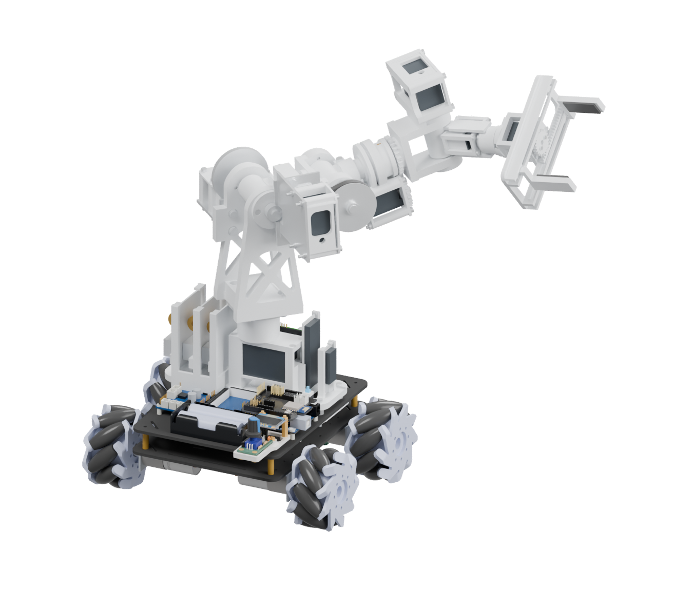
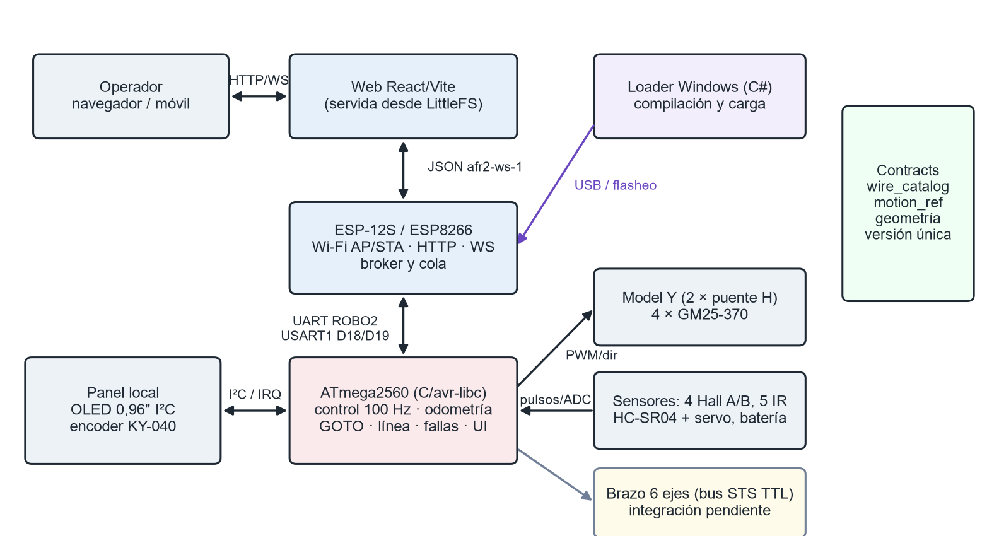
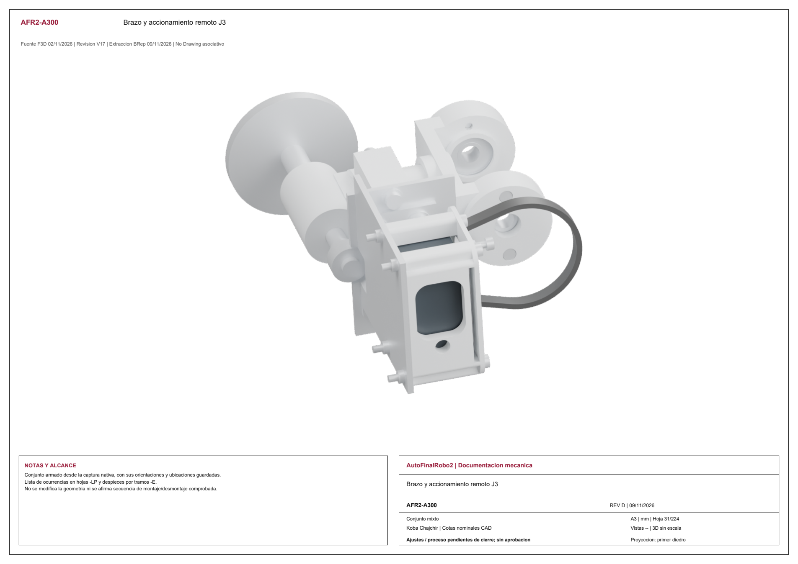
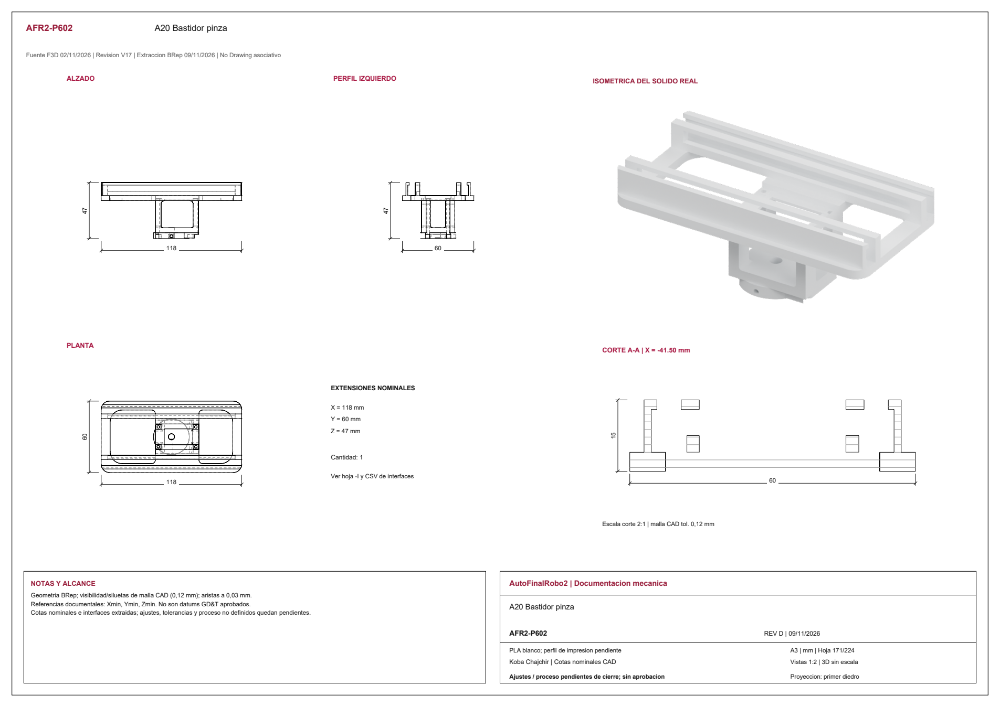
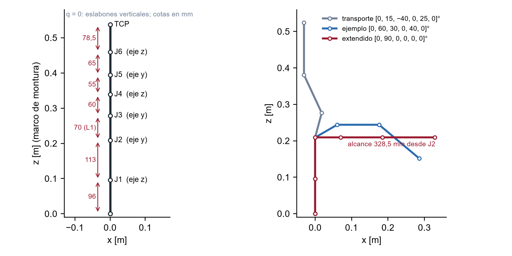
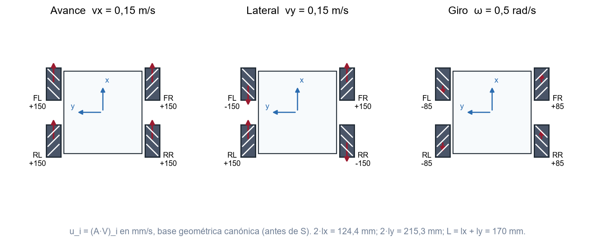
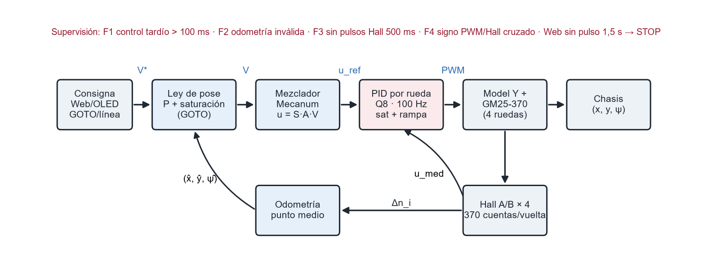
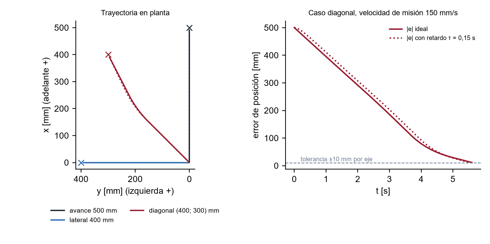

::: {custom-style="Portada Institucion"}
Ingeniería en Mecatrónica · Universidad Nacional de Entre Ríos
:::

::: {custom-style="Portada Datos"}
Robótica II · Ciclo lectivo 2026 · Trabajo integrador
:::

{width=28%}

::: {custom-style="Portada Titulo"}
AutoFinalRobo2
:::

::: {custom-style="Portada Subtitulo"}
Manipulador móvil para la recolección de piezas pequeñas: brazo antropomorfo de seis ejes sobre una plataforma omnidireccional Mecanum
:::

{width=62%}

::: {custom-style="Portada Datos"}
**Alumnos:** Koba Chajchir · [Completar integrantes]
:::

::: {custom-style="Portada Datos"}
**Docente:** [Completar] · Facultad de Ciencias de la Alimentación — UNER
:::

::: {custom-style="Portada Datos"}
Revisión documental D2 · 10 de noviembre de 2026 · Versión de producto del software 1.23.2
:::

```{=openxml}
<w:p><w:r><w:br w:type="page"/></w:r></w:p>
```

# Resumen {.unnumbered}

AutoFinalRobo2 es un manipulador móvil pensado para una tarea de recolección: buscar piezas cúbicas de 50 mm y hasta 200 g repartidas en el piso, tomarlas desde arriba con una pinza de dos mandíbulas y llevarlas a una zona de entrega circular. El trabajo parte del kit comercial **OSOYOO Mecanum 4WD**, cuya mecánica, motores y placas se conservan, y lo transforma en una plataforma propia: firmware nuevo para el ATmega2560, firmware nuevo para el ESP8266, interfaz Web servida por el propio robot, panel local con pantalla OLED y encoder, contratos compartidos entre los tres programas y un brazo antropomorfo de seis ejes diseñado para el chasis.

**Plataforma móvil.** Cuatro motorreductores GM25-370 con encoder Hall y ruedas Mecanum de 80 mm. Se modeló la cinemática omnidireccional con los signos medidos en el robot y una odometría con integración de punto medio sobre 370 cuentas por vuelta medidas en las ruedas. El firmware cierra un lazo PID por rueda cada 10 ms, un lazo de pose GOTO, un seguidor de línea de cinco sensores y una supervisión con cuatro códigos de falla.

**Brazo v17.** Seis articulaciones rotacionales (Z–Y–Y–Z–Y–Z) con muñeca de ejes concurrentes, cinco servos de bus FEETECH STS3250 y dos STS3032 (J6 y pinza), eslabones de PVC de 25 y 20 mm con encastres impresos en PLA, transmisión 18/72 en el hombro y correa 20/50 hacia el codo con el motor ubicado junto al hombro para bajar el par gravitatorio. Alcance de 328,5 mm desde el hombro. El CAD de Fusion 360 está documentado en un libro de **224 láminas A3** con 66 definiciones de piezas, seis conjuntos y listas de materiales.

**Modelos y resultados.** Se dedujeron la cinemática directa (tabla Denavit–Hartenberg equivalente), la inversa analítica por desacople de muñeca, el Jacobiano geométrico, la estática, la cinemática Mecanum y el modelo integrado de nueve grados de libertad. Una verificación numérica propia sobre 20 000 configuraciones confirma que la tabla DH reproduce exactamente la cadena del modelo usado por la Web (error 2·10⁻¹⁶ m) y que la inversa recupera la pose con error inferior a 2·10⁻¹⁵. La simulación de la ley GOTO del firmware sobre la cinemática ideal llega al objetivo en 4 a 6 s a 150 mm/s y se detiene dentro de la tolerancia de ±10 mm. El análisis estático del conjunto muestra que, con el brazo extendido hacia adelante, el factor de estabilidad al vuelco es 1,023: por debajo del 1,2 buscado. Ese resultado condiciona la postura de trabajo.

**Estado.** El software de la base, la interfaz y el protocolo están implementados y compilados en revisiones anteriores; la recolección completa funciona en el simulador Web. Faltan los ensayos físicos de la base, la fabricación del brazo y su integración eléctrica al bus de servos. [Agregar los resultados de los ensayos físicos cuando estén.]

**Palabras clave:** manipulador móvil, ruedas Mecanum, brazo antropomorfo, cinemática inversa, odometría, ATmega2560, ESP8266.

```{=openxml}
<w:p><w:r><w:br w:type="page"/></w:r></w:p>
```

::: {custom-style="Titulo Indice"}
Índice
:::

```{=openxml}
<w:p><w:r><w:fldChar w:fldCharType="begin" w:dirty="true"/></w:r><w:r><w:instrText xml:space="preserve"> TOC \o "1-2" \h \z \u </w:instrText></w:r><w:r><w:fldChar w:fldCharType="separate"/></w:r><w:r><w:t>Actualizar el índice (F9).</w:t></w:r><w:r><w:fldChar w:fldCharType="end"/></w:r></w:p>
```

::: {custom-style="Titulo Indice 2"}
Índice de figuras
:::

```{=openxml}
<w:p><w:r><w:fldChar w:fldCharType="begin" w:dirty="true"/></w:r><w:r><w:instrText xml:space="preserve"> TOC \h \z \t "Image Caption,1" </w:instrText></w:r><w:r><w:fldChar w:fldCharType="separate"/></w:r><w:r><w:t>Actualizar (F9).</w:t></w:r><w:r><w:fldChar w:fldCharType="end"/></w:r></w:p>
```

::: {custom-style="Titulo Indice 2"}
Índice de tablas
:::

```{=openxml}
<w:p><w:r><w:fldChar w:fldCharType="begin" w:dirty="true"/></w:r><w:r><w:instrText xml:space="preserve"> TOC \h \z \t "Table Caption,1" </w:instrText></w:r><w:r><w:fldChar w:fldCharType="separate"/></w:r><w:r><w:t>Actualizar (F9).</w:t></w:r><w:r><w:fldChar w:fldCharType="end"/></w:r></w:p>
```

```{=openxml}
<w:p><w:r><w:br w:type="page"/></w:r></w:p>
```

# 1. Aplicación y requisitos

## 1.1 Contexto y necesidad

En talleres, laboratorios y depósitos chicos hay tareas de orden que consisten en recoger objetos pequeños dispersos y llevarlos a un punto de acopio. Un brazo fijo no alcanza un área amplia y un vehículo sin brazo no puede tomar el objeto. La combinación de ambos, un **manipulador móvil**, resuelve las dos cosas, pero acopla los problemas: el error de posición de la base se transfiere a la toma del brazo y el peso del brazo extendido compromete la estabilidad de la base.

El objetivo del trabajo es diseñar, modelar y programar un manipulador móvil de bajo costo sobre un kit educativo existente, de manera que cada número del diseño (cotas, signos, relaciones de transmisión, cuentas de encoder) quede trazado a una fuente y que el mismo modelo matemático se use en el firmware, en la interfaz y en este informe.

::: {custom-style="Recuadro"}
**Operación propuesta**

**Qué:** piezas cúbicas de 50 mm de lado y hasta 200 g (cajas).

**Dónde:** un área de piso plano y libre de obstáculos fijos, con una zona de entrega circular de 240 mm de radio.

**Finalidad:** encontrar cada pieza, tomarla por arriba, llevarla a la zona de entrega, soltarla y repetir hasta que no queden piezas.

**Vínculo entre robots:** la base se detiene a una distancia frontal medida con el ultrasonido; el brazo usa esa distancia para calcular el punto de toma. El error de estacionamiento de la base es, por lo tanto, el dato de entrada del brazo.
:::

## 1.2 Secuencia de la operación

La secuencia está implementada en el simulador de recolección de la Web (cambio AFR2-20261110-05):

1. **Patrullar y escanear.** La base recorre puntos de patrulla. En cada parada el sensor ultrasónico, montado sobre un servo, barre 180° hacia adelante; si no detecta nada, la base gira 180° y barre hacia atrás.
2. **Acercarse.** Si la pieza está a más de 550 mm, la base se acerca hasta 400 mm, se detiene y vuelve a medir.
3. **Encarar y centrar.** La base se orienta hacia la cara de la pieza más cercana a su rumbo y corrige con desplazamiento lateral Mecanum hasta que la pieza queda a menos de 4 mm del eje frontal.
4. **Ajustar la distancia.** Con el eco frontal calcula el centro de la pieza: origen del sensor (103 mm) + distancia medida + media pieza (25 mm). Avanza o retrocede hasta que el centro queda en la ventana de toma del brazo.
5. **Tomar.** El brazo baja con la muñeca vertical, cierra la pinza sobre la parte superior de la pieza (TCP 20 mm sobre su centro), la eleva y se pliega a la postura de transporte.
6. **Transportar.** La base planifica una ruta libre hasta la zona de entrega (A* sobre una grilla de 100 mm con un margen de 10 mm alrededor de la base).
7. **Entregar.** El brazo coloca la pieza dentro del círculo, abre la pinza y vuelve a transporte. La entrega se cuenta solo si la pieza queda dentro del radio útil y entre 15 y 65 mm de altura.
8. **Repetir.** La base sale de la zona de entrega, vuelve a barrer y continúa la patrulla.

## 1.3 Pieza y carga

: Tabla 1. Datos de la pieza y la carga.

| Elemento | Descripción | Valor |
|---|---|---|
| Pieza | Cubo rígido | 50 × 50 × 50 mm |
| Masa de diseño | Carga de referencia usada en todos los cálculos del brazo | 200 g |
| Agarre | Pinza de dos mandíbulas por cremallera, toma por la parte superior | apertura 4,0 a 79,4 mm |
| Punto de toma | TCP sobre el eje vertical de la pieza | 20 mm sobre el centro (45 mm del piso) |
| Ventana de toma | Distancia del TCP delante del origen del auto, muñeca vertical | 170 a 177,5 mm |
| Zona de entrega | Círculo fijo en el piso | radio 240 mm |
| Base sin brazo | Dato aproximado del usuario | 1,5 kg (P) |
| Brazo con montura y control | Masa calculada desde el CAD | 2,345 kg |

(P) = valor propuesto o informado, pendiente de pesar.

## 1.4 Marcos de referencia

: Tabla 2. Marcos de referencia.

| Marco | Definición |
|---|---|
| {W} | Mundo: origen en la pose inicial de la base al arrancar la odometría, z vertical. |
| {B} | Base: centro geométrico del chasis; x hacia adelante, y a la izquierda, z hacia arriba. Giro positivo antihorario visto desde arriba. |
| {M} | Montura del brazo: en {B}, traslación (27,8; 0; 79,0) mm y giro de −90° alrededor de z. |
| {0}…{6} | Marcos de articulación J1…J6 del descriptor v17. |
| {H} | Herramienta (TCP): centro de agarre entre mandíbulas, 78,5 mm después de J6 sobre su eje. |
| {S} | Sensor ultrasónico: 103 mm delante del origen de {B}, ángulo cero hacia +x. |

La pose de la herramienta en el mundo se obtiene encadenando transformaciones:

$$ {}^{W}T_{H} = {}^{W}T_{B}(x,y,\psi)\;{}^{B}T_{M}\;{}^{M}T_{H}(q) \qquad (1) $$

donde ${}^{W}T_{B}$ es la pose que estima la odometría. Por el giro de −90° de la montura, la toma frontal corresponde a $q_1 = +90°$.

## 1.5 Prestaciones buscadas

: Tabla 3. Requisitos de prestación y su justificación.

| Requisito | Valor | Justificación |
|---|---|---|
| **Brazo** | | |
| Carga útil | 200 g | Pieza de referencia con margen; todos los cálculos de par la usan. |
| Alcance desde el hombro | ≥ 300 mm | Tomar la pieza delante del chasis sin acercar las ruedas a ella. Logrado: 328,5 mm. |
| Velocidad articular | 30 °/s por eje | Hipótesis de diseño para el cálculo dinámico y el planificador Web. |
| Margen de par | ≥ 1,2 sobre el par nominal | Criterio de preselección de actuadores (no se usa el par de bloqueo). |
| Error de posición del TCP | ≤ 5 mm (P) | Holgura de la apertura sobre la pieza: 79,4 − 50 = 29,4 mm total. |
| **Base** | | |
| Velocidad máxima de consigna | 150 mm/s | Valor por defecto del firmware; ajustable. |
| Error final de posición | ±10 mm por eje | Tolerancia de la ley GOTO del firmware. |
| Error final de orientación | ±25 mrad (±1,4°) | Tolerancia de la ley GOTO del firmware. |
| Corte por pérdida de enlace | 1,5 s sin pulso Web | Detener el movimiento si se pierde la comunicación. |
| **Conjunto** | | |
| Estabilidad estática | factor ≥ 1,2 | Margen frente a variaciones de masa, contacto de rodillos y frenadas. No se cumple con el brazo extendido al frente (§4.11). |

## 1.6 Restricciones y convenciones

**Base:** se conserva el chasis, los motores, el puente H Model Y y las placas del kit. Batería de dos celdas 18650 en serie (7,4 V nominal, 8,4 V con carga completa). Velocidad reducida y parada accesible en las pruebas.

**Brazo:** servos de bus serie con realimentación propia; estructura liviana de PVC y PLA, apta para impresión 3D en una impresora de escritorio; sin apoyos desplegables (solo ruedas).

**Software:** ATmega2560 en C con avr-libc, sin entorno Arduino; ESP8266 con firmware propio (no comandos AT); interfaz Web React servida desde la memoria del ESP; un único repositorio Git con seis módulos.

**Convenciones comunes.** Ecuaciones en SI y radianes; la interfaz y los planos usan milímetros y grados con rótulo explícito. ${}^{A}T_{B}$ es la pose de {B} vista desde {A}. Ángulos positivos antihorarios alrededor de +z. En transmisiones, $i = \omega_{motor}/\omega_{salida}$. Orden lógico de ruedas: FL, FR, RL, RR (delantera izquierda, delantera derecha, trasera izquierda, trasera derecha).

## 1.7 Registro de decisiones

: Tabla 4. Decisiones y cambios principales durante el proyecto.

| Fecha | Tema | Cambio | Motivo |
|---|---|---|---|
| 23/10 | Organización | Un único repositorio con módulos ATmega, ESP, Web, Contracts y CAD (luego Loader) | Un solo historial y contratos compartidos. |
| 23/10 | Enlace ESP↔ATmega | Trama ROBO2 perfil 2 con sesión y transacción | Correlacionar respuestas y descartar sesiones viejas. |
| 24/10 | Entradas | Encoder de interfaz por interrupción en D2/D3; Hall de ruedas por PCINT en A8–A15 | Liberar el lazo principal y no perder pulsos. |
| 25/10 | Control remoto | Control directo sin adquisición de permiso | Simplificar el uso; el corte por pérdida de pulso Web se mantiene. |
| 27/10 | Brazo v07–v08 | Servo GX3270BLS en J3 con carcasa ventilada | Par de codo con carga de 200 g. |
| 28/10 | Actuadores v11–v13 | Búsqueda STS3215, DS51150, RS01; criterio 30 °/s y frenada finita | Ninguna combinación liviana pasaba par y masa a la vez. |
| 29/10 | Brazo v14–v17 | Eslabones 70/60 mm, PVC 25/20, cinco STS3250 y dos STS3032, motor de J3 junto al hombro con correa 20/50 | Reducir masa y palanca; el motor remoto baja su aporte al par de J2 de 0,052 a 0,015 N·m. |
| 30/10 | Signos de movimiento | Avance y giro invertidos en mezclador y odometría | Observación del usuario sobre el robot real. |
| 01/11 | Estabilidad | Factor 1,023 con el brazo extendido al frente | Análisis del conjunto con masas del CAD. |
| 06/11 | Memoria AVR | Reducción de buffers hasta 5 614 B de SRAM estática | La carga estaba bloqueada por falta de margen de pila. |
| 07/11 | Signos y línea | Lateral invertido; IR1 a la izquierda; velocidad mínima de 40 mm/s en GOTO | Observación física y motores que no arrancaban cerca del objetivo. |
| 08/11 | Encoders | 370 cuentas por vuelta, iguales en las cuatro ruedas | Medición del usuario girando cada rueda a mano. |
| 08/11 | Versionado | Versión de producto única para ATmega, ESP y Web | Saber qué firmware y qué interfaz son compatibles. |
| 09/11 | Planos | Libro A3 de 224 hojas con 66 definiciones | Cobertura dimensional de todas las piezas fabricadas o adaptadas. |
| 10/11 | Supervisión | Falla F1 no enclavante si es aislada (3 en 2 s enclavan) | Ruido de conmutación en las interrupciones cortaba el movimiento. |

# 2. Antecedentes y base del proyecto

## 2.1 Kit OSOYOO Mecanum 4WD

La base es el kit OSOYOO Mecanum 4WD: chasis metálico de dos placas (envolvente de 245 × 200 mm con ruedas), cuatro ruedas Mecanum de 80 mm con rodillos a 45°, cuatro motorreductores de corriente continua con encoder Hall de dos canales, placa compatible Arduino Mega2560, shield Wi-Fi con módulo ESP8266 (ESP-12S), puente H OSOYOO Model Y de dos canales dobles, sensor de línea de cinco canales, sensor ultrasónico HC-SR04 sobre un servo y portabaterías para dos celdas 18650 [5].

El manual del fabricante trae programas de ejemplo con Arduino, comandos AT para el Wi-Fi y una aplicación de control por UDP. Este proyecto **conserva el hardware y reemplaza todo el software**: el material del fabricante se usó como referencia de conexionado y no se reutiliza su código. Lo que se agrega al kit es el brazo, el panel OLED/encoder, el divisor de batería y los circuitos de mantenimiento del ESP.

## 2.2 Manipuladores móviles de referencia

Los manipuladores móviles sobre base omnidireccional son habituales en investigación y docencia. El KUKA youBot combina una base de cuatro ruedas Mecanum con un brazo de cinco ejes y es un ejemplo de la arquitectura que se adopta aquí [7]. Entre los brazos de bajo costo, los diseños abiertos con servos de bus serie FEETECH (por ejemplo la familia SO-ARM, con servos STS3215) muestran que este tipo de actuador, con encoder magnético y lectura de posición, carga y temperatura por el bus, permite brazos livianos sin drivers externos [8].

AutoFinalRobo2 es más chico que esas referencias: 328,5 mm de alcance desde el hombro y 200 g de carga. Agrega una sexta articulación respecto del youBot, un panel de operación local en el propio robot y una interfaz Web que no necesita instalar nada en el dispositivo del operador.

## 2.3 Alternativas investigadas

: Tabla 5. Alternativas consideradas.

| Aspecto | Alternativa 1 | Alternativa 2 | Elegida |
|---|---|---|---|
| Actuadores del brazo | Servos de modelismo PWM (MG996R, DS51150) | Servos de bus serie con encoder (STS3215, STS3250, GX3270BLS) | Alt. 2: STS3250 en J1–J5 y STS3032 en J6 y pinza; realimentación de posición sin drivers. |
| Estructura de eslabones | Perfiles de aluminio (v15) | Tubo de PVC con encastres impresos (v17) | Alt. 2: menor masa y piezas comerciales baratas. |
| Accionamiento del codo | Motor en el codo | Motor junto al hombro con correa | Alt. 2: baja el par gravitatorio sobre J2. |
| Cinemática inversa | Analítica por desacople de muñeca | Numérica por mínimos cuadrados amortiguados | Ambas: la analítica para la toma vertical y la numérica para puntos con orientación libre (§4.4). |
| Programación del ATmega | Entorno Arduino | C con avr-libc, sin Arduino | Alt. 2: control de memoria y tiempos; el presupuesto de SRAM fue un límite real. |
| Wi-Fi | Comandos AT del firmware de fábrica | Firmware propio en el ESP8266 | Alt. 2: servidor HTTP/WebSocket y archivos de la Web en el propio módulo. |
| Interfaz de operación | Aplicación de escritorio | Web servida por el robot | Alt. 2: cualquier navegador; sin instalación. |
| Lectura de encoders | Cuadratura ×4 | Flanco ascendente de A y sentido por B (×1) | Alt. 2: menos interrupciones; 0,68 mm por cuenta alcanza para la tarea. |

# 3. Diseño

## 3.1 Arquitectura general

El sistema se divide en seis módulos de software y diseño dentro de un único repositorio (Figura 1). El ATmega2560 es la única autoridad sobre motores y sensores: ningún otro módulo escribe salidas. El ESP8266 es el puente entre la red y el ATmega; sirve la interfaz Web, mantiene las conexiones WebSocket y traduce mensajes JSON a tramas UART. La Web es la interfaz completa de operación, simulación y diagnóstico. **Contracts** es la fuente común de signos, unidades, geometría, catálogo de comandos y versión; los otros módulos la leen en lugar de copiar constantes. El **Loader** es una aplicación de Windows para compilar y cargar los firmwares y el sistema de archivos. **CAD** reúne Fusion 360, KiCad y Blender.

{width=100%}

La cadena de operación es: operador → Web u OLED → comando con parámetros → ESP → trama ROBO2 → ATmega → motores, con retorno por telemetría en el mismo camino.

## 3.2 Plataforma móvil

: Tabla 6. Parámetros de la base. D = documentado, M = medido, C = calculado, E = estimado.

| Parámetro | Valor | Fuente |
|---|---|---|
| Motorreductor | GM25-370, 9 V nominal, reducción 75:1 | D: ficha del motor (variante a confirmar en el robot) |
| Velocidad de salida | 150 rpm en vacío, 100 rpm nominal (±10 %) | D |
| Par nominal / de bloqueo | 0,294 / 0,932 N·m (3 / 9,5 kgf·cm) | D |
| Corriente nominal / de bloqueo | 1,2 / 4,5 A por motor | D |
| Diámetro de rueda | 80 mm (r = 40 mm) | D: manual; diámetro efectivo bajo carga pendiente |
| Semidistancia longitudinal $l_x$ | 62,2 mm | E: centros de rodillos en el CAD final |
| Semidistancia transversal $l_y$ | 107,64 mm | E: ídem |
| $L = l_x + l_y$ | 170 mm (redondeo de 169,84) | C |
| Cuentas por vuelta de rueda | 370 (×1, flanco de A) | M: usuario, iguales en las cuatro ruedas |
| Resolución lineal | 0,679 mm por cuenta | C |
| Velocidad ideal a 100 rpm | 0,419 m/s | C: no medida |
| Puente H | OSOYOO Model Y, dos canales por placa | D |
| Masa de la base | 1,5 kg | E: dato del usuario |

La geometría $l_x$, $l_y$ se tomó de los centros de las envolventes de rodillos del modelo CAD final del auto y no de una medición de contacto. El robot completo, con la montura y el panel, aparece en la Figura 2.

## 3.3 Manipulador v17

### 3.3.1 Configuración general

El brazo es antropomorfo, con seis articulaciones rotacionales de ejes Z–Y–Y–Z–Y–Z: giro de base (J1), hombro (J2), codo (J3), giro de antebrazo (J4), inclinación de muñeca (J5) y giro de herramienta (J6). Los ejes de J4, J5 y J6 se cortan en el centro de J5: la muñeca es de ejes concurrentes y eso permite separar posición y orientación en la cinemática inversa (§4.4). Con todos los ángulos en cero el brazo queda vertical (Figura 5).

{width=72%}

El modelo de Fusion 360 se divide en seis conjuntos, documentados en el libro de planos (Anexo A):

: Tabla 7. Conjuntos del brazo y su lámina principal.

| Conjunto | Función | Lámina |
|---|---|---|
| A100 · Montura y control fijo | Une el brazo a la placa superior del chasis; aloja los rodamientos de J1 y el control propio del brazo | [AFR2-A100, h. 1](PLANO#1) |
| A200 · Base J1 y transmisión de hombro | Plataforma giratoria de J1 (servo directo) y piñón 18 / rueda 72 de J2 | [AFR2-A200, h. 12](PLANO#12) |
| A300 · Brazo y accionamiento remoto J3 | Tubo de PVC 25 de 70 mm entre ejes; motor de J3 junto al hombro, correa HP3M hacia el codo | [AFR2-A300, h. 31](PLANO#31) |
| A400 · Antebrazo y muñeca J4/J5 | Tubo de PVC 20 de 60 mm; giro J4 por engranajes 24/24 | [AFR2-A400, h. 48](PLANO#48) |
| A500 · Inclinación J5 y soporte J6 | Núcleo de J5 con servo directo; alojamiento del servo de J6 | [AFR2-A500, h. 64](PLANO#64) |
| A600 · Herramienta y pinza V7 | Giro J6 y pinza de dos cremalleras con piñón de 24 dientes | [AFR2-A600, h. 71](PLANO#71) |

### 3.3.2 Descripción por conjunto

**A100 — Montura y control.** La montura baja ([AFR2-P108, h. 209](PLANO#209)) y la contraplaca inferior ([AFR2-P109, h. 215](PLANO#215)) toman la placa del chasis entre ambas. Un cartucho desmontable con rodamiento 6000 ([AFR2-P110, h. 219](PLANO#219)) soporta el giro de J1 y una tapa ([AFR2-P105, h. 203](PLANO#203)) retiene los rodamientos. El eje de J1 queda unos 18 mm por delante del centro del apoyo de las ruedas, lo que influye en la estabilidad (§4.11).

**A200 — Base y hombro.** La plataforma giratoria ([AFR2-P201, h. 78](PLANO#78)) recibe el horn adaptado del servo de J1 ([AFR2-P225, h. 97](PLANO#97)). Dos carcasas para STS3250 con apoyo en rodamiento 625 ([AFR2-P204, h. 86](PLANO#86)) alojan los motores de J2 y J3. El servo de J2 mueve un piñón de 18 dientes que engrana con una rueda de 72 (módulo 0,8, relación 4) sobre el eje de hombro de 8 mm ([AFR2-P301, h. 99](PLANO#99)).

**A300 — Brazo.** Tubo de PVC Tigre 25 × 1,2 mm cortado a 42 mm ([AFR2-P302, h. 101](PLANO#101)) entre los encastres proximal ([AFR2-P333, h. 112](PLANO#112)) y distal ([AFR2-P334, h. 114](PLANO#114)). El motor de J3 va 19,5 mm sobre el eje de J2 y mueve el codo con una correa Optibelt Omega HP3M de 210 mm y 6 mm de ancho, con poleas de 20 y 50 dientes (relación 2,5). Una placa tensora de aluminio ([AFR2-P306, h. 109](PLANO#109)) ajusta la correa. Como el motor gira con el brazo, su masa queda cerca del hombro y no en el codo.

{width=92%}

**A400 — Antebrazo y J4.** Tubo de PVC 20 × 1 mm cortado a 28,5 mm ([AFR2-P421, h. 118](PLANO#118)) entre los encastres proximal ([AFR2-P430, h. 131](PLANO#131)) y distal ([AFR2-P422, h. 120](PLANO#120)). El servo de J4 mueve el antebrazo con un par de engranajes 24/24 ([AFR2-P453, h. 191](PLANO#191)); la horquilla de J5 ([AFR2-P435, h. 143](PLANO#143)) gira sobre el eje de J4 ([AFR2-P436, h. 146](PLANO#146)).

**A500 — Muñeca.** El núcleo de J5 ([AFR2-P501, h. 157](PLANO#157)) aloja el servo de J5 en accionamiento directo y el servo STS3032 de J6, cerrado por su tapa ([AFR2-P503, h. 167](PLANO#167)). El eje y brida de J5 ([AFR2-P504, h. 159](PLANO#159)) se apoya en rodamientos 625.

**A600 — Pinza V7.** El servo STS3032 de la pinza mueve un piñón de 24 dientes y módulo 1 ([AFR2-P620, h. 187](PLANO#187)) que desplaza dos cremalleras integradas a las mandíbulas ([AFR2-P618, h. 183](PLANO#183) y [AFR2-P619, h. 185](PLANO#185)) sobre el bastidor ([AFR2-P602, h. 171](PLANO#171)). Las dos mandíbulas se mueven en sentidos opuestos y se mantienen centradas respecto del TCP.

{width=92%}

### 3.3.3 Tabla de parámetros del diseño

: Tabla 8. Decisiones de diseño del manipulador.

| Aspecto | Definición adoptada |
|---|---|
| Geometría | Hombro a 209 mm sobre la montura (96 + 113); brazo 70 mm; codo–J5 115 mm (60 + 55); J5–TCP 143,5 mm (65 + 78,5); alcance 328,5 mm desde J2. |
| Límites articulares | J1 ±90°; J2 −10° a +125°; J3 a J6 ±90°; pinza 0 a 180° de servo. Postura de transporte [0, 15, −40, 0, 25, 0]°. |
| Estructura | PVC Tigre CL10 Ø25 × 1,2 mm (brazo) y Ø20 × 1 mm (antebrazo); encastres, carcasas y tapas en PLA; ejes y separadores en acero; horns, carros y separadores en aluminio 6061. |
| Actuadores | Cinco FEETECH STS3250 (12 V, 16 kgf·cm nominal) en J1–J5; dos STS3032 (6 V, 1,5 kgf·cm nominal) en J6 y pinza. Bus serie TTL. |
| Transmisiones | J1 directa; J2 engranajes 18/72 (i = 4); J3 correa 20/50 (i = 2,5); J4 engranajes 24/24 (i = 1); J5 y J6 directas. |
| Apoyos | Rodamientos 608, 625 y 6000; ejes de 8 y 5 mm. |
| Herramienta | Pinza de dos cremalleras, piñón z = 24, m = 1 (radio primitivo 12 mm); apertura 4,0 a 79,4 mm. |
| Masa | 2 345 g con montura y control propio, sin carga; 1 961 g giran con J1 incluida la carga (cálculo desde el CAD, no pesaje). |

### 3.3.4 Selección de accionamientos

Cada actuador se eligió comparando el par externo pico que exige el eje con el par **nominal** disponible a la salida de la transmisión, con eficiencias supuestas de 0,95 para acoples directos y 0,8 para engranajes y correa:

$$ \tau_{disp} = \eta \, i \, \tau_{nom}, \qquad \text{margen} = \frac{\tau_{disp}}{\tau_{pico}} \ge 1{,}2 \qquad (2) $$

El par pico se calculó con el brazo horizontal (J2 = 90°, J3 = 0), la carga de 200 g, 30 °/s por eje y una frenada cúbica de 50 ms (pico de 900 °/s²), sobre 1 760 estados con combinaciones de signos de movimiento.

: Tabla 9. Selección de accionamientos (preselección del 30/10 con masas y reservas).

| Eje | Actuador | i | τ pico [N·m] | τ disponible [N·m] | Margen |
|---|---|---:|---:|---:|---:|
| J1 | STS3250 | 1 | 1,113 | 1,491 | 1,34 |
| J2 | STS3250 | 4 | 3,707 | 5,021 | 1,35 |
| J3 | STS3250 | 2,5 | 2,467 | 3,138 | 1,27 |
| J4 | STS3250 | 1 | 0,790 | 1,255 | 1,59 |
| J5 | STS3250 | 1 | 0,983 | 1,491 | 1,52 |
| J6 | STS3032 | 1 | 0,011 | 0,140 | 12,3 |

J3 es el eje más exigido. J2 necesita 120 °/s en el motor para dar 30 °/s en la salida y J3, 75 °/s; ambos valores están por debajo de la velocidad de catálogo del STS3250. Esta tabla es una preselección: falta repetirla con los montajes finales de J1, J4 y J5 y con masas pesadas.

### 3.3.5 Herramienta

La pinza se conservó de la versión V7 cambiando el servo MG90S por un STS3032, lo que exigió adaptar la fijación del horn ([AFR2-P621, h. 189](PLANO#189)). La apertura depende linealmente del giro del piñón (§4.7). El caso dinámico de la selección da 4,475 N sobre la pieza; para retener 200 g con margen 1,2 por fricción se necesita un coeficiente de contacto efectivo de al menos 0,516 entre almohadilla y pieza. [Confirmar el material de almohadilla y medir la fuerza de agarre.]

## 3.4 Documentación de fabricación

El CAD se documentó en un libro de **224 láminas A3** (revisión D, 09/11/2026), dividido también en seis tomos por conjunto. Contiene:

- seis láminas de conjunto con render, listas de ocurrencias (hojas -LP) y despieces isométricos por tramos (hojas -E);
- 66 definiciones de piezas fabricadas o adaptadas, cada una con alzado, perfil, planta, isométrica, corte de referencia, extensiones nominales y una hoja de interfaces cilíndricas (diámetros, ejes y longitudes de los tramos coaxiales);
- listas de materiales por pieza y por conjunto, y una tabla de 474 interfaces.

: Tabla 10. Materiales de las 66 definiciones del libro.

| Material | Piezas | Ejemplos |
|---|---:|---|
| PLA blanco (impresión 3D) | 30 | encastres, carcasas, tapas, mandíbulas, piñones de pinza y J4 |
| Aluminio 6061 | 15 | horns adaptados, carros de motor, separadores, placa tensora |
| Acero | 19 | ejes de hombro, codo y J4; separadores M3 y axiales |
| PVC Tigre CL10 | 2 | tubos del brazo y del antebrazo |

Las cotas son nominales y se extrajeron del modelo sólido; las siluetas y cortes se generaron sobre una malla con tolerancia de 0,12 mm. **Falta definir** ajustes de rodamientos y ejes, tolerancias, roscas, orientación y perfil de impresión, y comprar los engranajes y poleas comerciales con su perfil de diente real; esos puntos están listados en el documento de cierre de fabricación del paquete de planos. [Agregar fotos de las piezas impresas cuando estén.]

## 3.5 Electrónica y conexionado

: Tabla 11. Conexionado adoptado en el Mega2560.

| Función | Señal | Pines |
|---|---|---|
| Motor FL / FR | IN1, IN2, PWM | D26, D28, D10 / D22, D24, D9 |
| Motor RL / RR | IN1, IN2, PWM | D7, D8, D12 / D5, D6, D11 |
| Hall canal A (FR, FL, RR, RL) | PCINT | A8, A9, A10, A11 |
| Hall canal B (FR, FL, RR, RL) | sentido | A12, A13, A14, A15 |
| Línea IR1…IR5 (izquierda a derecha) | digital | A4, A3, A2, A1, A0 |
| Ultrasonido HC-SR04 | TRIG / ECHO | D30 / D31 |
| Servo del ultrasonido | pulso 1 000–2 000 µs | D13 |
| OLED 0,96" | SDA / SCL (I²C) | D20 / D21 |
| Encoder KY-040 | CLK / DT / SW | D2 / D3 / D42 |
| Batería | divisor 10 kΩ / 10 kΩ, 100 nF | A5 |
| Enlace con ESP8266 | TX1 / RX1 (USART1) | D18 / D19 |
| Mantenimiento ESP (opcional) | KEY / RESET por transistor NPN y 1 kΩ | D32 / D33 |
| Depuración | USART0 por el USB del Mega | D0 / D1 |

El panel local es una placa propia de 20 × 35 mm diseñada en KiCad, con un conector 1 × 5 de señales (CLK, DT, SW, SDA, SCL) y uno de alimentación 1 × 2. El OLED es el único dispositivo del bus I²C y se accede a él a través de un administrador de bus en el firmware. La alimentación del brazo (12 V para los STS3250 y 6 V para los STS3032), el adaptador del bus TTL y las protecciones son parte del diseño eléctrico pendiente.

# 4. Modelos

## 4.1 Tabla única de parámetros

: Tabla 12. Parámetros usados por todos los modelos.

| Símbolo | Valor | Significado |
|---|---|---|
| $h$ | 0,209 m | altura de J2 sobre la montura |
| $L_1$ | 0,070 m | J2–J3 |
| $L_2$ | 0,115 m | J3–J5 (centro de muñeca) |
| $d$ | 0,1435 m | J5–TCP sobre el eje de J6 |
| ${}^{B}p_{M}$ | (0,027819; 0; 0,079041) m | posición de la montura en la base |
| $r$ | 0,040 m | radio nominal de rueda |
| $L$ | 0,170 m | $l_x + l_y$ |
| $N$ | 370 | cuentas por vuelta de rueda |
| $\Delta t$ | ≥ 10 ms | período del lazo de control |
| $r_p$ | 0,012 m | radio primitivo del piñón de la pinza |
| $g$ | 9,80665 m/s² | gravedad |

## 4.2 Transformaciones homogéneas

Una transformación ${}^{A}T_{B}$ lleva coordenadas expresadas en {B} al marco {A}:

$$ {}^{A}T_{B} = \begin{bmatrix} {}^{A}R_{B} & {}^{A}t_{B} \\ 0 & 1 \end{bmatrix}, \qquad {}^{A}p = {}^{A}R_{B}\,{}^{B}p + {}^{A}t_{B}, \qquad {}^{A}T_{C} = {}^{A}T_{B}\,{}^{B}T_{C} \qquad (3) $$

$$ \left({}^{A}T_{B}\right)^{-1} = \begin{bmatrix} {}^{A}R_{B}^{T} & -{}^{A}R_{B}^{T}\,{}^{A}t_{B} \\ 0 & 1 \end{bmatrix} \qquad (4) $$

Las rotaciones elementales usadas son:

$$ R_z(\theta)=\begin{bmatrix} c\theta & -s\theta & 0\\ s\theta & c\theta & 0\\ 0&0&1\end{bmatrix}, \qquad R_y(\theta)=\begin{bmatrix} c\theta & 0 & s\theta\\ 0&1&0\\ -s\theta & 0 & c\theta\end{bmatrix} \qquad (5) $$

La montura del brazo en la base es

$$ {}^{B}T_{M} = \mathrm{Trans}(0{,}027819;\,0;\,0{,}079041)\;R_z(-\pi/2) \qquad (6) $$

## 4.3 Cinemática directa del brazo

### 4.3.1 Cadena del descriptor

El descriptor v17 (`pvc25-v17-blanco.json`), que usa la Web, define cada articulación por la posición de su origen en el marco anterior y su eje, con signo positivo y cero en la postura vertical. La cadena completa es:

$$ \begin{aligned} {}^{M}T_{H} = {} & T_z(0{,}096)\,R_z(q_1)\,T_z(0{,}113)\,R_y(q_2)\,T_z(0{,}070)\,R_y(q_3)\,T_z(0{,}060) \\ & R_z(q_4)\,T_z(0{,}055)\,R_y(q_5)\,T_z(0{,}065)\,R_z(q_6)\,T_z(0{,}0785) \qquad (7) \end{aligned} $$

Como una traslación sobre z conmuta con un giro alrededor de z, los tramos colineales se agrupan:

$$ {}^{M}T_{H} = T_z(h)\,R_z(q_1)\,R_y(q_2)\,T_z(L_1)\,R_y(q_3)\,T_z(L_2)\,R_z(q_4)\,R_y(q_5)\,R_z(q_6)\,T_z(d) \qquad (8) $$

$L_2$ = 115 mm es el tramo equivalente hasta el centro de muñeca y no un tubo de 115 mm; el tubo del antebrazo mide 28,5 mm y la distancia física codo–J4 es 60 mm.

{width=100%}

### 4.3.2 Tabla Denavit–Hartenberg equivalente

Con la convención estándar $A_i = R_z(\theta_i)\,T_z(d_i)\,T_x(a_i)\,R_x(\alpha_i)$ se propone la Tabla 13. Los desfases de $\theta_i$ convierten los ángulos geométricos del descriptor en ángulos DH; no son lecturas de servo.

: Tabla 13. Parámetros DH (convención estándar).

| i | $\theta_i$ | $d_i$ [m] | $a_i$ [m] | $\alpha_i$ |
|---|---|---:|---:|---|
| 1 | $q_1$ | 0,209 | 0 | π/2 |
| 2 | π/2 − $q_2$ | 0 | 0,070 | 0 |
| 3 | π/2 − $q_3$ | 0 | 0 | π/2 |
| 4 | $q_4$ − π | 0,115 | 0 | −π/2 |
| 5 | $q_5$ | 0 | 0 | π/2 |
| 6 | $q_6$ | 0,1435 | 0 | 0 |

$$ A_i=\begin{bmatrix} c\theta_i & -s\theta_i c\alpha_i & s\theta_i s\alpha_i & a_i c\theta_i\\ s\theta_i & c\theta_i c\alpha_i & -c\theta_i s\alpha_i & a_i s\theta_i\\ 0 & s\alpha_i & c\alpha_i & d_i\\ 0&0&0&1\end{bmatrix}, \qquad {}^{M}T_{H} = A_1 A_2 \cdots A_6 \qquad (9) $$

El producto $A_1 \cdots A_6$ coincide con la ecuación (8) en posición **y** orientación: se comprobó numéricamente sobre 20 000 configuraciones aleatorias dentro de los límites (§7.1).

### 4.3.3 Forma cerrada

Sea $\beta = q_2 + q_3$. El centro de muñeca W y la orientación de la herramienta son

$$ \rho = L_1 \sin q_2 + L_2 \sin\beta, \qquad z_W = h + L_1\cos q_2 + L_2 \cos\beta, \qquad p_W = \begin{bmatrix}\rho\cos q_1\\ \rho\sin q_1\\ z_W\end{bmatrix} \qquad (10) $$

$$ R = R_z(q_1)\,R_y(\beta)\,R_z(q_4)\,R_y(q_5)\,R_z(q_6), \qquad p_{TCP} = p_W + d\,R\,e_z \qquad (11) $$

: Tabla 14. Posición del TCP en posturas de referencia (marco de montura).

| Postura | q [°] | TCP (x; y; z) [mm] | Eje de herramienta |
|---|---|---|---|
| Cero | [0, 0, 0, 0, 0, 0] | (0; 0; 537,5) | vertical hacia arriba |
| Transporte | [0, 15, −40, 0, 25, 0] | (−30,5; 0; 524,3) | vertical hacia arriba |
| Extendido | [0, 90, 0, 0, 0, 0] | (328,5; 0; 209,0) | horizontal (+x) |
| Codo a 90° | [0, 90, −90, 0, 0, 0] | (70,0; 0; 467,5) | vertical hacia arriba |

## 4.4 Cinemática inversa

### 4.4.1 Solución analítica por desacople de muñeca

Para una pose deseada $(p_d, R_d)$ se resta primero la herramienta para obtener el centro de muñeca:

$$ p_{W} = p_d - d\,R_d\,e_z \qquad (12) $$

La posición se resuelve como un brazo plano de dos eslabones en el plano que contiene a J1:

$$ q_1 = \operatorname{atan2}(y_W, x_W), \qquad \rho = \sqrt{x_W^2 + y_W^2}, \qquad s = z_W - h \qquad (13) $$

$$ c_3 = \frac{\rho^2 + s^2 - L_1^2 - L_2^2}{2 L_1 L_2}, \qquad q_3 = \pm\arccos c_3, \qquad q_2 = \operatorname{atan2}(\rho, s) - \operatorname{atan2}(L_2\sin q_3,\; L_1 + L_2\cos q_3) \qquad (14) $$

Debe cumplirse $|c_3| \le 1$; los dos signos de $q_3$ son las ramas de codo. La orientación de la muñeca resulta de

$$ R_W = \left[R_z(q_1)\,R_y(q_2+q_3)\right]^{T} R_d = R_z(q_4)\,R_y(q_5)\,R_z(q_6) \qquad (15) $$

que es una terna de Euler Z–Y–Z. Con $r_{ij}$ los elementos de $R_W$ y $0 < q_5 < \pi$:

$$ q_5 = \operatorname{atan2}\!\left(\sqrt{r_{13}^2 + r_{23}^2},\; r_{33}\right), \qquad q_4 = \operatorname{atan2}(r_{23}, r_{13}), \qquad q_6 = \operatorname{atan2}(r_{32}, -r_{31}) \qquad (16) $$

La rama $(q_4 + \pi,\; -q_5,\; q_6 + \pi)$ es equivalente y se usa cuando la primera viola los límites. Cada candidato se filtra por límites, colisiones y cercanía a la postura actual.

### 4.4.2 Toma vertical

Para la recolección la herramienta apunta hacia abajo con $q_4 = q_6 = 0$. Entonces el centro de muñeca queda directamente sobre el TCP, $z_W = z_{TCP} + d$, y la condición de herramienta vertical hacia abajo da

$$ q_5 = \pi - (q_2 + q_3) \qquad (17) $$

Esta solución cerrada está implementada en `inverseDownward` (Web) y se usa para generar las posturas de aproximación, toma y elevación. Con la muñeca vertical y la pieza tomada por arriba, la ventana válida del TCP queda entre 170 y 177,5 mm delante del origen del auto; más cerca, la palma de la pinza (118 mm de largo) invade la envolvente del chasis.

### 4.4.3 Solución numérica general

Para puntos con orientación arbitraria la Web usa un método iterativo de mínimos cuadrados amortiguados que corre en un hilo aparte (Web Worker):

$$ \Delta q = J^{T}\left(J J^{T} + \lambda^{2} I\right)^{-1} e, \qquad e = \begin{bmatrix} p_d - p(q) \\ w\;\phi(R_d R(q)^{T}) \end{bmatrix} \qquad (18) $$

donde $\phi$ es el vector de rotación del error de orientación, $w$ = 0,15 m/rad pondera la orientación frente a la posición y $\lambda^2 = 10^{-4}$. El Jacobiano se calcula por diferencias finitas, cada paso se limita a 0,12 rad por eje y a los límites articulares, y se prueban varias semillas (postura actual, postura enseñada, inicial, transporte y cuatro semillas del descriptor) hasta 240 iteraciones. La solución se acepta con error menor a 1 mm y 1°; después un planificador busca un recorrido articular libre de colisiones con el chasis y estima su duración con la velocidad de 30 °/s del eje más lento.

## 4.5 Jacobiano y singularidades

Para una articulación rotacional $i$ con eje unitario $z_i$ que pasa por $o_i$ (ambos en el marco de la montura), la columna del Jacobiano geométrico es

$$ J_i = \begin{bmatrix} z_i \times (p_{TCP} - o_i) \\ z_i \end{bmatrix}, \qquad \begin{bmatrix} v \\ \omega \end{bmatrix} = J(q)\,\dot q, \qquad \tau = J(q)^{T}\begin{bmatrix} F \\ M \end{bmatrix} \qquad (19) $$

La última ecuación relaciona una fuerza y un momento en el TCP con los pares articulares cuasiestáticos por trabajo virtual.

**Singularidades.** (a) Codo alineado, $\sin q_3 = 0$: el brazo pierde la capacidad de moverse en la dirección de los eslabones. (b) Centro de muñeca sobre el eje de J1, $\rho = 0$: $q_1$ queda indeterminado. (c) Muñeca, $\sin q_5 = 0$: los ejes de J4 y J6 coinciden y solo importa $q_4 + q_6$. La postura cero reúne las tres. La Tabla 15 muestra los valores singulares calculados.

: Tabla 15. Valores singulares del Jacobiano (unidades mixtas m y rad).

| Postura | q [°] | σ máx | σ mín | Número de condición |
|---|---|---:|---:|---:|
| Transporte | [0, 15, −40, 0, 25, 0] | 1,780 | 0,0212 | 83,9 |
| Genérica | [20, 60, −50, 30, 40, 10] | 1,763 | 0,0284 | 62,1 |
| Codo alineado | [0, 60, 0, 30, 40, 10] | 1,757 | 0 | ∞ |
| Muñeca alineada | [0, 60, −50, 30, 0, 10] | 1,736 | 0 | ∞ |

El amortiguamiento $\lambda$ de la ecuación (18) mantiene acotado el paso cerca de esas posturas, a costa de error transitorio.

**Propagación de errores.** Un error pequeño de ángulos $\delta q$ y de longitudes $\delta l$ se propaga al TCP como

$$ \delta p \approx J_v\,\delta q + J_l\,\delta l, \qquad \Sigma_p \approx J_v \Sigma_q J_v^{T} + J_l \Sigma_l J_l^{T} \qquad (20) $$

Con el brazo extendido, 1° de error en J2 mueve el TCP unos 0,3285 · π/180 = 5,7 mm. La resolución del encoder del servo es mucho menor que eso; el error real lo dominarán el juego de engranajes y correa, la flexión del PVC y del PLA y el montaje.

## 4.6 Estática y dinámica del brazo

El centro de masa del conjunto y el par gravitatorio sobre los ejes son

$$ r_G = \frac{\sum_i m_i r_i}{\sum_i m_i}, \qquad \tau_g = \sum_i J_{v,i}(q)^{T}\,m_i\,g \qquad (21) $$

donde $J_{v,i}$ es el Jacobiano lineal del centro de masa del cuerpo $i$. El modelo dinámico completo tiene la estructura

$$ M(q)\,\ddot q + C(q,\dot q)\,\dot q + g(q) + \tau_f = \tau + J^{T} F_{ext} \qquad (22) $$

y la selección de actuadores (§3.3.4) lo evaluó con gravedad, aceleraciones lineal y angular y término giroscópico, proyectados por trabajo virtual sobre cada eje e incluyendo las relaciones 4 (J2), 2,5 (J3) y 1 (J4). La masa de cada cuerpo salió del volumen del CAD y de la densidad de su material (PLA macizo 1,24 g/cm³, aluminio 2,70, PVC 1,45) o de la masa comercial de servos, rodamientos y electrónica.

: Tabla 16. Masas del brazo calculadas desde el CAD (01/11/2026).

| Elemento | Masa [g] |
|---|---:|
| PLA, volumen sólido de las piezas | 789,0 |
| Acero: ejes, tornillos, casquillos | 566,8 |
| Cinco STS3250 (75,5 g c/u) | 377,5 |
| Dos STS3032 (21,6 g c/u) | 43,2 |
| Aluminio 6061 y 2024 | 217,8 |
| Rodamientos | 155,0 |
| Electrónica propia del brazo | 177,0 |
| PVC, correa, latón, almohadillas | 18,8 |
| **Total sin carga** | **2 345,0** |

El PLA se calculó macizo; con un relleno real la masa será menor, pero un relleno del 30 % no significa un 30 % de la masa porque las paredes y tapas también pesan. Las cargas resultantes en las secciones de J1 y J2 llegan a 27,0 N y 3,8 N·m; esos valores incluyen flexión y torsión que toman ejes, apoyos y montura, no solo el motor.

## 4.7 Transmisiones y pinza

$$ i = \frac{\omega_{motor}}{\omega_{salida}}, \qquad |\omega_{salida}| = \frac{|\omega_{motor}|}{i}, \qquad |\tau_{salida}| = \eta\, i\, |\tau_{motor}| \qquad (23) $$

Un par de engranajes exteriores invierte el sentido y una correa abierta lo conserva; por eso el descriptor visual usa −4 para J2 y +2,5 para J3. El signo definitivo de cada eje depende del cero mecánico y del sentido del servo, y se fijará en la puesta en marcha.

La pinza transforma el giro $\theta$ del piñón en una apertura simétrica:

$$ g(\theta) = g_0 + 2\,r_p\,\theta, \qquad \dot g = 2\,r_p\,\dot\theta, \qquad F_{mandíbula} \approx \frac{\eta\,\tau_{piñón}}{2\,r_p} \qquad (24) $$

Con $r_p$ = 12 mm, cada milímetro de apertura requiere 1/24 rad = 2,39° de piñón, y el recorrido completo de 4,0 a 79,4 mm corresponde a 180° de servo. Para retener la pieza por fricción se necesita $2\mu F \ge FS\cdot m\,(g + a)$.

## 4.8 Cinemática de la base Mecanum

La base se modela como un sólido rígido en el plano con velocidad de cuerpo $V = (v_x, v_y, \omega)$. Para ruedas con rodillos a 45° en configuración X, la velocidad periférica de cada rueda es [1, 6]:

$$ u = S\,A\,V, \qquad A = \begin{bmatrix} 1 & -1 & -L \\ 1 & 1 & L \\ 1 & 1 & -L \\ 1 & -1 & L \end{bmatrix}, \qquad \omega_{rueda,i} = \frac{u_i}{r} \qquad (25) $$

con filas en el orden FL, FR, RL, RR y $L = l_x + l_y$. $S = \mathrm{diag}(s_f, s_l, s_\omega)$ son los signos medidos en el robot (contrato `motion_reference.json`): los tres valen −1 porque la base de signos del motor hace avanzar el auto con velocidad de rueda negativa. La misma corrección se aplica en el mezclador y en la odometría.

La cinemática directa usa la pseudoinversa de $A$:

$$ V = S\,A^{+}\,u, \qquad A^{+} = \frac{1}{4}\begin{bmatrix} 1 & 1 & 1 & 1\\ -1 & 1 & 1 & -1\\ -1/L & 1/L & -1/L & 1/L \end{bmatrix} \qquad (26) $$

Se verificó que $A^{+}A = I_3$. La Figura 6 muestra los patrones de velocidad para los tres movimientos básicos.

{width=100%}

: Tabla 17. Velocidades de rueda para movimientos de referencia (base geométrica, antes de S).

| Movimiento | u FL, FR, RL, RR [mm/s] | Velocidad de rueda [rpm] |
|---|---|---|
| Avance 0,15 m/s | 150, 150, 150, 150 | 35,8 |
| Lateral 0,15 m/s | −150, 150, 150, −150 | 35,8 |
| Giro 0,5 rad/s | −85, 85, −85, 85 | 20,3 |
| Diagonal (0,1; 0,1) m/s | 0, 200, 200, 0 | 0 y 47,7 |

**Límite de velocidad.** Si alguna rueda supera la velocidad máxima $u_{max}$, se escala todo el vector para no cambiar la dirección pedida:

$$ \gamma = \max\left(1,\; \max_i \frac{|u_i|}{u_{max}}\right), \qquad u_{aplicada} = \frac{u}{\gamma} \qquad (27) $$

## 4.9 Encoders y odometría

Cada encoder Hall entrega dos señales. El firmware cuenta el flanco ascendente del canal A y toma el sentido del canal B (decodificación ×1). Con $N$ cuentas por vuelta:

$$ \Delta s_i = \frac{\pi D\,\Delta n_i}{N_i}, \qquad u_i \approx \frac{\Delta s_i}{\Delta t}, \qquad \frac{\pi D}{N} = \frac{\pi\cdot 80}{370} = 0{,}679\ \text{mm/cuenta} \qquad (28) $$

Los desplazamientos de rueda dan el incremento de pose en el marco de la base con la ecuación (26), y se integran en el mundo con la orientación de punto medio:

$$ \psi_m = \psi_k + \tfrac{1}{2}\Delta\psi, \qquad \begin{aligned} x_{k+1} &= x_k + \Delta x\cos\psi_m - \Delta y\sin\psi_m \\ y_{k+1} &= y_k + \Delta x\sin\psi_m + \Delta y\cos\psi_m \\ \psi_{k+1} &= \psi_k + \Delta\psi \end{aligned} \qquad (29) $$

El ángulo se normaliza a (−π, π]. El firmware invalida la pose si un incremento supera 100 000 cuentas en un ciclo, y no la arranca hasta que los encoders estén calibrados. La odometría acumula deriva por deslizamiento de los rodillos y por la diferencia entre el diámetro nominal y el efectivo; no es una localización absoluta.

## 4.10 Modelo integrado del manipulador móvil

Las coordenadas generalizadas del conjunto son la pose planar de la base y los seis ángulos del brazo:

$$ Q = (x,\, y,\, \psi,\, q_1, \ldots, q_6), \qquad {}^{W}T_{H}(Q) = {}^{W}T_{B}(x,y,\psi)\;{}^{B}T_{M}\;{}^{M}T_{H}(q) \qquad (30) $$

$$ {}^{W}T_{B} = \begin{bmatrix} \cos\psi & -\sin\psi & 0 & x\\ \sin\psi & \cos\psi & 0 & y\\ 0&0&1&0\\ 0&0&0&1\end{bmatrix} \qquad (31) $$

Para un TCP en $p = (p_x, p_y, p_z)$ respecto de la base, la base aporta una velocidad lineal $(v_x - \omega p_y,\; v_y + \omega p_x,\; 0)$ y una angular $(0, 0, \omega)$. La velocidad total de la herramienta es

$$ V_{TCP} = J_{base}(Q)\,V + J_{brazo}(Q)\,\dot q \qquad (32) $$

El sistema tiene nueve grados de libertad para una tarea de seis: es redundante. En la recolección se resuelve la redundancia por etapas: la base se mueve con el brazo en transporte, se detiene, y recién entonces se mueve el brazo. Esto evita acoplar el error dinámico de la base con el del brazo y mantiene el centro de masa bajo durante la marcha.

## 4.11 Estabilidad al vuelco

La proyección del centro de masa del conjunto debe quedar dentro del polígono de apoyo con margen. Se usa el factor de estabilidad por momentos respecto del borde de vuelco:

$$ FS = \frac{M_{estabilizante}}{M_{volcante}} \qquad (33) $$

El análisis del 01/11/2026 tomó 426 cuerpos del CAD, el brazo con 200 g, la base de 1,5 kg con su centro de masa en el centro del apoyo y un rectángulo de apoyo de 214 × 124 mm entre centros de rueda.

: Tabla 18. Resultados de estabilidad estática (análisis del 01/11/2026).

| Caso | Masa total | FS frontal | Distancia del CG al borde |
|---|---:|---:|---:|
| PLA macizo (100 %) | 4,045 kg | 1,023 | 0,85 mm |
| PLA al 70 % de la masa sólida | 3,808 kg | 1,073 | 2,61 mm |
| PLA al 50 % de la masa sólida | 3,651 kg | 1,112 | 3,91 mm |
| Macizo + 50 g fijos + 10 g en la punta | 4,105 kg | 1,018 | 0,66 mm |

**Con el brazo extendido hacia adelante el conjunto queda prácticamente en el límite de vuelco**, y ni siquiera con la mitad de la masa de plástico se llega al factor 1,2. Por eso la postura de transporte es una restricción de diseño y la toma vertical cerca del chasis (170–177,5 mm) es preferible a una toma extendida. En marcha, la aceleración desplaza el centro de presión; una estimación de la fuerza de tracción necesaria es

$$ F = M\left[a + g\sin\alpha + C_{rr}\,g\cos\alpha\right], \qquad \tau_{rueda} \approx \frac{F\,r}{4} \qquad (34) $$

con reparto uniforme entre ruedas. Para M = 4,05 kg, a = 0,3 m/s², piso horizontal y $C_{rr}$ = 0,05 (supuesto), F ≈ 3,2 N y τ ≈ 0,032 N·m por rueda, muy por debajo de los 0,294 N·m nominales del motor.

## 4.12 Sensores

**Ultrasonido.** La distancia es la mitad del recorrido del eco:

$$ \rho = \frac{c\,\Delta t}{2}, \qquad c \approx 331{,}3 + 0{,}606\,T\ \text{[m/s, T en °C]} \qquad (35) $$

A 20 °C, c = 343,4 m/s; una cuantización del tiempo de 25 µs equivale a 4,3 mm de distancia. Con el servo en el ángulo $\alpha$, el punto detectado en el marco del sensor es $(\rho\cos\alpha,\; \rho\sin\alpha)$. La posición del servo es la comandada, no una medición, y el haz es ancho; el dato sirve para detectar y medir distancia frontal, no para estimar el centro de la pieza de costado. En el firmware el ultrasonido es telemetría: no detiene el movimiento por sí solo.

**Línea.** Los cinco sensores IR se leen como bits. El error lateral es el promedio de las posiciones activas:

$$ e_{línea} = \frac{1}{n}\sum_{i \in \text{activos}} (2 - i), \qquad i = 0 \ldots 4,\; e \in [-2, 2] \qquad (36) $$

IR1 (bit 0) está a la izquierda, de modo que una línea a la izquierda da error positivo y giro antihorario. Si ningún sensor detecta la línea, el modo se detiene: no se interpreta como «centrado».

**Batería.** Con un divisor de resistencias iguales y conversor de 10 bits con referencia de 5 V:

$$ V_{bat} = \frac{ADC}{1023}\,V_{ref}\,\frac{R_1 + R_2}{R_2} = \frac{ADC}{1023}\cdot 5\ \text{V}\cdot 2 \qquad (37) $$

El rango medible llega a 10 V, por encima de los 8,4 V de la batería cargada. La tensión no se convierte a porcentaje de carga sin una curva de descarga medida.

# 5. Trayectorias

## 5.1 Brazo

Cada movimiento articular se interpola con un polinomio de quinto grado, que da velocidad y aceleración nulas en los extremos:

$$ q(t) = q_0 + (q_f - q_0)\left(10\sigma^3 - 15\sigma^4 + 6\sigma^5\right), \qquad \sigma = t/T \qquad (38) $$

$$ \dot q_{max} = \frac{15}{8}\,\frac{|q_f - q_0|}{T}, \qquad \ddot q_{max} = \frac{10\sqrt{3}}{3}\,\frac{|q_f - q_0|}{T^2} \qquad (39) $$

La duración $T$ se elige con el eje que más se mueve para no superar 30 °/s. El planificador Web divide el recorrido en etapas (por ejemplo, subir antes de girar) y comprueba cada muestra contra la envolvente del chasis (caja de 278 × 232 × 80 mm) y un cilindro de 35 mm de radio alrededor de la torre. La interpolación en ángulos no produce una línea recta del TCP; para la bajada vertical de la toma se resuelve la inversa de la §4.4.2 en varios puntos.

## 5.2 Base

La base se mueve de tres maneras:

- **GOTO:** un destino relativo (x, y, θ) respecto de la pose al comenzar, con velocidad de misión entre 10 mm/s y el límite configurado. La Web permite dibujar recorridos con tramos rectos, arcos y curvas y enviarlos como una cadena de GOTO relativos.
- **Secuencias temporizadas:** bloques de velocidad constante, rampa lineal, giro sobre el centro y curva, convertidos a velocidades de rueda con la ecuación (25) y cargados en el ATmega en tramos de duración fija.
- **Rutas del recolector:** A* sobre una grilla de 100 mm con ocho vecinos, segmentos comprobados cada 15 mm contra la envolvente de la base y simplificación por tramos libres.

# 6. Control e interfaz

## 6.1 Control de velocidad de rueda

El lazo de control corre en el ATmega con un período mínimo de 10 ms (hasta 100 Hz). Para cada rueda compara la velocidad pedida con la medida por el Hall y calcula un PID discreto en punto fijo Q8 (las ganancias se guardan multiplicadas por 256):

$$ e_i(k) = u_{ref,i}(k) - u_{med,i}(k), \qquad I_i(k) = \mathrm{sat}_{\pm 32767}\!\left[I_i(k-1) + e_i(k)\right] \qquad (40) $$

$$ PWM_i^{*}(k) = \mathrm{sat}_{\pm 255}\!\left[\frac{K_p\,e_i + K_i\,I_i + K_d\,(e_i - e_i(k-1))}{256}\right] \qquad (41) $$

Los valores por defecto son $K_p$ = 128, $K_i$ = 8 y $K_d$ = 0, es decir 0,5 de PWM por mm/s de error y 0,031 de PWM por mm/s acumulado en cada ciclo. El acumulador saturado actúa como antiwindup y se reinicia cuando la consigna es cero. La salida pasa por una **rampa** de 4 unidades de PWM por ciclo (de 0 a 255 en unos 0,64 s) y, si el signo se invierte, la rampa pasa primero por cero. La Figura 7 muestra la estructura completa.

{width=100%}

## 6.2 Control de pose (GOTO)

Al iniciar la misión se fija el destino en el marco del mundo a partir de la pose actual. En cada ciclo el error se lleva al marco de la base y se aplica una ley proporcional con saturación:

$$ \begin{bmatrix} v_x \\ v_y \end{bmatrix} = \mathrm{sat}_{v_m}\!\left( R(\psi)^{T}\begin{bmatrix} x^{*} - \hat x\\ y^{*} - \hat y\end{bmatrix}\right), \qquad \omega = \mathrm{sat}_{\omega_m}\!\left(\psi^{*} - \hat\psi\right) \qquad (42) $$

con ganancia unitaria (mm/s por mm y mrad/s por mrad), $v_m$ la velocidad de misión y $\omega_m = v_m / L$. Tres agregados resuelven problemas observados:

1. **Velocidad mínima:** si la velocidad lineal pedida cae por debajo de 40 mm/s fuera de la tolerancia, se escala a 40 mm/s; cerca del destino la ley proporcional quedaba dentro de la zona muerta de los motores y el auto se detenía sin llegar.
2. **Escalado conjunto:** si $|v_x| + |v_y| + |\omega| L$ supera $v_m$, se escalan los tres términos juntos.
3. **Fin y tiempo máximo:** termina con $|e_x|, |e_y| \le$ 10 mm y $|e_\psi| \le$ 25 mrad, o falla a los 60 s.

## 6.3 Seguimiento de línea

Con la línea detectada, la base avanza a la velocidad de línea (80 mm/s por defecto) y gira con $\omega = K_{línea}\, e_{línea}$, con $K_{línea}$ = 100 mrad/s por unidad de error (ecuación 36). La consigna pasa por el mismo mezclador y PID que el resto de los modos.

## 6.4 Supervisión y seguridad

: Tabla 19. Condiciones de detención del firmware.

| Código / condición | Detección | Acción |
|---|---|---|
| F1 · control tardío | Más de 100 ms entre ciclos con PWM aplicado | Corta las salidas; si ocurre 3 veces en 2 s queda enclavada |
| F2 · odometría | Incremento imposible o movimiento cerrado sin calibrar | Corta y exige limpiar la falla |
| F3 · rueda trabada | Más de 500 ms sin pulsos con consigna ≥ 20 mm/s y PWM ≥ 40 | Corta y exige limpiar la falla |
| F4 · signo cruzado | Puntaje PWM/Hall ≤ −10 en alguna rueda (realimentación positiva) | Corta y exige limpiar la falla |
| Pérdida de la Web | 1,5 s sin pulso de la interfaz que dio la orden | Detiene |
| Orden local | Tiempo máximo por modo (30 s línea, 60 s GOTO) | Detiene |
| Comandos manuales | Cada orden lleva su tiempo de vida (TTL) | Detiene al vencer |

F4 nace de un problema real: con el signo del motor y el del Hall cruzados, el PID empuja la rueda cada vez más rápido. El firmware aprende la concordancia comparando el signo del PWM con el de los pulsos (solo con |PWM| ≥ 60 y 300 ms después de una inversión) y corta antes de que la rueda se dispare.

## 6.5 Firmware del ATmega2560

El firmware está escrito en C con avr-libc, sin el entorno Arduino. Se organiza en capas: plataforma (motores, sensores, TWI, USART, watchdog y preferencias en EEPROM), servicios (producto, aplicación, enlace, secuencias, red, depuración) y presentación (OLED, encoder, menús y pantallas). Solo los servicios de producto tocan el hardware; las pantallas nunca escriben salidas. El encoder de la interfaz usa INT4/INT5 y los Hall usan interrupciones por cambio de pin con una guarda por software contra ráfagas de ruido.

La memoria fue un límite de diseño: el 06/11 la carga estaba bloqueada por falta de margen de pila. Tras reducir buffers, el uso estático de SRAM quedó en 5 614 de 8 192 bytes, con 2 578 bytes libres antes de la pila. La configuración se guarda en EEPROM (versión 11, 66 bytes de contenido) con valores de fábrica y validación de rangos.

## 6.6 ESP8266 y protocolo ROBO2

El ESP-12S corre firmware propio en Arduino ESP8266: Wi-Fi en modo punto de acceso o cliente, servidor HTTP que entrega la Web desde LittleFS, WebSocket con mensajes JSON (`afr2-ws-1`), cola de pedidos hacia el ATmega y diagnóstico de memoria. La memoria estática del ESP quedó en 46 644 bytes tras la optimización del 09/11 y el paquete Web en 2,83 MB frente a un presupuesto de 2,87 MB.

Entre el ESP y el ATmega viaja la trama ROBO2:

$$ \texttt{"ROBO2"}\;|\;N\;|\;\texttt{3A A5}\;|\;\texttt{01}\;|\;ruta\;|\;cmd\;|\;carga[N \le 64]\;|\;XOR \qquad (43) $$

con 12 bytes de sobrecarga (76 bytes como máximo) y XOR de todos los bytes anteriores. La ruta es 0x31 en los pedidos y 0x13 en las respuestas. Cada pedido lleva sesión y transacción (8 bytes) y cada respuesta agrega el resultado (9 bytes); una sesión nueva detiene el movimiento.

: Tabla 20. Familias del catálogo de comandos (54 comandos en `wire_catalog.json`).

| Familia | IDs | Cantidad | Ejemplos |
|---|---|---:|---|
| Base | 0x01–0x06 | 6 | HELLO, ALIVE, STATE, SENSORS, ENCODERS, STOP |
| Movimiento (EX01) | 0x10–0x1E | 15 | DRIVE, WHEEL, GOTO, POSE, CONFIG, LIMITS, DRIVE_PWM |
| Interfaz OLED | 0x20–0x24 | 5 | UI_PAGE, UI_ACTION, TOUCH_UI |
| Wi-Fi y diagnóstico | 0x30–0x33 | 4 | WIFI_POLL, DIAG_RESULT |
| Secuencias | 0x40–0x45 | 6 | SEQ_BEGIN, SEQ_APPEND, SEQ_START |
| Sistema y red | 0x50–0x56 | 7 | INFO, REBOOT, BATTERY, FAULT |
| Sensores | 0x60–0x6A | 11 | US_GET, IR_GET, SERVO_SET, RADAR_START, MOTION_HALT |

Un comando dado de baja conserva su ID (0x19 HALL_CAL está retirado) y los que pueden llevar SSID o claves se marcan como sensibles. El catálogo lo leen la Web, el intérprete del Loader y la herramienta Protocol Studio.

## 6.7 Interfaz de operación

**Web.** React con Vite, servida por el propio robot. Incluye: control manual con pad, PWM directo, GOTO con herramientas de dibujo y control táctil; editor de secuencias; simuladores del auto, del brazo y del conjunto con la matemática a la vista; recolector; sensores y radar; calibración de encoders guiada; espejo de la pantalla OLED; herramientas de desarrollador (Protocol Studio, simulador de interfaz) y una sección de armado que muestra el ensamble del robot paso a paso.

**OLED y encoder.** Una sola perilla: el giro recorre opciones; la pulsación corta confirma o alterna y, desde el tablero principal, abre el menú completo; la pulsación larga (≥ 800 ms, ejecutada al soltar) abre los controles rápidos desde el tablero y vuelve al contexto anterior desde el resto. Si hay cambios sin guardar, siempre se pregunta Sí/No; la pulsación larga no saltea esa confirmación. Las mismas reglas rigen en la Web.

**Loader.** Aplicación de Windows en C# que compila y carga el firmware del ATmega, el del ESP y el sistema de archivos de la Web, con perfiles de rutas configurables, monitor serie, copia de respaldo opcional de la flash y verificación posterior.

## 6.8 Versiones

Los tres programas que se cargan comparten una única versión de producto (1.23.2 al cerrar esta revisión): sube el número mayor si se rompe la compatibilidad, el menor si se agrega una función y el parche si se corrige. Así se sabe qué firmware y qué Web pueden trabajar juntos. Cada cambio se registra con un identificador AFR2-AAAAMMDD-NN y el estado real de cada módulo.

# 7. Validación

## 7.1 Verificación numérica de los modelos

Se escribió un programa independiente en Python (NumPy) que implementa por separado la cadena del descriptor (7), la cadena agrupada (8), la tabla DH (9), la inversa (12)–(16) y el Jacobiano (19), y los compara entre sí sobre configuraciones aleatorias uniformes dentro de los límites.

: Tabla 21. Resultados de la verificación numérica (10/11/2026).

| Comprobación | Muestras | Error máximo |
|---|---:|---|
| Cadena del descriptor (7) vs. agrupada (8) | 20 000 | 2,2·10⁻¹⁶ (elementos de T) |
| Cadena del descriptor vs. tabla DH (9), posición | 20 000 | 2,2·10⁻¹⁶ m |
| Ídem, orientación | 20 000 | ${}^{desc}R^{T}\,{}^{DH}R = I$ |
| Directa → inversa → directa, ambas ramas de codo, $|\sin q_5| > 0{,}05$ | 19 391 | 1,6·10⁻¹⁵ |
| Jacobiano geométrico vs. diferencias finitas (ε = 10⁻⁷ rad) | 6 columnas | 1,3·10⁻⁸ m/rad |
| Mecanum $A^{+}A$ | — | $I_3$ exacto |

Estos resultados prueban que las ecuaciones del informe son consistentes entre sí y con el modelo que usa la Web. No dicen nada del error del brazo real, que depende de la fabricación y del montaje.

## 7.2 Simulación del control GOTO

Se reprodujo la ley del firmware (§6.2) paso a paso con Δt = 10 ms sobre la cinemática ideal de la base, en dos variantes: seguimiento perfecto de la velocidad pedida y un retardo de primer orden de τ = 0,15 s que representa, de forma aproximada, la dinámica de motores y PID. La velocidad de misión es 150 mm/s.

{width=100%}

: Tabla 22. Resultados de la simulación GOTO (modelo ideal, sin deslizamiento).

| Destino | Tiempo [s] ideal / τ | Posición final [mm] | Error final [mm] |
|---|---|---|---:|
| Avance 500 mm | 4,39 / 4,31 | (490,1; 0) | 9,9 |
| Lateral 400 mm | 3,73 / 3,64 | (0; 390,3) | 9,7 |
| Diagonal (400; 300) mm | 5,60 / 5,52 | (390,2; 295,0) | 11,0 |
| Giro 90° | 2,98 / 2,90 | 88,6° | 1,4° |

Se observan dos características de la ley actual: (a) la misión termina apenas entra en la tolerancia, por lo que el robot se detiene sistemáticamente unos 10 mm (o 1,4°) **antes** del destino; (b) como $v_x$ y $v_y$ se saturan por separado, el camino diagonal no es recto: primero avanza a 45° y luego corrige (Figura 8). Ambas se discuten en la §8. La simulación no incluye deslizamiento, zona muerta ni error de odometría.

## 7.3 Comprobaciones de software

: Tabla 23. Comprobaciones de software registradas.

| Fecha | Comprobación | Resultado |
|---|---|---|
| 25/10 | Compilación de ATmega, ESP y Web | Sin errores ni advertencias finales |
| 06/11 | Uso de SRAM del ATmega | 5 614 B estáticos, 2 578 B libres antes de la pila |
| 06/11 | Paridad de pantallas OLED entre el firmware y la Web (en PC) | 2 104 / 2 104 iguales |
| 09/11 | Memoria estática del ESP tras optimizar | 51 172 → 46 644 B |
| 10/11 | Misión de recolección en el simulador, 13 escenas de 6 cajas | 13 de 13 entregaron las 6 cajas (diagnóstico fuera del repositorio) |

La compilación y la simulación muestran que el código es coherente; no reemplazan una prueba en la placa.

## 7.4 Ensayos físicos

**Realizados por el usuario sobre el robot:** medición de 370 cuentas por vuelta en cada rueda girándola a mano (08/11); identificación de los signos de avance, giro y desplazamiento lateral (30/10 y 07/11); posición de IR1 a la izquierda; observación de la falla F1 por ruido de conmutación, que llevó a la guarda por software (10/11).

**Pendientes.** La Tabla 24 resume los ensayos mínimos propuestos, con su procedimiento y criterio.

: Tabla 24. Ensayos físicos propuestos.

| Ensayo | Procedimiento | Medida | Criterio |
|---|---|---|---|
| Avance recto 1,0 m | GOTO (1000; 0) a 100 mm/s, 5 repeticiones, cinta métrica y marca en el piso | error final x, y, ψ | ≤ 20 mm y ≤ 3° |
| Lateral 1,0 m | GOTO (0; 1000), ídem | ídem | ≤ 20 mm y ≤ 3° |
| Giro 360° | GOTO (0; 0; 2π) en el lugar | error de ángulo | ≤ 3°; ajustar L efectivo |
| Diámetro efectivo | 5 vueltas de rueda en avance recto | distancia recorrida | corrige D por rueda |
| Respuesta del PID | escalón de 0 a 150 mm/s con registro de velocidad | tiempo de subida y sobrepaso | sin oscilación sostenida |
| Ultrasonido | blanco plano a 100, 200, 400 y 800 mm | error y dispersión | ≤ 10 mm a 400 mm |
| Masas | pesar base, brazo, batería y pieza | masa real | actualizar Tablas 16 y 18 |
| Brazo, poses conocidas | comparar 10 posturas medidas con el modelo (11) | error del TCP | ≤ 5 mm |
| Agarre | sostener la pieza de 200 g con aceleración de 1 m/s² | deslizamiento | sin deslizamiento |

Cada ensayo debe registrar versión de firmware, calibraciones, tensión de batería, superficie, consignas, cuentas crudas, tiempos y causa de parada. [Agregar los resultados.]

# 8. Discusión

**Lo que el diseño resuelve.** La base y el brazo comparten un solo modelo: la misma cadena cinemática está en el descriptor que usa la Web, en las ecuaciones de este informe y, a través de los contratos, en las constantes del firmware. La verificación numérica muestra que esas tres expresiones coinciden. Los signos del movimiento se tomaron del robot real y se aplican igual en el mezclador y en la odometría, lo que evita el error común de corregir el movimiento y olvidar la medición. La supervisión del firmware corta el movimiento ante cada falla detectada en el desarrollo (ciclo tardío, encoder trabado, signo cruzado, pérdida de enlace).

**Estabilidad.** Es el límite principal del conjunto. Un brazo de 2,3 kg sobre una base de 1,5 kg, con el eje de J1 corrido hacia adelante, deja un factor de 1,023 con el brazo extendido al frente. Las opciones son: trabajar siempre con la toma vertical cercana (lo que ya hace el recolector), aligerar las piezas lejanas al apoyo (no las de la base, que estabilizan), centrar la montura sobre el apoyo o agregar lastre bajo en la parte trasera. Cualquier decisión debe repetirse con masas pesadas y contactos reales.

**Precisión de la base.** La ley GOTO actual se detiene en el borde de la tolerancia: en el modelo ideal llega siempre unos 10 mm antes. Para la toma eso no es crítico, porque la distancia final se vuelve a medir con el ultrasonido y el brazo tiene una ventana de 7,5 mm y una pinza con 29 mm de holgura sobre la pieza. Aun así, se puede mejorar con una zona de histéresis (detenerse a 3 mm y considerar «llegado» a 10 mm) y con una saturación vectorial que mantenga la dirección del error, para que el camino diagonal sea recto.

**Brazo.** El diseño mecánico y los modelos están completos, pero el brazo no está fabricado ni conectado. Falta el diseño eléctrico del bus (adaptador TTL, alimentaciones de 12 V y 6 V, protecciones), la conversión entre ángulo geométrico y consigna del servo (cero, signo y relación de cada eje) y la liberación de los planos para fabricación. Un comentario del código de la toma vertical todavía menciona dimensiones de una versión anterior (130/120 mm); el cálculo usa los valores del descriptor v17 y el comentario debe actualizarse.

**Evidencia.** La mayor parte de los resultados de este informe son de modelo o de simulación. Los datos físicos disponibles son pocos (cuentas por vuelta, signos, observaciones de fallas). Las tablas distinguen dato documentado, medido, calculado y estimado para que las conclusiones se puedan revisar cuando lleguen las mediciones.

# 9. Conclusiones

Se desarrolló un manipulador móvil sobre el kit OSOYOO Mecanum 4WD con software propio en sus tres procesadores lógicos (ATmega2560, ESP8266 y navegador), un panel de operación local y un brazo antropomorfo de seis ejes diseñado para el chasis, documentado en 224 láminas.

Se modelaron la cinemática directa e inversa del brazo, su Jacobiano, singularidades, estática y dinámica; la cinemática y odometría de la base Mecanum con los signos medidos; y el modelo integrado de nueve grados de libertad. Las ecuaciones se verificaron numéricamente entre sí y contra el modelo de la Web.

El firmware controla la base a 100 Hz con PID por rueda, lazo de pose y seguimiento de línea, con detención ante cuatro tipos de falla y ante la pérdida de comunicación. En simulación, la ley GOTO alcanza destinos de 0,4 a 0,5 m en 4 a 6 s dentro de ±10 mm, y la misión completa de recolección entrega todas las piezas en las 13 escenas probadas.

El análisis de estabilidad indica que el conjunto no debe operar con el brazo extendido hacia adelante; la toma vertical cerca del chasis es la postura de trabajo adecuada.

Los próximos pasos son los ensayos físicos de la base (Tabla 24), el pesaje real, la fabricación del brazo, el diseño eléctrico de su bus y la comparación de poses medidas con el modelo. [Completar con los resultados de los ensayos.]

# Bibliografía {.unnumbered}

[1] K. M. Lynch y F. C. Park, *Modern Robotics: Mechanics, Planning, and Control*. Cambridge University Press, 2017. Cap. 4 (cinemática directa), 6 (inversa) y 13 (robots móviles con ruedas omnidireccionales).

[2] B. Siciliano, L. Sciavicco, L. Villani y G. Oriolo, *Robotics: Modelling, Planning and Control*. Springer, 2009.

[3] J. J. Craig, *Introduction to Robotics: Mechanics and Control*, 3.ª ed. Pearson, 2005.

[4] FEETECH, *STS3250 Smart Servo — Specification*, 2024. https://www.feetechrc.com/

[5] OSOYOO, *Mecanum Wheel Robotic Car Kit for Arduino Mega2560 — Manual*. Material aportado al proyecto (Documentacion/ManualOsoyoo.pdf).

[6] H. Taheri, B. Qiao y N. Ghaeminezhad, «Kinematic model of a four mecanum wheeled mobile robot», *International Journal of Computer Applications*, vol. 113, n.º 3, 2015.

[7] R. Bischoff, U. Huggenberger y E. Prassler, «KUKA youBot — a mobile manipulator for research and education», *IEEE International Conference on Robotics and Automation*, 2011.

[8] TheRobotStudio, *SO-ARM100: Standard Open Arm 100*, repositorio abierto, 2024.

[9] Microchip, *ATmega640/1280/1281/2560/2561 Datasheet*.

[10] Espressif Systems, *ESP8266EX Datasheet*.

[11] Motorreductor GM25-370 con encoder Hall, ficha del fabricante (Documentacion/GM25-370-motor specification.pdf).

# Anexo A. Índice de planos citados {.unnumbered}

El libro completo está en el paquete de revisión: `Revision/R01_20261110/02_Planos/AFR2_Planos_Brazo_V17_Documentacion_Dimensional_A3.pdf` (224 hojas A3, revisión D). Los enlaces de esta tabla abren la hoja correspondiente. Las hojas -LP son listas de ocurrencias, las -E despieces y las -I interfaces de cada pieza.

<!--ANEXO_PLANOS-->

# Anexo B. Estructura de archivos {.unnumbered}

: Tabla B1. Ubicación de las fuentes en el repositorio.

| Ruta | Contenido |
|---|---|
| AutoFinalRobo2-Atmega/ | Firmware del ATmega2560 en C (src/platform, src/services, src/ui) |
| AutoFinalRobo2-ESP/ | Firmware del ESP8266, servidor y broker |
| AutoFinalRobo2-Web/ | Interfaz React/Vite; modelo del brazo en src/features/collector/models/pvc25-v17-blanco.json |
| AutoFinalRobo2-Contracts/contracts/ | geometry.json, motion_reference.json, wire_catalog.json, afr2_build_info.h |
| AutoFinalRobo2-Contracts/hardware/ | Pinout y documentación eléctrica |
| AutoFinalRobo2-CAD/mecanica/brazo-antropomorfo/revision_v17/ | CAD v17, selección de actuadores, masas, estabilidad y láminas |
| AutoFinalRobo2-Loader/ | Cargador de Windows en C# y su manual |
| AutoFinalRobo2-Contracts/docs/informe_20261110/ | Fuente de este informe, figuras y programas de verificación |
| Revision/ | Paquetes de revisión con informe, planos y pinout |

Los programas de verificación (`fuentes/check.py`) y de figuras y simulación (`fuentes/figs.py`) se ejecutan con Python 3 y NumPy/Matplotlib, sin acceso al robot.

# Anexo C. Símbolos y conversiones {.unnumbered}

: Tabla C1. Símbolos.

| Símbolo | Significado | Unidad |
|---|---|---|
| $q_i$ | ángulo geométrico de la articulación i | rad |
| $h, L_1, L_2, d$ | longitudes del modelo equivalente del brazo | m |
| ${}^{A}T_{B}$ | pose de {B} vista desde {A} | — |
| $J$ | Jacobiano geométrico | m/rad y adimensional |
| $v_x, v_y, \omega$ | velocidades de cuerpo de la base | m/s, m/s, rad/s |
| $u_i$ | velocidad periférica de la rueda i | m/s |
| $N_i, \Delta n_i$ | cuentas por vuelta y variación de cuentas | — |
| $S$ | matriz de signos del contrato de movimiento | — |
| $FS$ | factor de estabilidad al vuelco | — |
| $\rho$ | alcance radial del brazo (§4.3) o distancia del ultrasonido (§4.12) | m |

$$ 1\ \text{kgf·cm} = 0{,}0980665\ \text{N·m}, \qquad 1° = \pi/180\ \text{rad}, \qquad 1\ \text{rpm} = 2\pi/60\ \text{rad/s} $$
