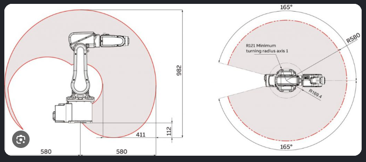
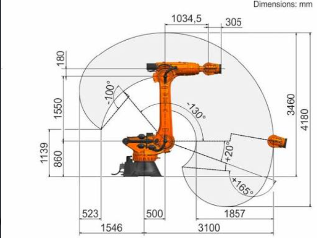

# Pendiente: burbujas del espacio de trabajo del brazo sobre el auto

AFR2-20261027-08 · 27/10/2026 · **PENDIENTE — esperar aviso explícito del usuario de que el diseño está listo.**

## Pedido conservado

El usuario solicita guardar los prompts adjuntos y las dos imágenes para ejecutarlos después, cuando avise que el diseño está listo. Guardar este material no inicia ninguna de las etapas. Tampoco la autorización de cálculo escrita dentro del prompt 3 entra en vigor por recibir el adjunto: pertenece al pedido futuro.

Las «burbujas» son las envolventes del espacio de trabajo del TCP del brazo montado sobre el vehículo, como las áreas de alcance de las referencias industriales. El objetivo futuro incluye vistas técnicas, envolvente calculada, visualización Web y láminas. Las referencias orientan la composición gráfica; sus cotas, geometrías y rangos no pertenecen a AutoFinalRobo2.

## Material original guardado

- [Los cinco prompts completos, en el orden recibido](prompts-originales.txt). Copia íntegra del adjunto, sin corregir ni reescribir el texto.
- [Referencia 1: envolvente lateral y superior](referencia-01-envolvente-lateral-superior.png).
- [Referencia 2: envolvente lateral cotada](referencia-02-envolvente-lateral-cotada.png).

Procedencia: adjuntos del usuario en esta conversación, 27/10/2026. No se conoce autoría, modelo industrial ni licencia de las imágenes; se conservan como referencias aportadas, sin atribuirlas como diseño propio. Nombres originales: `Pasted text.txt`, `codex-clipboard-011a1056-853d-406a-8910-c182338a5eb0.png` y `codex-clipboard-6e049fdb-02da-47f9-bb89-75a36168863a.png`.

## Etapas pendientes, en orden

- [ ] **1. Preparar geometría y datos.** Marcos mundo/chasis/montaje/J1…J6/TCP; ejes, longitudes, offsets, ceros, signos, límites y transmisiones; transformaciones CAD–robótica–Web; altura de montaje; exclusiones y datos estructurados.
- [ ] **2. Obtener vistas técnicas.** Superior, laterales, frontal/posterior, isométrica, montaje y TCP; posturas extremas solo cuando procedan del cálculo; cotas exclusivamente del CAD.
- [ ] **3. Calcular la burbuja.** Espacio posicional, orientado, admitido por colisiones y útil para recoger/descargar; muestreo interior y fronteras; extremos con q/XYZ/restricción; puntos, malla, contornos y metadatos. Conservar huecos y concavidades; no reemplazar por esfera o envolvente convexa.
- [ ] **4. Integrar la representación Web.** Superficie semitransparente, regiones y controles compartidos; TCP destacado; transformación de montaje aplicada una sola vez; burbuja solidaria al auto. Recursos compartidos y livianos, separados del control físico.
- [ ] **5. Preparar láminas como las referencias.** Proyecciones y cortes identificados; cotas propias; extremos; marco/TCP/límites/versión/método/resolución/restricciones; figuras vectoriales y explicación matemática para vincular posteriormente al informe.

**Estado de las cinco etapas: no iniciadas por este pedido.** Su disponibilidad no activa ejecución automática ni seguimiento programado.

## Condiciones para retomar cuando avise el usuario

1. Leer el texto original completo y las instrucciones vigentes del proyecto y del CAD.
2. Identificar la revisión de diseño que el usuario declare lista. Los prompts nombran `AFR2_Brazo_PVC32_AGV_v03`, parámetros y `revision_v03`: son el punto de partida indicado, no una confirmación actual de diseño final ni una razón para usar una revisión obsoleta si luego cambia.
3. Conservar maestros y documentar datos faltantes. Las cotas y extremos deben salir de nuestros modelos.
4. Mantener la composición:

   `T_mundo_TCP = T_mundo_chasis · T_chasis_montaje · T_montaje_TCP(q)`.

5. Distinguir espacio del TCP, volumen barrido de eslabones y trayectoria completa de recoger/elevar/descargar. Distinguir proyección de un volumen y corte a una altura dada.
6. Presentar resultados como alcance del modelo, sin afirmar carga útil demostrada ni posición física medida.
7. Preservar `Documentacion/` y nuestro informe en esta entrega de archivo. Cualquier trabajo posterior sobre el informe depende del pedido futuro.

## Referencias visuales

### Referencia 1

Tomar la idea de robot legible, relleno tenue, contorno de alcance, sectores angulares, límites discontinuos y cotas. No copiar medidas ni la silueta del espacio industrial.

### Referencia 2

Tomar la relación entre posturas extremas, alturas, alcances y contorno. Las exclusiones reales de nuestro auto, montaje y depósito deben surgir del modelo correspondiente.

## Estado de esta entrega

Solo archivo de referencias y registro de pendientes. ATmega, ESP, Web y CAD sin modificaciones por esta ficha; sin cálculo de alcance, vistas nuevas, implementación, tests, compilaciones, validadores, flasheos o movimientos físicos. Sin commit ni publicación Git por este pedido.
