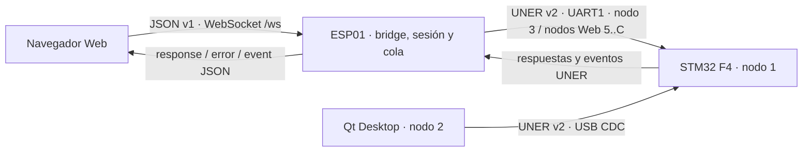

# Auditoría de línea de base de contratos AutoMicro — 2026-09-29

Estado: **inspección estática de código y documentación; sin compilación, tests, ejecución, flasheo ni prueba física**. Esta es una fotografía del contrato existente, no una ficha de cambio contractual ni una afirmación de interoperabilidad probada. El [informe detallado de choques](2026-09-29-contract-collisions-detailed.md) explica cada recorrido y decisión con más profundidad.

## Alcance y autoridad

| Clave | Repositorio | Revisión inspeccionada | Autoridad principal |
| --- | --- | --- | --- |
| F4 | `FirmwareF4` | `061a1b2f6bb4` | Frame UNER, handlers STM32, estados, eventos y screen codes OLED |
| ESP | `Firmware ESP01/FirmESP01MicroArduino2025` | `61a1ab9fd3b8` | Broker UART/WebSocket, catálogo admitido, sesiones, colas y JSON |
| Web | `Web ESP01/WebESP01AutoMicro2025` | `7aac41cd1876` + cambios locales de interfaz | Consumidor JSON, decodificadores y réplica de pantallas |
| Qt | `AutoMicroQtDesktop` | `bfe316000c1c` | Consumidor UNER por USB CDC y catálogo propio |

Los cambios locales existentes en Web no se editaron. Las conclusiones se apoyan en el código de esta fotografía; los documentos históricos se usan como contexto y se señalan cuando quedaron atrasados. `F4:Core/Src/uner_app.c:1591`, `ESP:src/ws_json_bridge.cpp:2849`, `Web:src/contexts/WebSocketContext.tsx:88`, `Qt:src/communication/CommunicationHub.cpp:68`.

## Conexión efectiva

La F4 registra UART1 y USB CDC, enruta al broker ESP (`0x3`) por UART y a Qt (`0x2`) por USB. El ESP asigna el nodo de origen a la sesión Web; el navegador no elige `src`, `dst` ni `route`. El código ESP documenta hasta ocho nodos Web (`0x5..0xC`), mientras que su contrato WebSocket actual limita a una sesión Web activa; capacidad de nodos y simultaneidad no son lo mismo. Qt tiene código de un bridge WebSocket local y una página Web, pero el `MainWindow` montado usa `CommunicationHub` y `ProtocolPage`; no encontré `WebAppPage` instanciada en el recorrido de arranque inspeccionado. Por tanto, el trayecto Qt operativo documentado aquí es USB directo. Evidencia: `F4:Core/Src/uner_app.c:1604-1644`, `F4:Docs/integration_handoff_esp_web/F4_WIRE_CONTRACT.md:7-50`, `ESP:docs/integration/ESP_WS_COMMAND_CONTRACT_V1.md:54-72`, `Qt:src/ui/MainWindow.cpp:38-88`, `Qt:src/services/UsbWebSocketBridge.cpp:120`.

## Formato, correlación y respuesta

### UNER v2

`UNER` (4 bytes), longitud `N:u8`, `:` (`0x3A`), versión `0x02`, ruta `(src << 4) | dst`, comando/evento `u8`, `N` bytes de payload y checksum XOR de los bytes anteriores: total `10 + N`, con `N <= 255`. Los enteros de varios bytes viajan little endian y los flotantes como IEEE-754 `float32`. El frame no tiene `requestId` ni secuencia; ESP serializa una transacción F4 en vuelo y Qt `RequestManager` admite una pendiente por instancia. Evidencia: `F4:Docs/integration_handoff_esp_web/F4_WIRE_CONTRACT.md:52-89`, `ESP:src/uart_transaction_manager.c:300-342`, `Qt:src/services/RequestManager.cpp:12-40`.

Una operación puede terminar con respuesta del **mismo ID** y payload propio, con `ACK 0xE0 [originalCmd,status]`, con `NACK 0xE1 [originalCmd,status]`, o quedar sin respuesta hasta timeout. `requestAccepted` de ESP solo confirma que el pedido se encoló. No hay un enum universal de status: por ejemplo, `7` indica sesión requerida en un NACK de control remoto, mientras que el significado de los bytes de status de otros comandos depende de cada payload. Un ID o longitud no registrados puede descartarse sin NACK por el router F4. Evidencia: `F4:Core/Src/uner_handle.c:578-630`, `F4:Core/Src/uner_app.c:1030-1100,3082-3115`, `ESP:src/ws_json_bridge.cpp:2859-2962`.

### JSON WebSocket v1

Solicitud canónica: `{"api":1,"type":"request","requestId":"...","command":"...","args":{}}`. ESP responde primero, si encoló trabajo F4, con evento `requestAccepted` que incluye `requestId`, `state` y `queueDepth`. El resultado final es `type:"response", ok:true, command, data` o `type:"error", code, message, details`. Otros `type:"event"` son espontáneos y pueden conservar nombres como `screen.changed`, `stm.event` o `wifi.*`. Web conecta `EspClient` desde `WebSocketContext`, correlaciona solo el resultado final por `requestId` y comprueba que coincida `command`; su timeout general es 10 s, ajustable por operación. El commit OLED pide 20 s, coherente con el máximo de 15 s definido por ESP. El cliente Web impide un `requestId` duplicado entre sus pendientes; el servidor no mantiene un índice general de duplicados. Evidencia: `ESP:docs/integration/ESP_WS_COMMAND_CONTRACT_V1.md:73-110`, `ESP:src/ws_json_bridge.cpp:2859-2962`, `Web:src/protocol/wsApi.ts:1-164`, `Web:src/protocol/espClient.ts:35-155`, `Web:src/contexts/WebSocketContext.tsx:88,144,218-244,313`, `Web:src/features/oledEditor/useOledCanvasTransfer.ts:190-192`.

ESP valida existencia, propietario, longitud, privilegio y sesión antes de encolar; permite un reintento solo cuando el catálogo marca la operación como idempotente. Errores típicos de API v1: `invalid_request`, `unauthorized`, `forbidden`, `unsupported_by_f4`, `busy`, `timeout`, `uart_error`, `f4_nack`. También hay nombres `ERR_*` en rutas heredadas y adaptadas; no conviene asumir que todo `code` pertenece a esa lista cerrada. `args` adicionales no se rechazan uniformemente. Evidencia: `ESP:src/f4_command_registry.c:20-99,199-222`, `ESP:src/ws_json_bridge.cpp:2890-2962,5480-5506`, `ESP:docs/integration/ESP_WS_COMMAND_CONTRACT_V1.md:73-100`, `Web:src/protocol/wsApi.ts:73-90`.

## Matriz de contratos que cruzan repositorios

`Mismo ID` significa frame de respuesta con el ID de la solicitud. Las longitudes son bytes del payload UNER, no del frame completo. La columna de consumo describe código hallado, no prueba de funcionamiento.

| Familia / ID | Productor y contrato observado | ESP → Web | Qt directo |
| --- | --- | --- | --- |
| WiFi/ESP `0x10..0x18`, `0x1A`, `0x30` | Dueño ESP; modo, credenciales, scan, reboot, estado y detalles, con respuestas por ID o ACK según comando. F4 los usa o los reenvía. | Dispatcher JSON local + eventos `wifi.*`; privilegios ESP/STM según operación. | Catálogo UNER contiene los IDs; acceso a ESP a través de forwarding F4 según ruta. |
| Ping `0x31`, firmware `0x41/0x68/0x69`, echo `0x42` | `0x31` dual; `0x41` depende de transporte/propietario; `0x68/69` información F4 por mismo ID. `0x42` F4 muestra aviso OLED y **no devuelve eco**. | Catálogo distingue propietario y respuesta; la Web pide versiones y estado. | Catálogo expone ping/info/echo; interpretar `0x42` como eco de payload sería incorrecto. |
| Preferencias `0x40/0x63`, modo `0x5B/0x6E`, PID `0x65/0x66` | F4 es autoridad; lectura por ID, escritura con estado/payload propio; algunas escrituras tienen ACK intermedio. | Serializa solicitudes y traduce la respuesta a JSON. | `F4ApiCodec` codifica/decodifica operaciones USB. |
| Autenticación `0x51/0x5D` | F4 verifica PIN/sesión; `0x51` acepta 6 o 10 bytes y responde 9; `0x5D` es continuación de autorización. | Sesión Web y sesión STM son capas distintas; ESP limita comandos privilegiados. | `AuthController` y `F4ApiCodec` usan USB; no se debe inferir sesión Web del PIN Qt. |
| Pantalla `0x52`, acciones `0x53..0x58`, eventos `0x95/0x96` | `0x52` devuelve `screenCode:u32 LE` + `source:u8` y opcionales: 5, 7, 9 o 13..45 bytes. Las acciones devuelven `ACK [cmd,status]`; `0` aplicada, `2` pantalla distinta, `3` estado/argumento inválido, `4` no consumida; además hay NACK de guardas. `0x95` tiene 5/9 bytes; `0x96` tiene 7. | Emite `screen.current` y `screen.changed`; traduce estado de acción a JSON y programa refresh cuando corresponde. | Decodifica reportes/eventos y opera comandos USB. |
| Sensores `0x60..0x62`, `0x64`, `0x67`, `0x6A..0x6C` | Snapshot MPU 42, telemetría 92, control 64, IR 56 bytes; streams `0x90` MPU 42 y `0x91` IR 56; start de stream acepta 1/3 y responde 4; stop responde 1. | Registry y decoders fijan longitud; bridge gestiona suscripciones. | Catálogo/codec y modelos de telemetría. |
| OLED Canvas `0x6D` | F4 procesa BEGIN/CHUNK/COMMIT/CANCEL; requests de 3/12/22/118 y respuesta por mismo ID de 10 bytes. | `oledCanvas.begin/chunk/commit/cancel`; Web carga dos bloques Base64 de 512 bytes, ESP envía BEGIN + 10 CHUNK + COMMIT y finaliza solo tras render F4. | Tiene código local de transferencia WebSocket/USB, pero ese bridge no aparece montado en la ventana actual. |
| Boot `0x6F/0x9F`, reset `0x19` | Reporte de arranque 22 bytes; `0x19` detiene actuadores, manda ACK `[0x19,0]` y difiere reset hasta terminar TX. | Web expone `getBootReport` y `rebootStm`; ESP debe tolerar reconexión. | Comandos USB y decodificador de boot. |
| Perfil de extensión `0x73/0x74/0x76` | F4 lee perfil (2 bytes), selecciona (1) y reinicia en perfil mediante `0x76` con payload `profileId:u8` y ACK. `0x75` solo declara pin map: no hay handler local. | ESP expone `stm.extensionProfile.*`, pero **reboot usa `0x75`**; véase hallazgo C1. | Usa `0x76` para reboot y reserva `0x75` para pin map. |
| Configuración AP `0x77/0x78`, aplicación ESP `0x4A` | F4 conserva configuración deseada; lectura y escritura con respuesta/estado, luego ESP aplica configuración. | Bridge implementa `stm.apConfig.get/set` y aliases. | Catálogo USB registra los IDs. |
| Emisores IR `0x79/0x7A/0x98` | F4 lee tres booleanos `[objects,line,lights]`; SET toma 3, responde `[status,objects,line,lights]` por `0x7A` y emite evento de tres bytes `0x98`. | `0x79/0x7A` figuran reservados; sin comando JSON tipado y sin `0x98` en registry. | No aparecen en `UnerTypes`, `CommandCatalog` ni `F4ApiCodec`. |
| Asset binario `0x5A` | F4 contiene parser/receptor y solicitudes de assets; no es la misma transferencia que OLED Canvas. | Registry marca `0x5A` no implementado: no hay proveedor UNER de assets. Los assets Web se sirven por HTTP/LittleFS. | El ID está declarado en catálogo; no presupone un servidor de assets en ESP. |

Evidencia principal de la matriz: `F4:Core/Inc/wifi_bridge_types.h:263-350`, `F4:Core/Src/uner_app.c:333-424,1030-1426,3043-3080`, `ESP:src/f4_command_registry.c:20-124,199-222`, `ESP:src/ws_json_bridge.cpp:4126-4160,4538-4543,4760-4796,5480-5506`, `Web:src/protocol/wsApi.ts:1-40`, `Web:src/protocol/f4Payloads.ts`, `Qt:src/protocol/UnerTypes.h:34-125`, `Qt:src/protocol/CommandCatalog.cpp:531-540`, `Qt:src/services/F4ApiCodec.cpp:401-858`.

## Screen codes y réplica OLED

La identidad es un `u32` cuyo valor efectivo se arma como tres bytes `menu/submenu/page` (`0xMMSSPP`); el reporte UNER lo envía little endian con un cuarto byte alto normalmente cero. `source` distingue menú, render, notificación, permiso y sistema. Web reproduce el mismo empaquetado y `ScreenContext` acepta eventos `screen.changed`, `screen.current` y variantes heredadas. `screenRenderRegistry` usa builders exactos o identificados cuando la entrada lo permite; si no reconoce el código, retorna `null`. Evidencia: `F4:Core/Inc/screen_codes.h:18-35`, `F4:Core/Src/uner_app.c:1259-1318,3020-3040`, `Web:src/screens/screenCodes.ts:1-25`, `Web:src/contexts/ScreenContext.tsx:135-176`, `Web:src/screens/screenRenderRegistry.ts:337-353,528-570`.

Comparación de **constantes directas por nombre**: F4 tiene 139 y Web 122; las 122 compartidas conservan el mismo valor. Las 17 presentes solo en F4 son:

| Área | Códigos F4 ausentes como constantes en Web |
| --- | --- |
| Conectividad | `0x02020E` OSK WiFi SSID, `0x02020F` contraseña, `0x020210` IPv4 |
| Navegación y sensores | `0x010202` favoritos, `0x030203` IR ambiente, `0x030600` menú teclado, `0x030601` ASCII, `0x030602` numérico |
| Configuración IR | `0x050419` menú, `0x05041A` objetos, `0x05041B` línea, `0x05041C` luces |
| Sistema y acerca de | `0x050204` bootloader, `0x050500` menú sistema, `0x050501` confirmación bootloader |
| Entrada | `0x090101` teclado alfabético, `0x090102` numérico |

Esto prueba una brecha de catálogo de nombres, no que cada pantalla falle necesariamente: algunas pueden tener render genérico o rutas identificadas por valor. La cobertura visual real de las 17 requiere examinar builders y ejecutar la aplicación, fuera de esta auditoría estática. La afirmación de completitud de `Web:src/screens/SCREEN_INVENTORY.md:22-25` y su test histórico no se toma como resultado actual. Evidencia: `F4:Core/Inc/screen_codes.h:36-197`, `Web:src/screens/screenCodes.ts`, `Web:src/screens/screenRenderRegistry.ts:337-570`.

## Incongruencias y orden de trabajo

| ID | Prioridad | Hallazgo, impacto y evidencia |
| --- | --- | --- |
| C1 | **Alta** | **Colisión `0x75/0x76` en reboot de perfil.** F4 ejecuta `REBOOT_INTO_PROFILE=0x76`; ESP define y transmite `0x75`, que F4 reserva nominalmente para `GET_EXTENSION_PIN_MAP` pero no registra como handler. El pedido Web `stm.extensionProfile.reboot` puede agotarse por timeout sin reiniciar. Qt sí envía `0x76`. Corregir primero la tabla y enum ESP, junto con cualquier decoder/respuesta dependiente, luego informar el cambio en ficha AMI. `F4:Core/Inc/wifi_bridge_types.h:342-343`, `F4:Core/Src/uner_app.c:346,1125-1127`, `ESP:src/uner_cmdspec.h:93`, `ESP:src/f4_command_registry.c:93-94`, `ESP:src/f4_extension_profiles.c:42`, `Qt:src/protocol/UnerTypes.h:97-98`. |
| C2 | **Alta** | **F4 adelantado en emisores IR.** `0x79`, `0x7A` y `0x98` ya tienen comportamiento F4, pero ESP reserva los comandos y no cataloga el evento, mientras Web/Qt no los nombran. El flujo Web tipado no puede operar esta función y un evento espontáneo no tiene decoder dedicado. Definir respuesta final y status, agregar registry/bridge ESP, luego consumidor Web/Qt según necesidad. `F4:Core/Src/uner_app.c:347-348,955-980,1128-1154`, `ESP:src/f4_command_registry.c:98,116-124`, `Qt:src/protocol/UnerTypes.h:89-125`. |
| C3 | **Media** | **17 screen codes F4 sin constante Web.** Hay igualdad numérica de las 122 compartidas, pero la réplica nominal está atrasada en teclados, preferencias IR, bootloader y otras pantallas. Sin render específico, el registry puede devolver `null`; revisar cada código contra el payload que realmente emiten `0x52/0x95/0x96`. `F4:Core/Inc/screen_codes.h:36-197`, `Web:src/screens/screenCodes.ts`, `Web:src/screens/screenRenderRegistry.ts:337-570`. |
| C4 | **Media** | **Asset `0x5A` incompleto entre F4 y ESP.** F4 puede pedir/procesar chunks, pero el registry ESP lo declara no implementado. Documentar si se completará la provisión UNER o se retirará esa expectativa; HTTP/LittleFS del SPA no la satisface por sí solo. `F4:Core/Src/uner_app.c:1263,2042,2965`, `ESP:src/f4_command_registry.c:66`. |
| C5 | **Media** | **Puente WebSocket local de Qt no integrado al arranque observado.** Hay codec, servidor y bridge para un protocolo parecido al de ESP, pero `MainWindow` monta la interfaz USB directa. Tratarlo como código disponible, no como segundo backend Web operativo, hasta conectarlo explícitamente y definir equivalencia de errores, autenticación y eventos. `Qt:CMakeLists.txt:62-64`, `Qt:src/ui/MainWindow.cpp:38-88`, `Qt:src/ui/pages/WebAppPage.cpp:38`. |
| C6 | **Baja** | **Documentación con fechas de corte antiguas.** El handoff F4 y snapshot copiado en Web no contienen todo lo que el código posterior implementó (OLED/boot/IR/AP según archivo). Resolver con esta línea de base y futuras fichas, sin usar esos documentos como prueba de compatibilidad. `F4:Docs/integration_handoff_esp_web/F4_WIRE_CONTRACT.md:1-7`, `Web:docs/integration/FIRMWAREF4_UNER_CONTRACT_SNAPSHOT.md`, `F4:Core/Inc/wifi_bridge_types.h:330-350`. |
| C7 | **Baja** | **Semántica del echo `0x42` puede inducir error.** El nombre y descripciones viejas sugieren eco, pero el handler F4 solo presenta una notificación OLED; ESP lo clasifica sin respuesta. Mantener esa semántica explícita al documentar o renombrar el uso en interfaces. `F4:Core/Src/uner_app.c:1155-1158`, `ESP:src/f4_command_registry.c:48`. |

La prioridad expresa riesgo contractual observado en fuente, no una incidencia reproducida en hardware. En particular, C1 es una incompatibilidad de ID inequívoca; el efecto concreto para una solicitud dependerá de rutas, permisos y timeout en ejecución.

## Ampliación de choques de respuesta y recepción

La inspección posterior de los handlers y consumidores encontró tres choques de flujo adicionales. Complementan C1-C3 y precisan sus efectos; siguen siendo conclusiones estáticas.

| ID | Prioridad | Implementación por repositorio y efecto |
| --- | --- | --- |
| C8 | **Alta** | **ACK de reboot de perfil mal correlacionado.** F4 recibe `0x76`, persiste el perfil y llama al handler de reset general. Ese handler envía `ACK 0xE0 [0x19,0]`, no `[0x76,0]`, y luego programa el reset. ESP hoy envía `0x75` (C1), así que falla antes de llegar a este segundo choque; si se corrige solo su ID, `UartTransactionManager` exige que el primer byte del ACK sea el ID solicitado y lo deja sin correlación. Qt envía `0x76`, pero `RequestManager` también descarta el ACK de `0x19` como ajeno: el equipo puede reiniciarse mientras Qt informa timeout o desconexión. Web solo conoce la operación JSON y depende de que ESP entregue la respuesta final; `hello.features.extensionProfiles` se anuncia desde el registry ESP que todavía cree que `0x75` es válido. Corregir F4 para etiquetar el ACK con el comando original y ESP para enviar `0x76`, como una misma migración contractual. `F4:Core/Src/uner_app.c:3043-3078,4596-4604`; `ESP:src/uner_cmdspec.h:93`, `src/f4_command_registry.c:93-94`, `src/uart_transaction_manager.c:312-329`, `src/ws_json_bridge.cpp:6838-6846`; `Qt:src/protocol/UnerTypes.h:97-98`, `src/services/RequestManager.cpp:51-76`. |
| C9 | **Alta** | **Qt espera ACK para seleccionar perfil `0x74`; F4 responde por `0x74`.** F4 persiste y devuelve un byte `status` mediante frame del mismo ID. ESP lo cataloga como `SAME_COMMAND` y la Web usa `stm.extensionProfile.set` sobre esa ruta. Qt `CommandCatalog::completionFor` clasifica `0x74` como `Ack`; su `RequestManager` no completa la solicitud con el frame de respuesta y termina por timeout aunque el cambio haya sido aplicado. El codec Qt tiene decoder para ese status, pero la política impide que llegue al resultado normal. Ajustar la finalización Qt a `SameCommand` y mostrar el status recibido. `F4:Core/Src/uner_app.c:4576-4594`; `ESP:src/f4_command_registry.c:92`; `Web:src/protocol/wsApi.ts:34-36`; `Qt:src/protocol/CommandCatalog.cpp:64-70,526-530`, `src/services/RequestManager.cpp:79-99`, `src/services/F4ApiCodec.cpp:1290-1292`. |
| C10 | **Media** | **Qt y Web interpretan distinto un ACK de acción con status no cero.** F4 usa `ACK [cmd,status]` en `0x53..0x58`; por ejemplo `2` indica pantalla distinta. ESP convierte status no cero en `type:"error"`, Web rechaza la promesa y `ScreenContext` vuelve a consultar pantalla. Qt `RequestBroker` emite `responseReady` para cualquier ACK de esos comandos, con `status` dentro de los datos; `ScreenController` finaliza la acción como éxito sin evaluar ese campo. Es un falso positivo de interfaz frente a un rechazo funcional de F4. Tratar status no cero como fallo o resultado rechazado y resincronizar pantalla. `F4:Core/Src/uner_app.c:1360-1426`; `ESP:src/ws_json_bridge.cpp:5475-5505`; `Web:src/protocol/espClient.ts:98-124`, `src/contexts/ScreenContext.tsx:148-176`; `Qt:src/communication/CommunicationHub.cpp:88-99`, `src/controllers/ProtocolControllers.cpp:238-259`. |
| C11 | **Baja** | **ESP conserva dos catálogos con criterios distintos.** `f4_command_registry.c` gobierna el bridge Web, privilegios y longitudes F4; `uner_cmdspec.c` gobierna el dispatcher UNER local después del interceptor. Este segundo catálogo mantiene, por ejemplo, `0x51` con longitud 6 mientras el contrato F4 acepta 6/10, `0x52` con rango 0..45 como entrada, IDs heredados `0x4F/0x50` y la asociación vieja `0x75`. El interceptor absorbe el tráfico Web/F4 pertinente antes de la tabla local, por lo que **no se atribuye un fallo actual** a cada diferencia; sí es una fuente de desalineación cuando se agregan comandos. `ESP:src/uner_app_handlers.cpp:1629-1696`, `src/uner_handle.cpp:112-146`, `src/uner_cmdspec.c:9-94`, `src/f4_command_registry.c:57-99`. |
| C12 | **Baja** | **Longitudes admitidas distintas para iniciar streams.** F4 registra `0x61/0x6B` con 1..3 bytes y, si llegan exactamente 2, usa el período por defecto e ignora el segundo byte. Qt publica 1..3 y su consola puede enviarlos. ESP exige exactamente 1 o 3, por lo que un cliente Web con 2 recibe `invalid_request` antes de llegar a F4. Los builders normales Web usan las formas admitidas por ESP; el choque afecta principalmente a clientes manuales y a la definición del contrato canónico. Definir si 2 bytes deben rechazarse también en F4 o documentarse explícitamente. Para `0x51` y `0x6D` también existen rangos generales en catálogos, pero los flujos guiados/especializados generan las longitudes concretas y no se identificó otro fallo normal por esa diferencia. `F4:Core/Src/uner_app.c:380-391,3904-3935,4076-4113`; `ESP:src/f4_command_registry.c:198-207`; `Qt:src/protocol/CommandCatalog.cpp:430-438,480-488`, `src/controllers/ProtocolControllers.cpp:43-109`. |

### Secuencias concretas que hoy importan

- **Web → ESP → F4, reiniciar en perfil:** `stm.extensionProfile.reboot` → ESP `0x75` → F4 no registra ese ID como reboot → timeout probable. `extensionProfiles=true` en `hello` refleja el catálogo ESP, no confirma compatibilidad de la F4 conectada.
- **Qt → F4, reiniciar en perfil:** Qt envía `0x76` → F4 puede persistir el perfil y emitir `ACK [0x19,0]` → Qt lo ignora por correlación → F4 se reinicia → Qt puede ver desconexión/timeout sin resultado exitoso.
- **Qt → F4, seleccionar perfil:** Qt envía `0x74` → F4 persiste y responde `0x74 [status]` → Qt espera ACK y no completa la operación → timeout visible aunque haya cambiado la preferencia.
- **Acción remota con pantalla distinta:** F4 responde `ACK [cmd,2]`. Web recibe error y resincroniza; Qt completa la acción con `status:2` como respuesta lista. 

C2 también tiene un efecto de recepción más preciso: `WSJsonBridge_OnUNERPacket` descarta `0x98` **antes** de emitir eventos genéricos porque el registry ESP no lo reconoce como implementado. Para los 17 códigos de C3 no aparecen referencias numéricas ni constantes en los módulos de pantallas Web examinados; cuando el registro no resuelve un código, el preview muestra «Sin comandos para renderizar». Estas observaciones no equivalen a una prueba visual o física. `ESP:src/ws_json_bridge.cpp:7020-7042,7157`; `Web:src/screens/screenRenderRegistry.ts:337-353,505-510`, `src/components/ScreenStreamWorkspace.tsx:873-881`.
## ¿Quién está más adelantado?

No hay un repositorio universalmente “más adelantado”. **F4** es fuente de verdad en pantallas y ya implementa emisores IR nuevos. **ESP** tiene el broker transaccional, sesiones y OLED Canvas Web integrados, pero su mapeo de perfil está desfasado y bloquea los emisores nuevos. **Web** consume la API v1 real y contempla timeout largo de OLED, pero su catálogo de pantallas no sigue los 17 IDs F4 nuevos. **Qt** coincide con F4 en `0x76` y mantiene un catálogo USB amplio, aunque no incorpora emisores IR y su bridge WebSocket local no está conectado a la ventana actual. Estas diferencias se deben seguir por contrato, no con una etiqueta global de versión.

## Cómo usar esta línea de base

1. Registrar cada corrección o extensión que modifique contrato en `changes/AMI-YYYYMMDD-XX.md` y enlazarla desde `CHANGELOG.md`; este informe no reemplaza fichas.
2. En cada ficha separar **productor**, **transporte**, **request exacto**, **ACK/aceptación intermedia**, **respuesta final**, **evento**, **errores/timeout**, **permisos** y estado de los cuatro repos.
3. Resolver C1 antes de ofrecer como compatible el reboot de perfil desde Web. Para C2 y C3 publicar primero el contrato del productor y después actualizar cada consumidor; dejar `pendiente` donde no se inspeccionó o adaptó.
4. Mantener la diferencia entre compatibilidad estática de fuente, compilación y comportamiento en placa. Esta auditoría cubre solo la primera.

## Nota metodológica

Se intentó iniciar el inventario automático de la skill `document-codebase` sobre las cuatro raíces. No entregó salida en un tiempo razonable y se interrumpió; la auditoría continuó con inventario focalizado mediante `rg` y lecturas de handlers, registries, codecs, contextos y rutas de arranque. No se ejecutó el paso `validate` de la skill porque el usuario pidió expresamente no hacer validaciones. Los tamaños, estados y flujos aquí citados son observaciones del código inspeccionado; pueden existir rutas adicionales no cubiertas por este recorrido focalizado.

