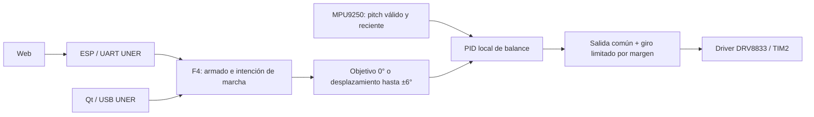

# MPU, motores y balance — 2026-10-03

Alcance: FirmwareF4, Firmware ESP01/FirmESP01MicroArduino2025, Web ESP01/WebESP01AutoMicro2025 y AutoMicroQtDesktop. Inspección y edición de fuente; **sin tests, compilación, validadores, ejecución, flasheo ni prueba física**. Contrato nuevo: [AMI-20261003-01](../changes/2026-10-03-01-motor-balance-control.md).

## Lo encontrado y corregido

| Área | Estado anterior | Resultado de esta edición |
| --- | --- | --- |
| MPU | MPU9250 implementado: DMA I²C, calibración, orientación y snapshot de 42 bytes. Un error podía cortar el próximo disparo; no se controlaba la antigüedad de la orientación. | Reintento periódico, procesamiento del buffer antes de reutilizarlo por DMA y frescura de orientación de 50 ms. Los flags del snapshot reflejan el estado actual. |
| Calibración MPU | Se acumulaban muestras aunque el detector indicara movimiento. | Una muestra con movimiento reinicia la acumulación y el tiempo de calibración. Requiere una referencia inmóvil y correcta del vehículo. |
| Motores | Driver DRV8833 con porcentajes y signo, PWM mínimo configurable, parada y frenado. Prueba local disponible en TEST. | Rechazo de números no finitos y dirección inválida; prueba remota de ambos motores con duración local limitada. |
| Balance | PID con derivada sobre medición, filtro y anti-windup. El armado se manejaba desde acciones locales/OLED. | Activación/desactivación remota explícita. MPU y calibración continúan con balance desactivado. Arranque desarmado. |
| Marcha | Ya cambiaba el objetivo de pitch: avance porcentual × 6°. Giro diferencial limitado por el margen restante de la salida PID. | Se conserva esa prioridad y se publica una orden de marcha dedicada. Detener/expirar borra la orden y vuelve a objetivo 0°, conservando el balance. |
| Fallos | Una orden detenida podía conservar valores; caída recuperada podía volver a activar motores automáticamente. Se repetía el PID para ticks pendientes con la misma muestra. | Orden eliminada al detener/desarmar; parada de seguridad enclavada; PID actualizado una vez por muestra usando el instante de adquisición. |
| Telemetría | Inclinación de control desarmado podía quedar en cero; orientación local sin inicializar al fallar MPU; salidas TEST no reflejadas. | Orientación inicializada y lectura MPU actual; salidas tomadas del driver con signo, también en TEST. Snapshot 0x64 devuelve status 3 si falta orientación válida. |
| ESP | No había contrato de marcha/motores; rechazaba nombres `stm.motor.*` sin entrada tipada. | Registro, JSON, serialización LE y respuestas para 0x7B–0x7F. Se conserva la autenticación STM. |
| Web | PID y simulador/secuencias disponibles; ejecución física de secuencias pendiente. | Panel real en Control de Motores y Calibración → Balance. Acciones, estado y lecturas de la placa; catálogo Protocol Studio actualizado. |
| Qt | Codec USB y telemetría; sin control dedicado equivalente. | Mismos comandos y codec, controlador autenticado y panel Telemetría y 3D → Balance y motores. |

## Funcionamiento esperado por el código

Desactivar balance desarma y apaga motores; no apaga MPU. Activar exige MPU calibrado, lectura reciente y pitch dentro de ±10°. No se infiere contacto con el piso: el usuario decide cuándo activar. El límite de caída sigue siendo ±35°; caída, error o pérdida de frescura enclavan una parada. Hace falta una activación explícita posterior con el auto cerca de vertical.

La marcha cambia la inclinación que el PID trata de mantener. El giro usa solo el margen de esfuerzo disponible después del balance. Detener marcha conserva compensación; **Parar motores y balance** la desactiva. Las órdenes remotas de marcha y TEST duran 50–2000 ms; las interfaces ofrecen pulsos de 750 ms. Al vencer marcha, vuelve al objetivo vertical; al vencer TEST, el PWM se apaga. TEST permite salida directa únicamente con balance desarmado. Entrar o salir de TEST elimina órdenes y desarma.

No hay garantía de estabilidad física, de velocidad o de posición: mantener un ángulo no cierra por sí solo un lazo de velocidad de ruedas. El signo físico de corrección, orientación de montaje, vertical de referencia, ganancias, PWM mínimo y comportamiento mecánico requieren puesta a punto real. El PWM TIM2 permanece con ARR 255 y prescaler 3749; con el reloj configurado de 96 MHz resulta 100 Hz. No se cambió esa configuración CubeMX sin evidencia de ajuste del conjunto real.

## Evidencia de fuente

- F4: `Core/Src/mpu9250.c`, `Core/Inc/mpu9250.h`, `Core/Src/motor_control.c`, `Core/Src/balance_control.c`, `Core/Src/motion_control.c`, `Core/Src/app_tasks.c`, `Core/Src/uner_app.c`, `Core/Inc/uner_app.h`, `Core/Inc/wifi_bridge_types.h`; pinout/reloj en `FirmwareF4.ioc`, `Core/Inc/main.h` y `Core/Src/main.c`. Las acciones locales de armado están en `eventManagers.c` y `menu_definition.c`.
- ESP: `src/f4_command_registry.c`, `src/uner_cmdspec.h`, `src/uner_cmdspec.c`, `src/ws_json_bridge.cpp`.
- Web: `src/features/motion/MotionControlPanel.tsx`, `src/features/motion/motion.css`, `src/protocol/wsApi.ts`, `src/pages/ControlSection.tsx`, `src/features/balanceCalibration/BalanceWorkbench.tsx`, `src/features/protocolStudio/commandManifest.json`.
- Qt: `src/controllers/MotionController.*`, composición de aplicación y bridge QML, `src/services/F4ApiCodec.cpp`, `src/services/WebApiContract.cpp`, `src/protocol/CommandCatalog.cpp`, `src/protocol/UnerTypes.h`, `src/communication/CommunicationHub.cpp`, `resources/qml/AutoMicro/TelemetryPage.qml`, `CMakeLists.txt`.

## Pendientes y publicación

Los cuatro repositorios tienen cambios locales de implementación, preservando trabajo previo. Esta edición no hace commits ni publica esos checkouts. La central publica el contrato y esta auditoría; ello no distribuye automáticamente los binarios ni el código de los consumidores.

Pendientes: compilación solicitada posteriormente, actualización/flasheo de F4 y ESP, distribución de Web/Qt y puesta a punto física. Carga autónoma de secuencias completas del Studio, captura sincronizada por ciclo y ensayo temporal de PID con reversión siguen sin implementarse; no se presentan como parte terminada de esta librería. La ficha AMI-20261001-01 conserva sus pendientes para esas funciones distintas.
