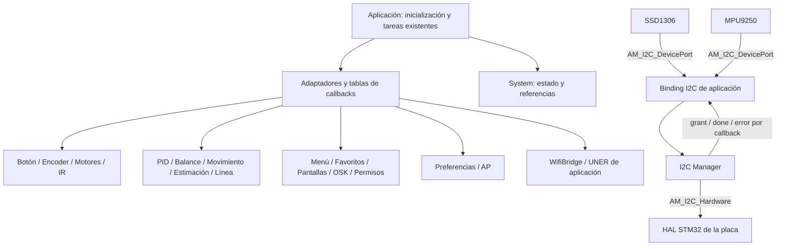

# FirmwareF4 3.0.0 — modularización implementada

Trabajo iniciado el 2026-10-03 y compilación final completada el 2026-10-04.
Esta revisión sustituye el diseño inicial con un System demasiado amplio.
La [auditoría original](../audits/2026-10-03-f4-library-modularity.md) describe la
línea de base; [el registro de etapas de F4](../../FirmwareF4/Docs/MODULARIZATION_3.md)
describe lo implementado. No se ejecutaron tests ni pruebas físicas.

## Prioridad y alcance

La refactorización conserva el contrato de la aplicación: IDs, comandos, eventos,
payloads, screen codes, permisos, TTL, secuencias de respuesta, persistencia y
comportamiento de los consumidores. FirmwareF4 es el repositorio de código modificado.
ESP01, Web ESP01 y Qt no se modificaron ni compilaron en esta tarea.

Las interfaces internas de inicialización de dispositivos reciben ahora puertos
y contextos neutrales. Los puntos de uso de F4 se actualizaron juntos. Las fachadas
de aplicación conservan las llamadas históricas sin contexto de OLED, preferencias
y setters de credenciales; las pantallas, menú, permisos, AP y teclado mantienen
sus entradas existentes. Esto no implica que un proyecto externo que copie las
antiguas inicializaciones STM32 pueda omitir los nuevos bindings de plataforma.

## System acotado

`SystemHandle` guarda estado compartido y referencias. No ejecuta tareas, no
inicializa periféricos, no aloja framebuffers ni instancias completas de librerías.
La aplicación sigue conectando módulos y ejecutando las tareas existentes.

```text
SystemHandle
├── runtime        flags, modo auxiliar, disparos y muestras ADC compartidas
├── connectivity   resultados de escaneo, IP y estado publicado de ESP
├── configuration  referencia a preferencias, capacidades y habilitación IR
├── security       referencia al handle de permisos
├── metadata       referencias const a versión, target y build
└── handles        referencias opacas a instancias usadas globalmente
```

Los estados privados permanecen con su dueño: buffers y colas de OLED, muestras y
calibración de MPU, transacción de preferencias, sesiones de permisos, favoritos,
scroll, teclado y canvas. Tareas y borradores UI tienen contextos privados de
aplicación. Ningún módulo se convierte en una librería maestra.

## Librerías y conexiones implementadas

| Librería | Estado/configuración | Operaciones que recibe desde afuera |
| --- | --- | --- |
| Botón | UserButton_Handle_t | UserButton_Port: lectura de nivel y contexto |
| Encoder | ENC_Handle_t | ENC_Port: contador, reset, start, botón y contexto |
| Motores | Motor_Handle_t / MotorControl_Handle | Motor_Port: PWM start/compare; canales y límites configurados |
| IR | TCRT5000_Handle | TCRT5000_Port: initialize y set_emitters; pines y ADC en AppIrContext externo |
| I2C Manager | I2C_ManagerHandle | AM_I2C_Hardware: reloj, estado, probe y transferencias |
| MPU9250 | MPU9250_Handle_t | AM_I2C_DevicePort: transporte y request/grant/release/policy |
| OLED SSD1306 | SSD1306_Handle | El mismo contrato de puerto I2C; callbacks por instancia |
| PID | PidController_Handle | Datos y tiempo del llamador; cálculo acotado sin HAL |
| Balance | BalanceControl_Handle | AM_PidOps + contexto; PID pertenece a la aplicación |
| Movimiento | MotionControl_Handle | AM_DriveOps, AM_BalanceOps y AM_OrientationOps |
| Estimación | MotionEstimator_Handle | Snapshot y estado de orientación externos |
| Seguimiento de línea | LineFollowControl_Handle | PID, comandos, estimación, lectura IR y orientación por operaciones |
| Preferencias | AppPreferences_Handle | View/unlock/lock/erase/program y reglas AP externas |
| Configuración AP | ApHandle | Preferencias, reloj y envío externos; misma máquina de reintentos |
| Menú | MenuSystem | Raíz, fast-scroll externo, disponibilidad y reportes por MenuServices |
| Favoritos | FavoritesHandle | Persistencia, búsqueda de ítems y acciones externas |
| Pantallas | Screens_Handle | ScreensServices: dibujo, datos, acciones, reportes y reloj externos |
| Permisos | PermissionHandle | PIN, reloj, dibujo, navegación y política de nodos externas |
| Router de eventos | UiRouterHandle | Servicios de menú, permisos, WiFi y pantalla externos |
| WiFi AT/WEB | WifiBridge_Handle | UART/reloj y servicios de aplicación/protocolo externos |
| UNER core/handle | Handles existentes | Parser/colas neutrales; transportes y aplicación son integración de plataforma |
| OSK | OSK_State | Callbacks de dibujo y finalización existentes, preservados |

Los headers de datos (`*_types.h`, `*_data.h`, `control_ports.h`, `i2c_port.h`)
contienen tipos y contratos neutrales. Compartir un tipo de snapshot o un handle
de datos no requiere enlazar la implementación de otra librería. Los adaptadores
`app_*_ports.h`, `app_*_binding.h` y `app_preferences_stm32.h` sí conocen las
implementaciones concretas, porque pertenecen a la aplicación.



OLED y MPU siguen usando el mismo arbitraje. Prioridad base 1, política, lease,
watchdog, solicitudes pendientes y notificación de fin permanecen en el gestor;
los dispositivos no incluyen su header ni almacenan su tipo concreto.

## Pantalla cohesionada y flujo

Wrappers, dibujo, scroll, notificaciones, teclado y canvas forman una librería
cohesionada con estado propio. Se mantiene este orden:

```text
evento -> router/acción -> wrapper prepara flags/contexto -> renderer dibuja
       -> operaciones externas de dibujo -> SSD1306 solicita bus
       -> transferencia DMA -> callback de finalización -> tareas/reportes existentes
```

Las entradas históricas sin argumento conservan un contexto activo suministrado
por la aplicación (`Screens_Context`, `Permission_Context`, etc.). Esto conserva
los callbacks actuales; no promete ejecución simultánea de múltiples contextos
activos de una API histórica. Los drivers OLED y MPU sí operan con instancia
explícita y puertos propios.

## Conservación funcional y límites

- El modo conserva el nibble alto de `carModeFlags` y los valores IDLE/FOLLOW/TEST/GOTO.
- IR conserva polaridad activa baja, orden ADC, umbrales y geometría. Valores por
  defecto: separación 16 mm, ancho negro 18 mm, margen centrado 7 mm.
- Favoritos conserva capacidad 3, dos filas visibles; menús ordinarios tres filas.
- PID, rampas, límites, dt, calibración y guardas mantienen sus cálculos y decisiones.
- Preferencias conserva formatos V1–V11, hash, migración y transacción. Geometría
  Flash y operaciones STM32 están en el adaptador, sin cambiar dónde se almacena.
- El arranque de OLED/MPU y la transacción Flash conservan las operaciones síncronas
  existentes. Las tareas y DMA activos conservan su ejecución por estados.
- Las variantes heredadas de OLED fuera de la configuración activa no se compilaron;
  contienen esperas heredadas. No se afirma que toda configuración sea no bloqueante.
- Código de placa, CubeMX, USB, transportes físicos, boot mailbox y coordinación de
  aplicación continúan ligados a F411. Los núcleos reutilizables no realizan esas operaciones.
- Sin heap nuevo y sin duplicación de framebuffers. No se realizó comparación de
  rendimiento ni ensayo de regresión sobre hardware.

## Versión y evidencia de compilación

Metadata y empaquetado pasan a **3.0.0**; manifiesto `0x030000`. El changelog de
F4 documenta una refactorización de código para una modularización más óptima.

Se compiló Debug STM32F411CEU6 desde cero con GCC ARM 14.3.1 y el make de CubeIDE.
Resultado final: salida 0. Se generaron ELF, BIN, HEX y SHA-256 bootables. Se conserva
un aviso del linker sobre un segmento LOAD RWX; no se cambió el script de enlace.
Los tamaños y el resultado exacto están en el registro de F4. No se cargó firmware
ni se ejecutaron tests, pruebas físicas o builds de los otros repositorios.

La compilación confirma la integración de fuentes para este target, y no demuestra
por sí sola equivalencia de ejecución en el hardware o compatibilidad física con
los consumidores. Los pendientes previos de la central conservan sus estados.
