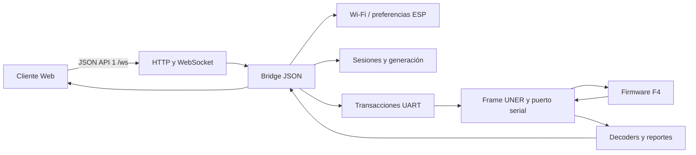

# Firmware ESP01 — arquitectura, propiedad y fronteras

ID: `esp:architecture`. Fuente: checkout de trabajo del 20-10-2026, con hashes
por ficha. [Índice de 28 unidades](README.md). Lectura estática; sin compilación,
tests, conexión de placa ni comprobación de runtime.

## Responsabilidad dentro del sistema

ESP sirve el bundle Web y los recursos de LittleFS, administra Wi-Fi y traduce
solicitudes WebSocket a operaciones locales o comandos F4. La interfaz de usuario
física, el control de movimiento y la autorización F4 pertenecen al F4. Una
respuesta de ESP que anuncia cola no equivale a una acción física realizada.

Las flechas representan recorridos revisados, no un grafo exhaustivo de llamadas.
Los [contratos wire](../shared/wire-contracts.md) y el
[registro de comandos](../shared/command-registry.md) conservan formatos/políticas.

## Núcleos, servicios y composición

| Frontera | Unidades y acoplamiento observado |
| --- | --- |
| Composición | `main.cpp`, `app_bindings.cpp`, `esp_system.*` conectan servicios, callbacks y plataforma. Conocen las piezas concretas; no se califican como librería agnóstica. |
| Núcleo UNER | Parser, frame, colas, tabla de comandos y transporte usan handles/ops; el envío físico se resuelve en el adaptador serial. La compatibilidad histórica no prueba que una unidad se compile en el entorno activo. |
| Transacciones | `uart_transaction_manager.*` mantiene cola e inflight sin depender de una clase WebSocket. IDs de cliente, nodo y generación expresan el dominio del broker. |
| Sesiones | `ws_session_manager.*` posee slots, TTL, reanudación y límites. Exponer una dirección de slot no transfiere su propiedad al consumidor. |
| Streams | `stream_broker.*` y waiters agregan demanda de clientes para MPU/IR y coordinan estado upstream; no representan un sensor nuevo por cada navegador. |
| Wi-Fi | `wifi_service.*`, driver port, árbitro y snapshot separan política de conexión/scan de las llamadas Arduino. La fachada de utilidades y el backend ESP son adaptadores concretos. |
| Persistencia | `nvs_store.*` aplica serialización/política de preferencias; `nvs_littlefs.*` implementa almacenamiento sobre LittleFS. No debe confundirse con NVS binaria de F4. |
| Bridge | JSON, ArduinoJson, sesiones, registro F4, broker y WebSocket se componen en una unidad de aplicación concreta. Sus `.inc` no son librerías aisladas. |

No todas las unidades son independientes entre sí: hay dependencias de tipos,
puertos y servicios que las fichas explican. La modularidad consiste en ubicar
esas dependencias en la frontera correcta y conservar propiedad/contexto,
no en eliminar toda relación del sistema.

## La unidad bridge y sus fragmentos

`ws_json_bridge.cpp`, `ws_bridge/private_context.h` y los fragmentos `.inc`
comparten contexto privado y orden de inclusión. `dispatch.inc` elige ruta,
valida y codifica argumentos; `requests.inc` conserva correlación;
`reports.inc` traduce respuestas/eventos; lifecycle/sessions/auth/streams/canvas
completan la misma unidad. Una función `static` de un fragmento puede depender
de datos de otro fragmento y no ser reutilizable fuera de esa composición.

La [ficha JSON bridge](libraries/json-bridge.md) agrupa los fragmentos, sus
funciones y tipos. La consistencia entre validador y codificador de AutoMotion
está abierta en [AMDOC-ESP-001](../../review/FINDINGS.md#amdoc-esp-001).

## Handles, memoria y callbacks

| Dueño | Datos que posee | Qué recibe/presta hacia fuera |
| --- | --- | --- |
| `UartTransactionManager` | Cola de 8 requests, un inflight, métricas y deadlines; payload/requestId se copian a slots. | `send_fn/send_ctx` y `completion_fn/completion_ctx` son callbacks/contextos prestados. El receptor no debe retener punteros de respuesta después de su vigencia. |
| `UtmRequest` | Payload acotado a 255 bytes e identificadores hasta 64 caracteres útiles. | Cliente/generación/nodo correlacionan socket y transacción; el nodo no sustituye la generación. Máximo dos requests en cola por cliente. |
| `WsSessionManager` | Tabla de sesiones, rate buckets, siguiente generación y métricas. | Find devuelve vista/puntero a slot; tras liberar/reutilizar no identifica la misma sesión. La generación impide completar sobre un nuevo dueño. |
| Broker de streams | Demanda/suscriptores y estado upstream. | Solicita cambios a través de funciones de transporte; callbacks notifican resultado, no conceden propiedad del sensor. |
| Servicio Wi-Fi | Estado de conexión/scan y configuración de política. | Driver ops/contexto provistos por plataforma; snapshot de scan separa resultado retenido de una exploración activa. |
| Bridge y servidor | Contexto de aplicación, solicitudes pendientes y referencias a servicios. | Objetos/vistas ArduinoJson y buffers de callback no son almacenamiento permanente por implicación; copiar lo que deba sobrevivir. |
| OLED Canvas | Estado de transferencia, bloque/correlación y resultado. | Buffer serializado tiene contrato de páginas y checksum propio; no es un puntero al framebuffer F4. |

`UtmSendFn(ctx, request)` lo invoca el servicio del broker: OK significa envío
admitido por el puerto, BUSY permite esperar, ERROR inicia finalización de error.
`UtmCompletionFn(ctx, request, status, frame)` devuelve resultado al bridge; un
frame solo existe cuando corresponde al resultado recibido. Copiar datos que se
necesiten después; no reenviar un callback a una generación nueva.
Las firmas y atributos exactos se conservan en
[transacciones UART](libraries/uart-transactions.md),
[sesiones](libraries/sessions.md), [puertos](libraries/ports-platform.md) y
[servicio Wi-Fi](libraries/wifi-service.md).

## Recorrido de una solicitud y una desconexión

1. El servidor recibe JSON y la ruta decide operación local o F4.
2. El bridge comprueba argumentos/sesión y codifica bytes según el comando.
3. El broker copia la solicitud y puede emitir `requestAccepted` con estado
   `queued`. Conserva requestId y command fuera del frame UNER.
4. Service arbitra envío y deadline. Solo la política idempotente permite los
   reintentos configurados; un timeout de transporte no demuestra ausencia de efecto.
5. La respuesta se relaciona por ruta/comando y política ACK/response; MPU/IR
   asíncronos siguen su camino de eventos y no completan cualquier pending.
6. Completion traduce a response/error JSON de la sesión/generación original.
7. Al desconectar se limpia demanda, permisos y pendientes del cliente; una
   transacción ya enviada puede quedar huérfana y su respuesta debe drenarse sin
   entregarla al siguiente socket que reutilice un recurso.

El TTL F4, la concesión de pantalla y el permiso local de depuración Wi-Fi son
autoridades distintas. El permiso local no concede control F4. No registrar
credenciales, PIN de usuario ni tokens en ejemplos, hashes de mensajes o notas.

## Traducción de pantallas y separación de direcciones

F4 publica identidad, fuente y algunas extensiones por `0x52/0x95/0x96`; ESP
los traduce a JSON. No existe en ese reporte un snapshot general de todos los
parámetros de dibujo, cursor OSK o PIN. El emisor actual completa con cero
selección/conteo ausentes, pendiente en
[AMDOC-ESP-002](../../review/FINDINGS.md#amdoc-esp-002).

El visor F4 → ESP → Web y OLED Canvas Web → ESP → F4 son recorridos diferentes.
Subir 1024 bytes de Canvas permite mostrar un documento enviado, pero no obtiene
una captura de la pantalla local. El modelo y controles están en
[sistema de pantallas](../shared/SCREEN_SYSTEM.md).

## Alcance del manual y mantenimiento

Las 28 fichas cubren 93 archivos propios de `src` incluidos por el inventario
documental. Vendor/dependencias, tests, binarios y bundle precompilado no se
describen como librerías propias. `source-map.json` conserva ownership y hashes.
El extractor C/C++ es estructural, sin preprocesar ni resolver todas las
sobrecargas, templates o ramas de build. Las funciones con explicación inferida
quedan identificadas y no equivalen a una revisión semántica agotada.

Para una corrección, buscar archivo o hallazgo en
[conexiones](../shared/CONNECTIONS.md), editar el overlay y regenerar solo su
ficha. Una modificación de mensaje compartido requiere además ficha AMI y
estados reales por repositorio. Qt sigue pendiente del manual interno equivalente.
