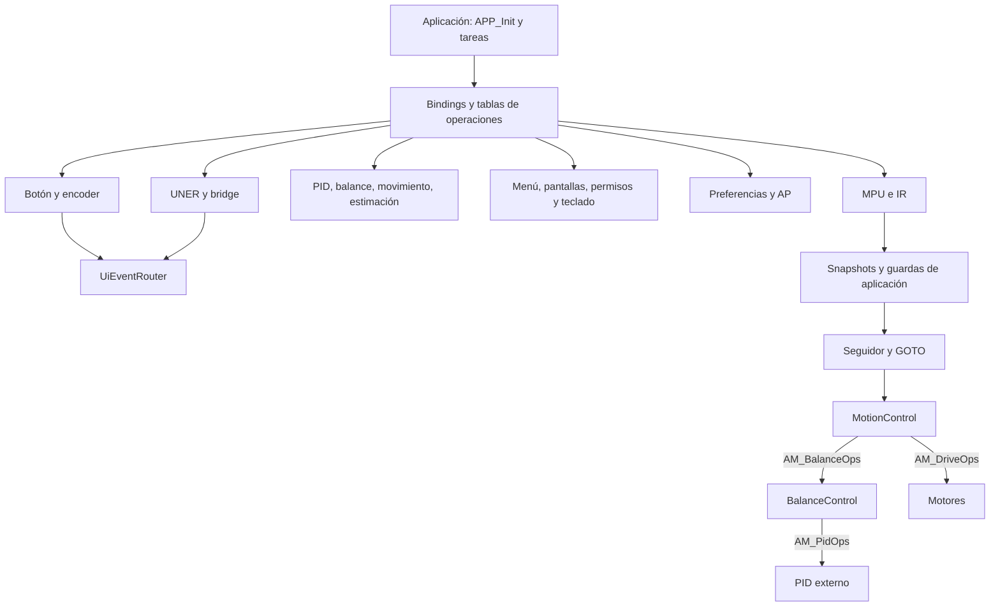
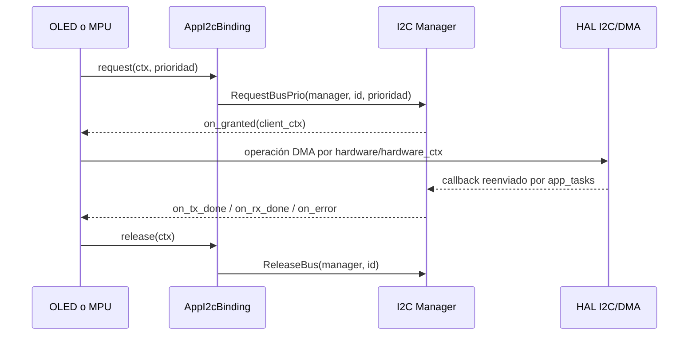

# Arquitectura y fronteras actuales de F4

Esta fotografía se basa en los archivos actuales de `FirmwareF4/Core` y
`USB_DEVICE`. Los documentos de auditoría del 2026-10-03 describen el estado
anterior al refactor; no se los usa como prueba del estado de hoy. Cada ficha
del [índice](README.md) fija archivos, hashes, API, atributos y límites propios.

## Qué significa agnóstico en este proyecto

Hay una separación real de plataforma en los núcleos de entrada, actuadores,
I2C, sensores y control. Eso no significa que todas las unidades sean
independientes entre sí: comparten modelos de datos, esquema del robot y capas
internas del mismo subsistema. La UI y la aplicación conservan dependencias
concretas. No corresponde afirmar aislamiento completo de todas las librerías.

| Familia | Frontera observada | Dependencia que sigue existiendo |
| --- | --- | --- |
| Botón / encoder / motores / IR | GPIO, timer, PWM y emisores por puertos | Cadencia, geometría y semántica del robot |
| SSD1306 / MPU | `AM_I2C_DevicePort` | Registros del dispositivo y modelos de datos propios |
| I2C Manager | `AM_I2C_Hardware` | IDs OLED/MPU y política que puede favorecerlos |
| PID / balance / movimiento / estimador | Datos y tablas `AM_*Ops` | Tipos compartidos, guardas y convenciones de control |
| Calibración / seguidor | read, command, hold, lights, restore, save | Dos APIs comparten `line_follow_control.c` |
| AutoMotion | Snapshot y operaciones inyectadas | Perfiles y serialización AutoMicro |
| Menú / OSK | Dibujo, acciones y servicios externos | Tipos de navegación o geometría del teclado |
| Preferencias | Puerto de almacenamiento | Modelos AP, calibración, misión y PIN |
| Pantallas / favoritos / permisos / AP / router UI | Tablas de servicios | Contexto global activo y referencias concretas |
| UNER core / handle | Bytes, rutas, tablas y transportes | Capas del mismo protocolo, buffers prestados |
| UNER_App / app_tasks / eventManagers | Composición | Conocimiento intencional del robot y plataforma |
| Adaptadores / USB / boot / placa | Recursos STM32 y stack ST | HAL, CubeMX, memoria, interrupciones |

La diferencia entre abstracción de llamadas y abstracción de datos queda
registrada en [AMDOC-F4-007](../../review/FINDINGS.md#amdoc-f4-007).

## Composición y control

En el ciclo actual, la aplicación reúne datos y decide qué productor opera según
modo; después aplica estimación y arbitraje. Los detalles están en
`Core/Src/app_tasks.c`, `APP_InitBalanceMotion`, tareas y callbacks de timer.
Una función presente no acredita que se ejecute en todos los modos.

## OLED y MPU trabajan en tándem por el bus

No hay llamada OLED → MPU ni MPU → OLED. `App_I2cConnect` enlaza cada cliente al
manager y su ID. El árbitro decide propiedad y el driver interpreta su secuencia
de registros. El puerto entrega también operaciones de hardware: la disciplina
de propiedad depende del uso correcto del cliente, no de un tipo que impida
todo acceso directo. Las configuraciones de arranque conservan operaciones
síncronas y esperas; el refresco/adquisición DMA es una fase distinta.

## Propiedad, atributos y callbacks

La aplicación reserva la memoria de los handles y de sus contextos. Algunos
módulos copian su tabla de puerto, otros guardan un puntero a ella; las fichas lo
distinguen. Un `void *` oculta el tipo al consumidor, pero no asegura que la
tabla y el objeto correspondan ni extiende la vida del objeto.

Los getters de estado suelen devolver vistas de RAM mutable. Un snapshot copiado
es más estable para un consumidor, aunque su copia no garantiza atomicidad
entre IRQ y tarea. `volatile` expresa acceso observable; no establece exclusión
mutua ni una transacción sobre todos los campos.

Los callbacks de finalización I2C pueden entrar desde IRQ, mientras que la
concesión puede ocurrir durante Request/Release. Los callbacks de UI sin ctx se
resuelven mediante un contexto activo. Documentar registro, invocación y efecto
separadamente evita confundir un callback instalado con un flujo ejecutado.

## Reconstrucción y pendientes

Leer primero ficha del núcleo, después puerto y adaptador, luego sus tareas y
consumidores. Para un problema ya registrado, comenzar por el ID de
[hallazgos](../../review/FINDINGS.md), que enlaza símbolos y secciones exactas.
No es necesario reconstruir el inventario completo para corregir una ficha.

No se ha probado funcionalidad, temporización física, equivalencia con otras
variantes de compilación ni independencia de varios contextos simultáneos.
