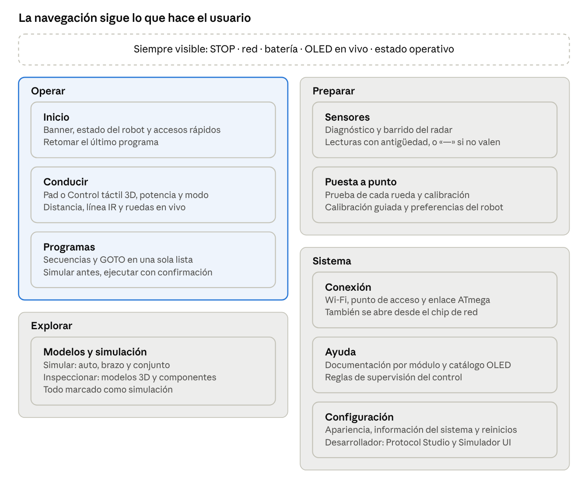
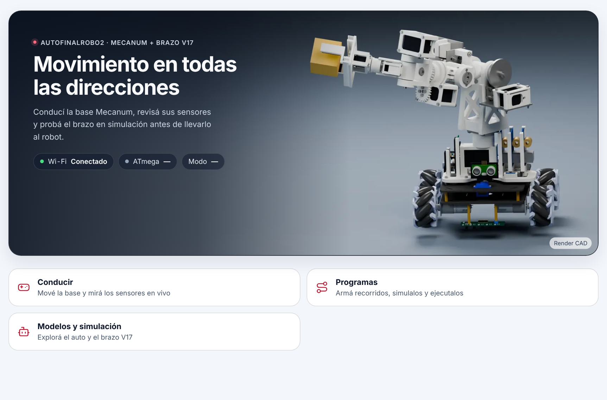
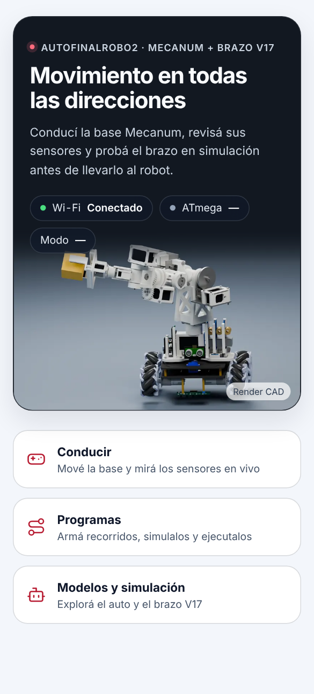

# AFR2 Web — Revisión visual y plan de implementación

> **Para implementar con Claude Code.** Este archivo es la versión en el repo del plan de revisión visual de la Web. Los recursos están en esta misma carpeta:
> - `assets/home-hero-1600.webp` y `assets/home-hero-mobile-720.webp`: banner de Inicio para el ESP. Destino: `AutoFinalRobo2-Web/public/brand/`.
> - `assets/banner-render-original.png`: render original (3,2 MB). Destino: `AutoFinalRobo2-Web/reference/brand/`, fuera del bundle.
> - `mockup/`: capturas, maqueta HTML del banner y diagrama de la navegación.
>
> Se implementa por fases (sección «Plan de implementación»), una ficha AFR2 por fase. No compilar, validar ni ejecutar `build:esp` sin pedido expreso. Si el repo cambió desde `ca9a2ae`, integrar sobre los cambios nuevos. Las opciones por defecto están en «Decisiones por defecto y riesgos».


01-11-2026 · Revisión sobre el commit `ca9a2ae`

## Resumen

La dirección visual se conserva. El plan cambia cuatro cosas: una familia de iconos única, una jerarquía tipográfica con espaciado fijo, un único selector segmentado con pill deslizante, y una organización de pantallas pensada primero para celular. Además reorganiza los recorridos por tarea (Operar, Preparar, Explorar y Sistema) y suma un banner con el render del robot en Inicio. Se ejecuta en 7 fases (la 7, pantallas OLED, se agregó el 01-11). Cada fase se puede entregar y revisar por separado.

- **Se conserva:** barra lateral, barra superior, material vidrio en capas flotantes, acento carmesí/rubí, STOP bermellón y estilo general de las pills.
- **Se cambia:** iconos, títulos (tipografía, padding, espaciado), selectores de sección, disposición responsive, ubicación de las funciones y recorridos de trabajo, banner de Inicio y algunas microinteracciones.
- **Skills aplicadas:** visual-identity-system en modo AUDITAR, apple-design, emil-design-eng, review-animations e improve-animations para el diagnóstico. animate para especificar la pill deslizante.
- **Tipo de revisión:** lectura del código fuente de `AutoFinalRobo2-Web/src` y del manual en `Contracts/docs/design-system`. No se renderizó la interfaz ni se ejecutaron builds, tests o validadores. Cada hallazgo indica si sale del código (**Observada**) o si es una propuesta (**Propuesta**).
- **Estado:** solo plan. No se modificó ningún archivo del repositorio.

## Estado del repositorio considerado

El plan está actualizado al commit `ca9a2ae` (01-11, 20:16), «Integrar firmware y Loader, reformar Simulador UI y visores 3D», que cambió 81 archivos de la Web (versión 0.4.0). No hay cambios sin commitear en la Web. Los cambios que afectan al plan son estos:

| Cambio en el repo | Efecto en el plan |
| --- | --- |
| Pill de batería en la barra superior y modal con voltaje medido (`BatteryStatus.tsx`, AFR2-20261029-26) | Entra en la barra superior en celular y en los chips del banner. Su icono SVG propio pasa al sistema de iconos. |
| Protocol Studio y Simulador UI como páginas propias (`/desarrollador/protocol-studio` y `/desarrollador/ui-simulator`) | Quedan dentro de Desarrollador y migran a `PageHeader` y `SegmentedControl`. Ahora son 8 las pantallas que usan `TaskSections`. |
| Control táctil: modelo 3D a pantalla completa, que simula si no hay enlace con el robot. Potencia en % del límite PWM. | Pasa a ser uno de los dos modos de Conducir, junto al pad. |
| «Invertir servo» se movió a Configuración → Sistema → Preferencias (`CalibrationPanel preferences`) | Las preferencias del robot pasan a Puesta a punto, y Configuración queda para la aplicación. |
| Wi-Fi reescrita: Estado de red, Buscar redes y Modificar credenciales | Sigue con 4 `SectionHeader` anidados. Se mantiene la propuesta de Conexión. |
| `MotorSelector`, `ModelAssetProgress` y tokens `--sim-scene-*` para las escenas 3D | Se reutilizan. Los tokens de escena se mantienen como están. |
| Nuevo paso `catalog-model-assets.mjs` antes de cada build | No cambia el presupuesto. El paquete del ESP sigue siendo el del 27-10/31-10. |

Los hallazgos del diagnóstico siguen vigentes y algunos crecieron. Siguen sin definirse `--dur-fast`, `--dur-press` y `--on-action`. Los glifos Unicode usados como iconos ahora son 80 en 28 archivos. Hay 16 breakpoints distintos (32 consultas `max-width` y una sola `min-width`) repartidos en 24 archivos CSS.

## Diagnóstico

El problema principal no es el estilo. Es que el mismo patrón está resuelto de varias formas: hay 7 estilos de selector, 6 tamaños de título y 16 breakpoints distintos. Además, el manual pide cosas que el código no tiene.

| Área | Hallazgo (Observada) | Dónde | Impacto |
| --- | --- | --- | --- |
| Tokens | Se usan `--dur-fast`, `--dur-press` y `--on-action`, que no existen en `tokens.css`. Al no estar definidas, el navegador descarta esas transiciones y el color de texto sobre acción queda heredado. | `workspace.css` (botones OLED, giro, avisos) | Alto |
| Tokens | El ámbar de pulsación larga está escrito como `#f59e0b` / `#fbbf24` y no cambia con el tema. | `workspace.css` `.afr2-oled-live-btn[data-state='long']` | Medio |
| Selectores | 7 estilos para el mismo control: `afr2-task-nav`, `afr2-map-views`, `afr2-segmented`, `afr2-theme-choices`, `oled-side`, botones de vista del colector y rango del radar. Ninguno tiene el indicador deslizante que el manual pide (§6.8, 250 ms). | `TaskSections.tsx` y 6 CSS | Alto |
| Iconos | 17 iconos dibujados a mano en un solo trazo, sin una grilla común. Hay 80 usos de caracteres Unicode como iconos en 28 archivos, más SVG sueltos fuera del sistema (batería y Control táctil) (→ × ■ ↑ ▶ ⏸ ⏹ ✓). STOP usa «■», aunque el manual pide un icono explícito de parada. | `UiIcon.tsx`, 28 archivos | Alto |
| Títulos | Solo OLED tiene `<h1>`. Las demás páginas empiezan con un `<h2>` de 20–24 px y peso 600; el manual pide peso 700 y tracking -0,02 em. Tamaños en uso: 14, 15, 16, 20/24, 21, 24 y clamp(26–38) px. | `SectionHeader`, `OledPage`, `ControlPage`, `afr2-section-card` | Alto |
| Títulos | Hay `SectionHeader` dentro de paneles que ya están dentro de otro `SectionHeader` (Wi-Fi tiene 4, Sensores 3). Todos se ven como título de página. | `WifiPage`, `SensorsPage` | Medio |
| Tipografía | `--font-sans` declara Inter, pero la fuente no se carga, así que se ve la del sistema. El manual define Segoe UI Variable. | `tokens.css`, `index.html` | Bajo |
| Contenedor | Modelos 3D envuelve toda la página en un `GlassSurface`. Las demás páginas no lo hacen, así que esta tiene doble padding y otro fondo. | `Model3DPage` | Medio |
| Responsive | Los breakpoints se escriben para escritorio y se achican (`max-width`) en 16 valores distintos (32 consultas max-width y una sola min-width): 380, 579, 600, 619, 640, 700, 760, 819/820, 900, 1000, 1020, 1050, 1099/1100 y 1279. | 24 CSS | Alto |
| Responsive | En el celular, el rail lateral ocupa 64 px más 16 px de margen. En una pantalla de 360 px eso es el 22 % del ancho. | `workspace.css` ≤819 px | Alto |
| Responsive | `--container-max: none`: en monitores anchos los textos y formularios se estiran sin límite. | `tokens.css` | Medio |
| Accesibilidad | Los botones para reordenar secuencias miden 24 px. El mínimo del manual es 44 px. | `.afr2-seq-reorder-btn` | Medio |
| Contenido | Control muestra telemetría cruda en un párrafo («Modo AVR: … · GOTO: … · Fallo: …») arriba de las pestañas. | `ControlPage.tsx` | Medio |
| Arquitectura | «Pantalla OLED» aparece tres veces: atajo de la barra lateral, ítem del menú y tarjeta de Inicio. Desarrollador solo se abre con un triple toque oculto en el logo. | `RouteNav`, `HomePage` | Bajo |

También hay cosas bien resueltas que conviene mantener: la escala de duraciones y curvas ya sigue a Emil Kowalski (`--ease-out` 0,23/1/0,32/1 y `--ease-drawer`), el hover está limitado a `(hover: hover) and (pointer: fine)` y existen fallbacks para movimiento reducido, transparencia reducida y alto contraste.

## Iconografía

Propuesta: reemplazar los 17 trazos dibujados a mano y los 35 caracteres Unicode por una sola familia de iconos de línea con licencia abierta, copiada dentro del repo. Así no se agrega ninguna dependencia al bundle del ESP.

**Problemas actuales (Observada).** Cada icono es un único `path` con grosores ópticos distintos. `settings` son dos líneas con dos trazos verticales y no se reconoce como ajustes. `sensors` es una onda genérica. `control` es un gamepad dibujado con curvas irregulares. En pantalla aparecen mezclados con flechas y cruces tipográficas, que cambian de forma según la fuente del sistema.

**Familia propuesta (Propuesta).** Lucide (licencia ISC), en grilla de 24 px, con el trazo ajustado de 2 a 1,75 px, con extremos y uniones redondeadas. Coincide con el `strokeLinecap`/`strokeLinejoin` que ya usa `UiIcon`. Alternativa: Phosphor (MIT) en peso Regular, si se prefiere un trazo más fino. Se copian solo los `path` que se usan a un archivo `src/components/ui/icons/registry.ts`, con un comentario de autoría y licencia, igual que el resto de las fuentes adaptadas del proyecto. El componente `UiIcon` mantiene su API (`name`), así que las llamadas existentes no cambian.

**Reglas del sistema (Propuesta).**

- Tres tamaños: 16 px en texto e insignias, 20 px en botones y la barra lateral, 24 px en tarjetas e ilustración. El grosor se mantiene en 1,75 px en todos los tamaños.
- Color siempre `currentColor`. Nunca un color fijo dentro del SVG.
- Un concepto, un icono, igual que en la regla de la skill OLED. Por ejemplo, «rueda» usa el mismo icono en Sensores, Control y Simulaciones.
- Un icono que funciona como botón lleva `aria-label`. Un icono junto a texto lleva `aria-hidden`.
- STOP usa `octagon-x` (octógono con cruz) y nunca «■», para cumplir el pedido de VIS-013 de un icono explícito de parada.

**Mapa de reemplazo (Propuesta).**

| Concepto | Hoy | Propuesta (Lucide) |
| --- | --- | --- |
| Inicio | casa propia | `house` |
| Control | gamepad propio | `gamepad-2` o `joystick` |
| Simulaciones | brazo propio | `bot` o un `arm` propio redibujado en la grilla |
| Sensores | onda | `radar` / `activity` |
| Wi-Fi | arcos propios | `wifi`, `wifi-off` y `wifi-low` como estados |
| Pantalla OLED | monitor | `monitor-smartphone` o un `oled` propio de 128×64 |
| Modelos 3D | cubo | `box` |
| Documentación | libro | `book-open` |
| Configuración | dos líneas | `settings-2` (deslizadores) |
| Colapsar barra | panel / flecha | `panel-left-close` / `panel-left-open` |
| STOP | «■» | `octagon-x` |
| Flechas de movimiento | ↑ ↓ ← → | `arrow-up` … `arrow-right` y `rotate-ccw` / `rotate-cw` para el giro |
| Reproducir / pausar / detener | ▶ ⏸ ⏹ | `play`, `pause`, `square` |
| Cerrar / confirmar | × ✕ ✓ | `x`, `check` |
| Enlace externo | ↗ | `arrow-up-right` |
| Rueda Hall / servo | propios | se redibujan como propios dentro de la grilla de 24 px y trazo de 1,75 px |

Los iconos propios del dominio (rueda Mecanum, servo, brazo, OLED) se dibujan sobre la misma grilla y se marcan como **Propuesta** en el manual. Peso estimado: unos 40 iconos de 300 a 600 bytes cada uno, entre 12 y 24 KB sin comprimir. Habría que confirmarlo contra el presupuesto de LittleFS que calcula `tools/web-budget.mjs`, pero eso solo se puede verificar compilando.

## Títulos, tipografía y espaciado

Propuesta: cinco niveles de texto con nombre propio, un `PageHeader` con el único `<h1>` de cada página y un ritmo vertical fijo de 8 px. Esto reemplaza los 6 tamaños de título actuales.

**Escala tipográfica (Propuesta).** Los valores son `font-size / line-height`, peso y tracking. Escritorio usa el valor mayor del `clamp`; celular, el menor.

| Token | Uso | Tamaño | Peso | Tracking |
| --- | --- | --- | --- | --- |
| `--type-display` | Bienvenida de Inicio | clamp(28, 4vw, 36) / 1,15 | 700 | -0,03 em |
| `--type-title` | `<h1>` de cada página | clamp(24, 2.6vw, 30) / 1,2 | 700 | -0,02 em |
| `--type-heading` | `<h2>` de un bloque o pestaña | 18 / 1,3 | 650 | -0,01 em |
| `--type-subheading` | `<h3>` de una tarjeta o panel plegable | 15 / 1,35 | 600 | 0 |
| `--type-body` | Texto general | 15 / 1,55 (16 en inputs) | 400 | 0 |
| `--type-label` | Etiquetas, pills, botones | 13 / 1,3 | 550 | 0,01 em |
| `--type-caption` | Ayuda, unidades, metadatos | 12 / 1,4 | 450 | 0,01 em |
| `--type-data` | Telemetría grande | 28 / 1 tabular | 600 | -0,02 em |

La familia vuelve a lo que fija el manual (VIS-004): `"Segoe UI Variable Display"` para títulos y `"Segoe UI Variable Text"` para texto, después `system-ui`, sin descargar fuentes. Inter sale de `--font-sans`, porque hoy está declarada pero no se carga. Los datos usan `font-variant-numeric: tabular-nums` para que las cifras no salten de ancho al cambiar.

**PageHeader (Propuesta).** Un componente nuevo reemplaza el uso de `SectionHeader` como cabecera de página y el `header` suelto de OLED:

- Fila 1: `<h1>` con `--type-title` y, a la derecha, las acciones de la página (por ejemplo, Pausar visor o Actualizar estado).
- Fila 2: una línea de descripción con `--type-body`, `--text-muted` y como máximo 60 caracteres por línea.
- Fila 3 (opcional): el selector segmentado de la página, pegado a la cabecera.
- Espacios: 8 px entre título y descripción, 20 px hasta el selector y 32 px hasta el contenido.

`SectionHeader` queda para encabezados internos (`<h2>`, `--type-heading`), sin el texto grande actual. Los `SectionHeader` anidados de Wi-Fi y Sensores se convierten en `h2`/`h3` del nivel que les toca. La barra superior deja de repetir el título de la página cuando el `<h1>` está visible y lo muestra solo al desplazarse, como en las barras de navegación de iOS (apple-design). Esa barra se sigue viendo igual que hoy.

**Títulos y textos de cada página (Propuesta).** El `<h1>` repite exactamente el nombre de la barra lateral, así el usuario sabe dónde está. La descripción es una sola línea en voseo, empieza con un verbo, dice qué se hace ahí y no afirma estados que no se midieron. Sin «Bienvenido» ni signos de exclamación.

| Página | Título (`<h1>`) | Descripción |
| --- | --- | --- |
| Inicio | Movimiento en todas las direcciones | Conducí la base Mecanum, revisá sus sensores y probá el brazo en simulación antes de llevarlo al robot. |
| Conducir | Conducir | Mové la base en cualquier dirección y mirá los sensores en vivo. |
| Programas | Programas | Armá recorridos, simulalos y ejecutalos en el robot. |
| Sensores | Sensores | Distancia, línea y ruedas, con la antigüedad de cada lectura. |
| Puesta a punto | Puesta a punto | Probá cada rueda y calibrá antes de operar. |
| Modelos y simulación | Modelos y simulación | Explorá el auto y el brazo V17, y simulá sus movimientos. |
| Conexión | Conexión | Wi-Fi, punto de acceso y enlace entre el ESP y el ATmega. |
| Ayuda | Ayuda | Cómo funciona cada módulo y cada pantalla de la OLED. |
| Configuración (modal) | Configuración | Apariencia, sistema y datos del proyecto. |

Los títulos internos (`<h2>`) son sustantivos cortos que nombran el bloque, por ejemplo «Velocidad», «Barrido del radar» o «Redes disponibles». Reemplazan títulos técnicos como «Conexion del robot» con la lista de comandos `wifi.status · wifi.scan · wifi.configure` como eyebrow. Los nombres de comandos se pueden ver en Ayuda o en un detalle plegable. Los textos recuperan las tildes que hoy faltan («Documentacion», «Calibracion», «Conexion», «Supervision»). Las pantallas OLED no cambian: sus textos siguen las skills OLED y el límite de 128×64.

**Espaciado (Propuesta).** Se usa solo la escala que ya existe (`--space-1` … `--space-12`, múltiplos de 4 px), con estos nombres según el rol:

| Token | Valor celular → escritorio | Dónde |
| --- | --- | --- |
| `--page-gutter` | 16 → 32 px | Padding lateral de `.afr2-main` y la barra superior |
| `--page-top` | 20 → 32 px | Espacio entre la barra superior y el `<h1>` |
| `--section-gap` | 24 → 40 px | Entre bloques de una página |
| `--card-padding` | 16 → 24 px | Tarjetas y paneles (hoy es 28 fijo) |
| `--stack-gap` | 12 → 16 px | Entre campos de un formulario |
| `--content-max` | 1200 px | Ancho máximo de texto y formularios. Escenas 3D, mapa y radar pueden ocupar todo el ancho. |

Con esto, Modelos 3D deja de envolver la página en un `GlassSurface`: la cabecera queda sobre el lienzo como en las demás páginas y solo el visor lleva superficie. Las tarjetas mantienen el radio de 18 px y los controles el de 10 px, como hoy.

## Selector de secciones: ranura con pill deslizante

Propuesta: un único componente `SegmentedControl`. Es una ranura oblonga con fondo sutil, y la pill seleccionada se desliza en 250 ms hasta la opción elegida. Reemplaza las 7 implementaciones actuales y cumple el §6.8 del manual, que ya pedía este indicador.

**Anatomía.**

- **Ranura:** `--surface-subtle`, radio de pill, padding de 4 px, borde interior de 1 px con `--border-subtle` y un `inset 0 1px 2px` muy leve para que se lea como hundida. Alto de 44 px, el mínimo táctil.
- **Pill activa:** `--surface-solid`, borde con `--border-default` y la sombra `--glass-chrome-shadow` que ya usa la pestaña activa. Así el estilo de pill que te gusta no cambia, solo pasa a estar dentro de una ranura.
- **Texto:** `--type-label`. Inactivo en `--text-muted`, activo en `--text-strong`. Icono opcional de 16 px a la izquierda.
- **Variantes:** `tabs` (`role="tablist"`, cambia el panel de la página) y `choice` (`role="radiogroup"`, para vista, rango, tema o modo). Tamaños `md` de 44 px y `sm` de 36 px; `sm` solo con puntero fino, porque en pantalla táctil vuelve a 44 px.

**Decisiones de movimiento (skill animate).**

1. **¿Debe animarse?** Sí. Se usa decenas de veces por día, así que el movimiento tiene que ser corto y discreto. Con teclado (flechas, Inicio, Fin) el cambio es instantáneo: el skill y el manual coinciden en que una acción de teclado no se anima.
2. **Propósito:** consistencia espacial. Muestra de dónde viene la selección y hacia dónde va.
3. **Herramienta:** una transición CSS, sin librerías de animación. Se usa la receta *tab indicator* del skill: una copia de la lista con estilo activo, recortada con `clip-path: inset(… round 9999px)`. Fondo y color de texto cambian juntos porque son el mismo elemento revelado; no hay dos colores interpolados desfasados.
4. **Propiedades:** solo `clip-path`, la cuarta propiedad permitida después de `transform` y `opacity`. No se anima `width` ni `left`.
5. **Curva y duración:** `--duration-segmented` (250 ms, ya existe) con `--ease-in-out`, porque es un movimiento dentro de la pantalla. El manual pide `easeStandard`; este cambio se registra como decisión VIS nueva.
6. **Interrupción:** al ser transición y no keyframes, si se toca otra opción a mitad de camino la pill cambia de destino desde donde está, sin volver a empezar.
7. **Movimiento reducido:** `--duration-segmented` ya vale 0 ms con `prefers-reduced-motion`. La pill aparece directamente en su lugar.

**Detalles para que se vea bien.**

- En el primer render no hay transición: la pill aparece en su sitio y la transición se habilita después del primer frame.
- Un `ResizeObserver` recalcula la posición si cambia el ancho (rotación del celular, barra lateral que se pliega) sin animar ese ajuste.
- El `clip-path` se escribe directamente en el elemento copia, no mediante una variable CSS del contenedor: el skill lo pide para no recalcular estilos en todos los hijos.
- Si las opciones no entran en el ancho, la ranura se desplaza horizontalmente con `scroll-snap` y la opción activa se trae a la vista (`scrollIntoView({ inline: 'nearest' })`). Con 2 a 4 opciones cortas, en celular se reparten en columnas iguales que ocupan todo el ancho.
- Al presionar, el texto se achica a `scale(.97)` en 150 ms con `--ease-out` (la regla de pulsación del manual), solo con puntero.

**Esqueleto del componente (Propuesta).**

```tsx
<div className="afr2-seg" data-size="md" data-ready={ready}>
  <div role="tablist" className="afr2-seg__track">{items.map(i => <button role="tab" …>{i.label}</button>)}</div>
  <div className="afr2-seg__active" aria-hidden="true" ref={copy}>{items.map(i => <span>{i.label}</span>)}</div>
</div>
// useLayoutEffect: medir el botón activo y escribir en copy.current.style.clipPath
// inset(0 {derecha}px 0 {izquierda}px round 9999px)
```

**Dónde se usa.**

| Hoy | Pasa a | Variante |
| --- | --- | --- |
| `TaskSections` (Control, Sensores, Wi-Fi, Simulaciones, Modelos 3D, Documentación, Protocol Studio, Simulador UI) | `TaskSections` usa `SegmentedControl` por dentro, con la misma API | `tabs` |
| `.afr2-map-views` (vista del mapa, radar) | `SegmentedControl` | `choice`, `sm` |
| Rango del radar 0,5 / 1 / 2 / 4 m | `SegmentedControl` | `choice`, `sm` |
| Vista del colector (Perspectiva / Superior / Lateral) | `SegmentedControl` | `choice`, `sm` |
| `.afr2-theme-choices` (Automática / Clara / Oscura) | `SegmentedControl` | `choice` |
| `.afr2-segmented` (modo del robot, lado de curva, pista de rueda) | `SegmentedControl` | `choice` |
| `.afr2-oled-side` (controles del menú OLED) | Se revisa con la skill oled128-ui-design antes de tocarlo, porque replica un control físico | — |

Los botones que encienden o apagan algo (Mover auto, Mostrar alcance, Referencias) no son selectores, así que siguen siendo botones con `aria-pressed`.

## Responsive mobile-first y organización de pantallas

Propuesta: escribir el CSS para 360 px y agregar reglas al crecer (`min-width`), con 4 breakpoints en lugar de 16. La navegación se ordena por lo que el usuario hace: operar el robot, simular y explorar, y configurar el sistema.

**Breakpoints (Propuesta).** Se definen como tokens y como variantes de Tailwind v4 con `@theme`, para que CSS y clases usen los mismos valores.

| Nombre | Desde | Disposición |
| --- | --- | --- |
| base | 0 | Celular: una columna, navegación inferior, STOP siempre visible |
| `sm` | 600 px | Celular grande o tablet vertical: tarjetas de 2 columnas y formularios en 2 columnas |
| `md` | 840 px | Tablet horizontal: aparece la barra lateral como rail de 76 px |
| `lg` | 1200 px | Escritorio: barra lateral expandida (248 px), vistas de trabajo con panel lateral |
| `xl` | 1600 px | Monitor ancho: el contenido se limita a `--content-max` y las escenas 3D usan el ancho sobrante |

Los paneles internos (radar, editor de secuencias, mapa, inspección 3D) usan *container queries* (`@container`): se adaptan al ancho que realmente tienen y no al de la ventana. Así un panel no se rompe cuando la barra lateral se expande.

**Reglas para que nada se salga de la pantalla (Propuesta).**

- Todo hijo de un grid o de un flex lleva `min-width: 0`.
- Identificadores, IP y nombres de red usan `overflow-wrap: anywhere`.
- Tablas y líneas de tiempo se desplazan dentro de su contenedor, con un degradado en el borde que indica que hay más contenido. La página nunca se desplaza horizontalmente.
- Ningún ancho fijo mayor a 320 px. Se usa `minmax(min(100%, Xpx), 1fr)` en los grids.
- Los inputs tienen 16 px de texto como mínimo para que iOS no haga zoom. Esto ya está en el manual.
- Las escenas 3D y el radar usan `aspect-ratio`: 4/3 en celular y 16/9 desde `lg`, con alto máximo de `70dvh`.
- Se respetan `safe-area-inset-*` en la barra inferior y en los modales.

**Navegación (Propuesta, requiere tu decisión).** En celular, el rail lateral ocupa el 22 % del ancho. Hay dos opciones; la barra lateral de escritorio no cambia en ninguna:

1. **Barra inferior en celular (recomendada).** Cinco destinos al alcance del pulgar: Inicio, Conducir, Programas, Sensores y Más. «Más» abre una hoja inferior con Puesta a punto, Modelos y simulación, Conexión, Ayuda y Configuración. El contenido recupera esos 80 px.
2. **Rail oculto.** Se mantiene la barra lateral actual como cajón superpuesto, que se abre desde un botón en la barra superior. Cambia menos, pero cada navegación necesita dos toques.

**Grupos de la barra lateral.** Operar, Preparar, Explorar y Sistema, como se detalla en la sección de flujos que sigue. El atajo «OLED en vivo» se mantiene arriba de todo.

**Barra superior en celular (Propuesta).** Una sola fila: título de la página (solo al desplazarse), las pills de red y batería reducidas a icono y valor (el texto completo queda en su \`aria-label\`) y STOP con 48 px de alto. Hoy se parte en dos filas por debajo de 820 px.

**Pantalla por pantalla.**

| Pantalla | Celular (base) | Escritorio (`lg`) |
| --- | --- | --- |
| Inicio | Banner (texto arriba, render abajo), tarjeta «Conectar» si no hay enlace y accesos compactos de 72 px | Banner 2,4:1 con el texto sobre la imagen y accesos en 3 columnas |
| Conducir | El pad ocupa el ancho, la velocidad debajo y los sensores en una franja deslizable. En horizontal, pantalla completa. | Pad y mapa a la izquierda, sensores en vivo en un panel lateral de 320 px |
| Programas | Lista de programas. El editor usa una línea de tiempo con desplazamiento horizontal y bloques de al menos 44 px, y la edición de un bloque abre una hoja inferior. | Lista a la izquierda, editor en el centro y propiedades del bloque a la derecha |
| Sensores | Selector Distancia / Línea / Ruedas. Radar con alto acotado y los controles de barrido debajo. Ruedas en un grid de 2×2 (FL FR / RL RR, igual que el robot). | Radar a la izquierda y controles en un panel lateral de 320 px |
| Puesta a punto | Selector Ruedas / Calibración. Una columna con la guía paso a paso. | Guía y explicación lado a lado |
| Modelos y simulación | Selector Simular / Inspeccionar y luego el modelo. Escena primero, controles en una hoja inferior y la matriz en un modal. | Escena con los controles a la derecha y la matriz como panel lateral plegable |
| Conexión | Estado del enlace arriba y luego redes y formulario, en una columna | Estado y formulario en 2 columnas |
| Ayuda | Selector Web / ESP / ATmega / OLED y acordeones | Lo mismo, con un máximo de 72 caracteres por línea |

Las tres simulaciones siguen marcadas como simulación. Un dato que falta o no es válido se muestra como «—» y nunca como 0, como piden las instrucciones del proyecto.

## Flujos de trabajo reorganizados

Propuesta: ordenar la Web por tareas y no por módulos. Los 8 destinos más los ocultos de hoy pasan a 9 destinos en 4 grupos: Operar, Preparar, Explorar y Sistema. Se mantienen la identidad visual y los componentes; cambian el lugar de las cosas y los recorridos.



El grupo resaltado es donde el usuario pasa la mayor parte del tiempo. Por eso Operar va primero en la barra lateral y ocupa la barra inferior en celular.

**Qué se mueve y por qué.**

| Hoy | Propuesta | Motivo |
| --- | --- | --- |
| Control → Conducción manual (tarjeta que abre un overlay) | **Conducir** es su propia página: pad, velocidad y mapa, con distancia, línea IR y ruedas en un panel al costado (abajo en celular) | Mientras maneja, el usuario quiere ver los sensores sin cambiar de página. Un paso menos. |
| Control → Secuencias y Control → GOTO, separados | **Programas**: lista de secuencias y misiones GOTO. Al abrir uno, editor con línea de tiempo, vista previa simulada y botón «Ejecutar en el robot» con confirmación | Los dos son «programar un recorrido». Separar simular de ejecutar evita confundir una animación con un movimiento real. |
| Control → Prueba de rueda y Calibración | **Puesta a punto** | Se usan antes de operar, no durante. |
| Sensores | **Sensores**, en Preparar, enfocada en diagnóstico y configuración del barrido | Las lecturas en vivo también están en Conducir. |
| Simulaciones y Modelos 3D, separadas | **Modelos y simulación**, con selector Simular / Inspeccionar | Usan el mismo modelo 3D y el mismo tipo de visor. |
| Wi-Fi | **Conexión**: Wi-Fi, punto de acceso y estado del enlace ESP–ATmega. También se abre desde el chip de red de la barra superior | El usuario busca «conexión» cuando algo no responde, no solo «Wi-Fi». |
| Pantalla OLED (página) + atajo + tarjeta de Inicio | El visor en vivo queda solo como modal global (atajo de la barra lateral). El catálogo de pantallas pasa a **Ayuda** | El visor se consulta desde cualquier lugar. El catálogo es material de referencia. |
| Documentación + «Supervisión del control Web» al pie de Control | **Ayuda**: documentación, catálogo OLED y reglas de supervisión | Saca texto de referencia de las pantallas de trabajo. |
| Telemetría en un párrafo arriba de Control | **Barra de estado operativo** bajo la barra superior, solo en Conducir y Programas: Modo, GOTO, Salidas y Fallo | El estado se ve donde importa y con el mismo formato en las dos páginas. |
| Desarrollador (triple toque oculto) | Configuración → Acerca de, y el triple toque sobre el banner | Se puede encontrar sin conocer el truco. |

**Funciones agregadas en `ca9a2ae` y dónde quedan.**

| Hoy | Propuesta | Motivo |
| --- | --- | --- |
| Control → Movimiento: pad y botón «Control táctil», que abre el 3D a pantalla completa | **Conducir** con un selector Pad / Táctil 3D. Sin enlace con el robot, Táctil 3D sigue disponible y se marca como simulación local. | Las dos son formas de conducir: mismas potencias, mismo permiso y mismo motivo de bloqueo (AFR2-20261030-18) |
| Potencia de traslación y de giro (% del límite PWM) y modo operativo dentro de la tarjeta | Fila fija debajo del pad: potencia, giro y modo (Inactivo / Manual / Seguir línea) en un `SegmentedControl` | Están a mano sin abrir otra tarjeta |
| Configuración → Sistema → Preferencias (invertir servo y otros parámetros del robot) | **Puesta a punto → Preferencias** | Son parámetros del robot que se guardan en EEPROM, no ajustes de la aplicación |
| Pill de batería y Configuración → Batería (repetida) | La pill y su modal se mantienen; se quita la copia de Configuración | Un solo lugar para medir |
| Configuración → Detalles de la conexión y Diagnóstico WebSocket | **Conexión → Diagnóstico** | Es donde se busca cuando algo no responde |
| Configuración → Información de hardware, LittleFS y reinicios | Se quedan en Configuración → Sistema | Son del sistema completo |
| Desarrollador → Protocol Studio y Simulador UI | Se mantienen como páginas propias dentro de Desarrollador, y Desarrollador se abre desde Configuración → Acerca de | Son herramientas de desarrollo y no tareas de operación |

**Recorridos principales (Propuesta).**

1. **Primera conexión:** si la Web no tiene enlace con el robot, Inicio muestra arriba una tarjeta «Conectar con el robot» que lleva a Conexión. Las secciones siguen accesibles, pero las acciones físicas quedan deshabilitadas con el motivo a la vista.
2. **Manejar:** Inicio → Conducir. En celular horizontal, el pad ocupa la pantalla y los sensores quedan en una franja. STOP sigue en la barra superior.
3. **Programar un recorrido:** Programas → Nuevo → armar bloques → Simular (vista previa marcada como simulación) → Ejecutar en el robot (confirmación). Durante la ejecución se ve el progreso real que informa el ATmega y no el de la simulación.
4. **Preparar antes de operar:** Puesta a punto → Prueba de rueda (FL, FR, RL, RR) → Calibración guiada.
5. **Algo no responde:** chip de red de la barra superior → hoja de Conexión, sin salir de la página actual.

**Rutas.** Las rutas nuevas (`/conducir`, `/programas`, `/puesta-a-punto`, `/modelos`, `/conexion`, `/ayuda`) mantienen redirecciones desde las actuales, como ya se hace con `/brazo` y `/simulacion`. Ningún cambio toca protocolos, comandos ni mensajes UART: es una reorganización de la interfaz. Los mapas de UI de `Web/docs` (por ejemplo `ui-control-map-20261023.json`) se tienen que actualizar en la misma ficha AFR2.

## Banner de Inicio

Propuesta: un banner con el render del robot en la parte superior de Inicio, arriba de las secciones. Reemplaza el bloque actual de logo y «¿Qué querés hacer?». La imagen ya está convertida a WebP y las tres versiones juntas pesan 54 KB, contra 3,2 MB del PNG original. Las capturas son de una maqueta HTML hecha con los tokens del proyecto; todavía no está en el código de la Web.





Maqueta navegable: [`mockup/banner-maqueta.html`](mockup/banner-maqueta.html). Usa las mismas WebP de `assets/`.

**Imagen (hecho; archivos en `assets/` de esta carpeta).** El render original es de 2048×1536. Para escritorio se extendió el fondo degradado hacia la izquierda, así el robot queda a la derecha y el texto tiene lugar sin tapar el brazo. No se modificó el robot.

| Archivo | Medida | Peso | Uso |
| --- | --- | --- | --- |
| `home-hero-1600.webp` | 1600×667 (2,4:1) | 24 KB | Escritorio y pantallas de alta densidad |
| `home-hero-960.webp` | 960×400 (2,4:1) | 13 KB | Tablet horizontal y escritorio chico |
| `home-hero-mobile-800.webp` | 800×500 (16:10) | 17 KB | Celular, recortada sobre el robot |

Calidad WebP 78. Destino propuesto: `AutoFinalRobo2-Web/public/brand/`, junto al logo. El PNG original se guarda como fuente en `Web/reference/brand/`, fuera del bundle, como se hizo con el logo (AFR2-20261024-03). Para el ESP se usan solo dos versiones ajustadas a bloques de 8 KiB: home-hero-1600.webp (22 KB, calidad 76) para escritorio y home-hero-mobile-720.webp (15 KB) para celular. En total ocupan 40 KiB en LittleFS.

**Diseño.**

- **Contenedor:** radio de 24 px (`--radius-xl`), borde de 1 px al 10 % y la sombra flotante del espacio de trabajo. El banner es oscuro en los dos temas, porque es una foto con fondo azul noche. Se integra con el carmesí del tema claro y con el rubí del oscuro.
- **Escritorio (desde 840 px):** proporción 2,4:1 y alto mínimo de 300 px. La imagen va de fondo, alineada a la derecha. Un degradado horizontal (de 88 % a 0 % de azul noche entre 0 y 58 % del ancho) asegura el contraste del texto en todo el lado izquierdo.
- **Celular:** texto arriba sobre el azul noche de la imagen y la foto abajo, con una máscara que funde su borde superior. Así el texto no queda sobre la parte clara del fondo.
- **Texto:** kicker «AutoFinalRobo2 · Mecanum + brazo V17» con un punto rubí. Título «Movimiento en todas las direcciones», que nombra lo que distingue a la base Mecanum, en `--type-display` (28–40 px, peso 700) y la descripción «Conducí la base Mecanum, revisá sus sensores y probá el brazo en simulación antes de llevarlo al robot.» La frase no afirma que el robot esté listo ni probado: deja claro que el brazo todavía se trabaja en simulación. El título es el `<h1>` de Inicio.
- **Estado del robot:** chips de vidrio con datos reales: Wi-Fi, enlace con el ATmega, modo y batería (voltaje medido, nunca un porcentaje de carga). Si un dato no se conoce, muestra «—». Tocar un chip abre el detalle de conexión.
- **Etiqueta «Render CAD»:** abajo a la derecha, para que la imagen no se confunda con una foto del robot real, según la regla de separar lo simulado de lo físico.
- **Accesibilidad:** `alt` descriptivo y `<picture>` con `srcset`, para que el celular no descargue la versión de 1600 px. Contraste del texto blanco sobre el degradado mayor a 7:1 en la zona del título.
- **Movimiento:** ninguno. Inicio se visita muchas veces por día, así que el banner aparece con la transición de página que ya existe y nada más.
- **Desarrollador:** el triple toque del logo pasa a la imagen del banner. También queda la entrada en Configuración → Acerca de.

## Movimiento y microinteracciones

El sistema de movimiento ya está bien planteado. Lo que hay que hacer es arreglar las transiciones que no se ejecutan, dar movimiento a los elementos nuevos (pill, hojas inferiores, título de la barra) y no animar lo que se usa todo el tiempo. Revisión hecha con review-animations e improve-animations, sobre el código y sin ver la interfaz en funcionamiento.

| Elemento | Hoy (Observada) | Propuesta | Motivo |
| --- | --- | --- | --- |
| Botones OLED, giro, avisos | `transition` con `--dur-fast`/`--dur-press`, que no existen; el navegador descarta la declaración completa | Usar `--duration-fast` y `--duration-button-press` | Hoy no tienen feedback de pulsación |
| Selector de sección | Cambio de color sin indicador | Pill con `clip-path`, 250 ms, `--ease-in-out`; instantáneo con teclado | Consistencia espacial |
| Panel de la pestaña | Se reemplaza de golpe | Fundido de entrada de 120 ms solo con `opacity` (`@starting-style`), sin desplazamiento | Se usa decenas de veces por día: casi imperceptible |
| Cambio de página | `afr2-route-enter`: opacidad + 4 px en 180 ms | Se mantiene | Ya cumple el manual |
| Barra lateral al plegarse | El ancho salta y el contenido se reacomoda de golpe | No animar el ancho (es layout). Fundido de etiquetas de 120 ms | Evita animar layout y el desplazamiento del contenido |
| Hoja inferior («Más», controles de simulación) | No existe | `translateY(100%)` → 0 en 240 ms con `--ease-drawer`. Sale por donde entró. Arrastrar para cerrar con resorte (`bounce` 0,15) | El manual permite resortes solo si hay un gesto de arrastre real (§9.5) |
| Título en la barra superior | No existe | Aparece con opacidad + 4 px en 180 ms con `--ease-out` cuando el `<h1>` sale de la vista | Mantiene el contexto sin duplicar el título |
| Pulsación larga del encoder | Barra con `scaleX` (bien), ámbar fijo | Mismo movimiento, color con un token `--attention` en ambos temas | Coherencia de tema |
| STOP | Sin animación de entrada | Solo `scale(.97)` al presionar, sin demora. Nunca una animación de entrada ni de pulso | Una acción de seguridad no espera a ninguna animación |
| Telemetría | Valores que cambian directamente | Sin animación de números, con cifras tabulares | El manual lo prohíbe; las cifras no deben moverse |
| Tarjetas de Inicio | Al pasar el puntero: `translateY(-2px)` y sombra, solo con puntero fino | Se mantiene. En celular, `scale(.98)` al presionar | Feedback táctil |

Para terminar: `transition: all` no aparece en el código revisado, y los selectores `aria-pressed` con `!important` de `robot-controls.css` y `collector.css` desaparecen cuando esos grupos pasan a `SegmentedControl`. Falta comprobar si `CollapsiblePanel` anima `grid-template-rows` como pide el manual: en esta revisión solo se vio su CSS, sin animación.

## Presupuesto de memoria (LittleFS)

La aplicación Web puede ocupar como máximo unos 1.000 KiB en la flash. Hoy usa 536 KiB, así que quedan unos 464 KiB de margen. Todo el plan está estimado en menos de 70 KiB. Los números salen del último paquete copiado al ESP (`ESP/data/dist/manifest.json`, interfaz del 27-10 y modelos del 31-10) y de la fórmula de `Web/tools/web-budget.mjs`. No se compiló nada para calcularlos.

**Cómo se cuenta (Observada).** El tope es de 2.800 KiB (2.867.200 bytes) y no de 3 MiB, porque el linker del ESP8266 reserva sectores para EEPROM y RF dentro de la partición nominal (AFR2-20261024-04). Cada archivo se guarda comprimido con gzip y ocupa bloques enteros de 8 KiB (tamaño comprimido + 512 bytes, redondeado hacia arriba). Además se reservan 64 KiB fijos. Un archivo de 9 KB ocupa 16 KiB, así que conviene que cada imagen quede justo por debajo de un múltiplo de 8 KiB.

| Categoría | Archivos | Ocupa en LittleFS |
| --- | --- | --- |
| Modelos 3D y decodificador | Auto (729 KB gz), brazo V17 (690 KB gz), cubo, catálogo y Draco (wasm + js) | 1.496 KiB |
| Marca | Logo 1024, logo 256 y favicon | 232 KiB |
| Reserva fija | — | 64 KiB |
| `manifest.json` | No entra en la fórmula actual, pero se copia igual | 8 KiB |
| **Disponible para la aplicación Web** | `index.html` + worker del brazo | **1.000 KiB** |
| Usado por la aplicación hoy | `index.html.gz` (512 KiB gz) + `armMotion.worker` (11 KB gz) | 536 KiB |
| **Margen** | — | **464 KiB** |

**Costo estimado del plan.**

| Cambio | Estimación en LittleFS | Fuente |
| --- | --- | --- |
| Banner de Inicio (versiones para el ESP) | 40 KiB | Medido: `home-hero-1600.webp` 22 KB (3 bloques) + `home-hero-mobile-720.webp` 15 KB (2 bloques) |
| Iconos (unos 40, en línea en el JS) | +8 a +16 KiB | Estimado: 12–24 KB sin comprimir, que gzip reduce mucho porque los trazos se repiten |
| `SegmentedControl`, `PageHeader`, hojas inferiores | +8 a +16 KiB | Estimado |
| CSS de selectores viejos y breakpoints duplicados que se borran | –8 a –0 KiB | Estimado |
| Reorganización de páginas y rutas | ≈ 0 | El código cambia de lugar, no se duplica |
| **Total** | **unos 50 a 70 KiB** | El margen quedaría entre 390 y 410 KiB |

**Reglas para mantenerse por debajo (Propuesta).**

- Cada imagen va en WebP y con el tamaño máximo al que se muestra. En el ESP hay una sola versión por uso (escritorio y celular), y las versiones intermedias quedan para el perfil `full`.
- No se descargan fuentes Web y no se agregan paquetes de iconos: solo los trazos usados, en línea.
- Los modelos 3D no se duplican y se cargan solo en las páginas que los usan.
- `package-web.mjs` ya cancela el empaquetado si se supera el tope. Se propone agregar un aviso al llegar al 90 % (2.520 KiB) y sumar `manifest.json` a la fórmula.
- Cada ficha AFR2 de este plan registra el espacio usado por categoría después del `build:esp`, cuando lo pidas.

**Ahorro posible.** El logo de 1024 px (`Logo-robot-1024.webp`, 156 KB en las fuentes actuales) solo se usa en la bienvenida, que lo muestra mucho más chico. Una versión de 512 px podría liberar más de 100 KiB; hay que medirlo. Además, el paquete del ESP todavía tiene el logo anterior (`Logo-1024.webp`, 204 KB): las fuentes cambiaron después del último empaquetado, así que el número real de hoy solo lo da un `build:esp` nuevo.

## Plan de implementación

Siete fases en orden, porque cada una se apoya en la anterior. La fase 7 toca además el firmware del ATmega, siempre junto con su copia Web. Cada fase cierra con su ficha AFR2 en Contracts. Las fases 1 a 6 son solo del módulo Web y de la documentación de Contracts; ninguna fase toca protocolos, mensajes UART ni pinout. El paquete que se copia al ESP cambia solo cuando lo pidas con `build:esp`.

**Al empezar y al cerrar cada fase.**

- [ ] Revisar `git log` y `git status` y comparar con `ca9a2ae`, el commit sobre el que se escribió el plan.
- [ ] Crear la ficha `AFR2-AAAAMMDD-NN` con la plantilla de `Contracts/changes`, con el número siguiente del día.
- [ ] Fases 1 a 6: editar solo la Web y la documentación de Contracts; no tocar Atmega, ESP, protocolos ni las skills OLED. Fase 7: pantallas ATmega + Web vinculadas según `afr2-screen-authoring`.
- [ ] No compilar, validar ni ejecutar `build:esp` sin pedido expreso.
- [ ] Cerrar la ficha con lo que realmente pasó: fuente modificada, artefacto generado, paquete copiado al ESP y verificación en navegador. Si algo no se hizo, se dice que no se hizo.
- [ ] Registrar en `CHANGELOG.md` y en `design-system/decisions.md` las decisiones VIS de la fase.

1. **Base: decisiones y tokens.**
   - Registrar en `Contracts/docs/design-system/decisions.md` las decisiones nuevas: iconos, escala tipográfica, selector segmentado con `--ease-in-out`, breakpoints y navegación en celular. Actualizar `tokens.json` y `manual.md`.
   - En `tokens.css` e `index.css`: tokens `--type-*`, `--page-gutter`, `--section-gap`, `--card-padding`, `--content-max`, `--attention`, breakpoints en `@theme` y familia Segoe UI Variable.
   - Arreglo inmediato: reemplazar `--dur-fast`, `--dur-press` y `--on-action` por los tokens existentes en `workspace.css`.
   - Criterio: no queda ningún `var(--…)` sin definir ni ningún color fijo fuera de `tokens.css`.
2. **Iconos.**
   - Crear `components/ui/icons/registry.ts` con los paths de Lucide, crédito y licencia, y redibujar los iconos propios en la grilla de 24 px.
   - Ampliar `UiIconName` y agregar la prop `size` (16 / 20 / 24).
   - Reemplazar los 80 usos de caracteres Unicode en 28 archivos y los SVG sueltos de batería y Control táctil, incluido STOP en `RouteNav`, `FloatingModal`, `StartupWelcome` y `MecanumDrivePad`.
   - Criterio: ningún glifo Unicode funciona como icono, y todos los botones que solo tienen icono tienen nombre accesible.
3. **Selector segmentado.**
   - Crear `components/ui/SegmentedControl.tsx` y `styles/segmented.css` según la especificación de arriba.
   - Hacer que `TaskSections` lo use por dentro, sin cambiar su API: las 8 pantallas que lo usan, incluidas Protocol Studio y Simulador UI, no se tocan.
   - Migrar los 6 grupos `choice`: mapa, radar, rango, colector, tema y `.afr2-segmented`. Borrar el CSS que queda sin uso. `oled-side` se revisa aparte con las skills OLED.
   - Criterio: hay una sola implementación; las flechas, Inicio y Fin funcionan; con teclado y con movimiento reducido el cambio es instantáneo.
4. **Títulos y contenido.**
   - Crear `components/ui/PageHeader.tsx` con el `<h1>` y reducir `SectionHeader` a `<h2>`.
   - Aplicarlo en las 9 páginas, en Protocol Studio y en Simulador UI, aplanar los `SectionHeader` anidados de Wi-Fi y Sensores, y quitar el `GlassSurface` exterior de Modelos 3D.
   - Pasar la telemetría de Control a una fila de chips de estado.
   - Criterio: cada página tiene exactamente un `<h1>`, sin saltos de nivel de encabezado, y todos los tamaños de texto salen de `--type-*`.
5. **Estructura responsive y navegación.**
   - Reescribir `workspace.css` mobile-first: barra inferior o cajón en celular según lo que decidas, barra superior en una fila, los 4 grupos en la barra lateral y Desarrollador en Configuración. Rutas nuevas (Conducir, Programas, Puesta a punto, Modelos y simulación, Conexión, Ayuda) con redirecciones desde las actuales y barra de estado operativo.
   - Reemplazar los 16 breakpoints por los 4 nuevos en los 24 CSS, con `min-width`.
   - Criterio: a 360, 600, 840, 1200 y 1600 px no hay desplazamiento horizontal de la página, STOP queda visible y todos los destinos táctiles miden al menos 44 px.
6. **Pantallas y cierre.**
   - **Avance 02-11 (AFR2-20261102-01):** banner de Inicio hecho. Modelos y simulación cambió por pedido humano: portada con tres banners de render → inspección directa (`/modelos/:modelo`, «Ir a simulación») → simulador aparte (`/simulacion/:tipo`) con selector; ya no hay selector Simular/Inspeccionar. El árbol de pantallas del Simulador UI pasó a mapa conceptual. Revisión en navegador hecha a 5 anchos.
   - Aplicar la tabla de pantallas: banner de Inicio (copiar las WebP a \`public/brand/\` y el PNG a \`reference/brand/\`), Conducir con sensores en vivo, Programas con simular y ejecutar separados, hojas inferiores en Modelos y simulación y en Programas, *container queries* en radar, mapa, editor e inspección 3D.
   - Botones de reordenar de 44 px. Fundidos y título de la barra según la tabla de movimiento.
   - Cerrar la ficha AFR2 y actualizar `INFORME_MAESTRO.md`.
   - Criterio: la ficha distingue fuente modificada, artefacto generado, paquete copiado al ESP y comprobación en navegador.

7. **Pantallas OLED: réplica Web y auto con la misma identidad** (agregada el 01-11 a pedido del usuario, después de la fase 1).
   - Motivo: la réplica Web (`OledCanvas128x64`, `firmwareRenderer.ts`) es una copia fiel del ATmega. Se usa como banco de diseño: lo que se rediseña en la Web se porta igual al firmware, así se sabe que va a funcionar en el auto. El estilo buscado es el mismo en la Web y en la OLED.
   - Skills: `oled128-ui-design` (diseño, perfil OLED128-5) y `afr2-screen-authoring` (integración ATmega + Web en la misma tarea, mismos ScreenCodes, bytes, coordenadas y navegación).
   - **Tokens de la réplica:** pasar a `tokens.css` los colores del marco y del panel de `OledCanvas128x64` (`--oled-pixel-on`, `--oled-pixel-off`, grilla, insignias de origen), con los mismos valores. Los píxeles no cambian. Cierra la excepción registrada en VIS-054.
   - **Acciones rápidas en tarjetas (010003):** reemplazar el carrusel actual de 7 páginas por `QuickActionDeck/Card/Row` de OLED128-4: título y contador `n/total` arriba, dos filas de 16 px con franja invertida de foco y pie con encoder+OK y largo+flecha. Agrupación propuesta de las 7 acciones actuales, a confirmar: **Radar** (Barrido, Rastro, Alcance), **Actuadores** (Servo, Motores), **Modo** (Seguir línea, Reposo/Manual) y **Menú principal**. El giro recorre las acciones y pasa de tarjeta al llegar al borde; corto confirma solo la acción enfocada; largo vuelve al dashboard. Se mantiene la confirmación por estado real (`quick_pending`, «Sin confirmar»).
   - **Dashboard (010001):** evaluar la composición OLED128-3 (cabecera invertida, paneles de estado y métrica) sin perder SSID/IP con desplazamiento ni batería por voltaje.
   - **Radar:** reformar la vista OLED y la Web juntas, ajustando el alcance al del código del ATmega reformado. **Pendiente de confirmar:** en el repo (commit `ca9a2ae`) el ATmega sigue con 4 / 2 / 1 / 0,5 m (`range_mm`, `afr2_menu_catalog.c`), igual que la Web; no se encontró otra versión en ramas, worktrees ni stash. Hace falta el alcance nuevo o el código donde está.
   - Se conserva el contrato de navegación vigente: largo al soltar (≥800 ms), corto desde el dashboard abre 010002, largo abre 010003, Sí/No obligatorio. `firmwareRenderer.sources.json` se actualiza solo después de portar cada cambio de dibujo.
   - Criterio: cada pantalla modificada tiene su copia Web en la misma ficha, con el mismo ScreenCode; la ficha separa el estado de atmega, esp y web, sin compilar ni flashear salvo pedido.

**Verificación (solo si la pedís).** Al final de las fases 3, 5 y 6 conviene pedir una revisión en el navegador a los cinco anchos, en tema claro y oscuro y con movimiento reducido. También `build:esp`, para confirmar que el paquete sigue entrando en LittleFS con los iconos nuevos. Ninguna de estas comprobaciones se ejecutó para este plan.

## Decisiones por defecto y riesgos

El plan queda listo con las opciones recomendadas como valores por defecto: Lucide, barra inferior en celular, `--ease-in-out` para la pill, la estructura de 4 grupos y los textos propuestos. Si querés cambiar alguna, avisá antes de la fase en la que se aplica. Lo único que bloquea es la autorización para aplicar el manual en borrador: alcanza con que pidas «implementá la fase 1».

**Decisiones (se aplican las recomendadas salvo que digas otra cosa).**

- [ ] Familia de iconos: Lucide (trazo más marcado, recomendada) o Phosphor Regular (trazo más fino).
- [ ] Navegación en celular: barra inferior con «Más» (recomendada) o cajón lateral desde la barra superior.
- [ ] Curva de la pill: `--ease-in-out` (lo que pide el skill animate para un movimiento dentro de la pantalla) o mantener `easeStandard`, como dice el manual.
- [ ] Autorización para aplicar: el manual está en estado `draft` y visual-identity-system solo permite APLICAR con un manual aprobado o con tu autorización expresa sobre este borrador.

* [ ] Nueva estructura: aprobar los 4 grupos y los nombres de las páginas (Conducir, Programas, Puesta a punto, Modelos y simulación, Conexión, Ayuda), o ajustar los nombres antes de la fase 5.
* [ ] Textos: aprobar el título del banner («Movimiento en todas las direcciones») y la tabla de títulos y descripciones, o ajustarlos.

**Riesgos.**

- **Espacio en LittleFS:** el plan suma unos 50 a 70 KiB sobre un margen de 464 KiB (ver Presupuesto de memoria). Se compensa borrando el CSS de los selectores viejos y los breakpoints duplicados, pero solo un `build:esp` lo confirma.
- **Regresiones en pantallas grandes:** el editor de secuencias tiene 1.820 líneas y estilos con Tailwind en línea. Pasarlo a mobile-first es la parte más cara, por eso queda para la fase 6.
- **Réplica OLED:** el visor y el encoder replican la pantalla física. Cualquier cambio cerca de ellos tiene que pasar por oled128-ui-design y afr2-screen-authoring, y no puede cambiar los píxeles ni la navegación (pulsación larga = menú, corta = confirmar).
- **Sin verificación visual:** este diagnóstico sale del código. Algunos problemas solo se ven renderizando, como cortes de texto o contraste sobre vidrio. Una revisión en el navegador antes de la fase 1 podría agregar o quitar hallazgos.

* **Trabajo en paralelo:** el repo cambia rápido (`ca9a2ae` tocó 81 archivos de la Web en una tarde). Antes de cada fase se revisa `git log` y `git status`. Si una fase toca archivos con cambios ajenos, se integra sobre esos cambios y no se pisan.
